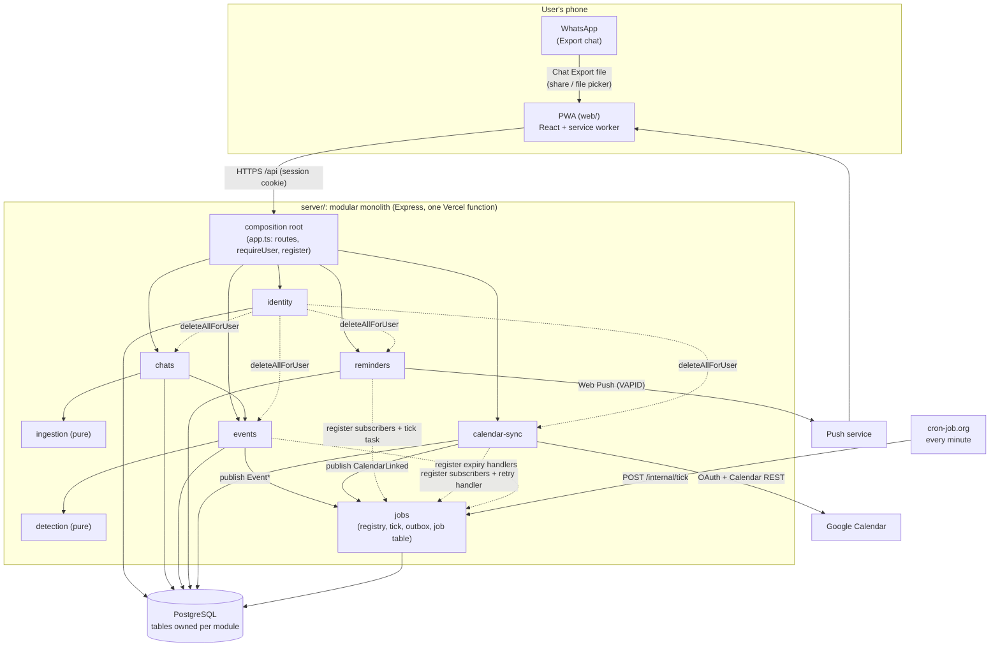

# Architecture: Kalender

| Field | Value |
|---|---|
| Course | ISE1003 Introduction to Software Engineering, Deliverable 3 |
| Client | Mahd Ahmed |
| Team | Abdul Hannan Rauf (25I-3053), Zain Amjad (25I-3042), Muhammad Areeb (25I-3056) |
| Requirements source | `PRD.md` v1.2 (v1.1 validated, TA changes applied; v1.2 renames the product only) |
| Decisions | `adr/ADR-001` … `adr/ADR-005` |
| Status | Accepted by the team; context v1.3 (v1.2 refined after two AI-agent validation runs, see sections 14 and 15; v1.3 adds the D4 gap-review changes in section 16) |

## 1. System overview

Kalender (formerly "WhatsApp & Calendar Sync") helps a student stop missing meetings and deadlines announced in WhatsApp groups, without giving up the privacy of other Chats.

1. The User exports a Chat from WhatsApp ("Export chat > Without media") and uploads the file to the app. This approves that Chat (FR-02).
2. The server reads only new text messages from the allowed time window and detects Events in English and Roman Urdu.
3. Every interpretation it is unsure of is marked **Uncertain**, and the User must review those details before confirming (FR-05, FR-06).
4. Confirmed Events get one Reminder (phone notification, plus an in-app fallback) and a copy in the User's Google Calendar (FR-08, FR-09).

The system consists of:
- a **Progressive Web App** (installable, phone-first);
- one **modular-monolith server** (Node.js + Express + TypeScript);
- one **PostgreSQL** database;
- a free external **per-minute tick** that drives time-based work.

Everything runs on free tiers.

## 2. Architectural goals / drivers

| # | Goal | Comes from |
|---|---|---|
| AG-1 | **Privacy by construction:** message text outside the read window, or not needed, is never stored or logged; only one module stores message text, and only temporarily. | G-03, NFR-01, BR-01–BR-03, BR-05 |
| AG-2 | **Time-based work is reliable on free hosting:** Reminders within 1 minute, calendar retries, timed deletions. | NFR-03, BR-05, BR-10, BR-14, C-03 |
| AG-3 | **Detection is measurable and repeatable.** | FR-05, NFR-05, BR-12, BR-20, BR-21 |
| AG-4 | **Each User's data is isolated.** | BR-11, AC-01.2 |
| AG-5 | **Simple enough for 3 students in one semester,** with boundaries an AI coding agent can follow. | C-01, C-03 |
| AG-6 | **Phone-first** on Android and iPhone. | C-04, C-05, NFR-04 |

## 3. Architecturally significant requirements (ASRs)

Only requirements that change the structure are listed. Feature requirements such as Manual Events (FR-07), the date-ordered list (FR-11) or Lead Time choices (FR-10) matter, but they fit inside the modules below without shaping them.

| ID | Source requirement | Why it is architecturally significant | Architectural concern created |
|---|---|---|---|
| ASR-01 | NFR-01, BR-01, BR-02, BR-03, BR-05, C-02 (privacy of Chat text) | An export contains the whole Chat history, yet only a time window may be read, and stored data and logs are inspected in the test. | Where may export files and message text exist? Which component knows the WhatsApp format? Logging rules. → ADR-003 |
| ASR-02 | BR-05, BR-06, BR-14, AC-05.11, AC-13.3 (retention and deletion) | Deletions happen at times, not on requests (end of date, 7 days), and across modules (Revoke, account deletion). | Ownership of each data type; a scheduler for timed deletion; deletion orchestration. → ADR-002, ADR-005 |
| ASR-03 | NFR-03, FR-09, C-05 (Reminders within 1 minute, push plus in-app) | Needs work at exact minutes while no User is using the app, on hosting that sleeps when idle. | Scheduling mechanism under free-tier limits; notification channels. → ADR-002 |
| ASR-04 | FR-08, BR-09, BR-10, BR-18 (Google Calendar one-way sync with retries) | External service that can fail or expire tokens; confirming must not wait for it; copies must not duplicate. | Integration boundary, asynchronous retries, idempotent copy mapping, token storage. → ADR-002, ADR-005 |
| ASR-05 | FR-05, NFR-05, BR-12, BR-20, BR-21 (measurable detection) | Acceptance is a numeric test on 80 messages, which must be repeatable; Uncertain marks follow exact rules. | Detection approach (rules or LLM), isolation and testability, CI gate. → ADR-004 |
| ASR-06 | FR-02, FR-03, BR-02, BR-15, NFR-02 (upload, read-once, validation, 60 s) | Read-once across overlapping uploads and refusing wrong files without storing anything need careful state handling and atomicity. | Split between pure parsing and Chat state; transaction boundaries; request size and time limits. → ADR-003 |
| ASR-07 | BR-11, AC-01.2 (one role, own data only) | Every query on every user-owned table must be scoped. | Authentication boundary and where `userId` comes from; repository rules. → ADR-005 |
| ASR-08 | C-01, C-03, C-04, OQ-02 (student team, free only, phone-first) | Rules out paid always-on servers, app-store builds and multiple databases. | Architecture style, client platform, hosting. → ADR-001, ADR-002 |

## 4. Architectural style and rationale

**Modular monolith plus a PWA client, deployed serverless with a per-minute tick, an outbox and a job table** (ADR-001, ADR-002).

| ASR/driver | Alternatives considered | Trade-offs | Selected |
|---|---|---|---|
| ASR-08, AG-5 | Microservices; layered monolith; modular monolith; client-only; native app | Microservices are too heavy for three students. A layered monolith leaves rules without an owner. Client-only cannot remind while the app is closed. Native apps need builds and installs. | Modular monolith API plus PWA (ADR-001) |
| ASR-03, ASR-02, ASR-04 | Always-on server with node-cron; Vercel cron; keep-awake pinging; external per-minute tick plus job table plus outbox | There is no free always-on host. Vercel Hobby cron runs once a day. Pinging is fragile. The tick depends on an external service and is accurate to about a minute. | External tick plus database jobs plus transactional outbox (ADR-002) |
| ASR-01, ASR-06 | Store the file and process it later; parse on the client; store everything and filter; parse in memory in the request | Storing breaks NFR-01. Client parsing moves trust to the client. In-memory parsing is bounded by request limits. | In-memory parse; only eligible text passes the boundary (ADR-003) |
| ASR-05 | Rules; LLM; rules with LLM fallback; date library only | An LLM is not deterministic and sends text to a third party. Rules need vocabulary work. | Deterministic rule-based pure module with a CI gate (ADR-004) |
| ASR-07, ASR-02 | Shared schema; module-owned tables; database per module; Postgres Row-Level Security | A shared schema scatters rules. A database per module is too heavy. RLS is complex with serverless connection pools. | One Postgres, tables owned per module, `userId` required at the repository layer (ADR-005) |

## 5. Major components / modules

### 5.1 Client: PWA (`web`)
- **Responsibilities:**
  - screens for sign-in, Approved Chats (approve, update, revoke), Detected Events review (Uncertain highlighting, Needs date, Possible Duplicate choice), upcoming Events list, Manual Event, Reminder settings, Google Calendar link, and account deletion;
  - the service worker receives web push, shows in-app Reminders and, on Android, acts as a **share target** for Chat Exports.
- **Boundaries:**
  - talks only to the server over HTTPS JSON (`/api/*`) plus multipart uploads;
  - contains **no** WhatsApp parsing or detection logic (ADR-003, ADR-004);
  - must not keep a shared Chat Export in browser storage after it has been uploaded, or if the User cancels. **Only exception:** the Android share target hands the file from the service worker to the page through one Cache API entry. The page deletes it as soon as it reads it, and any leftover entry older than 10 minutes is deleted at start-up.

### 5.2 Server modules (one deployable, `server/`)

| Module | Responsibility | Owns data | Must not |
|---|---|---|---|
| *composition root* (`server/src/app.ts`, `bootstrap.ts`; **not a module**) | Builds the Express app; mounts `identity.requireUser()` once on `/api`; mounts each module's router and the tick route; calls each module's `register(jobs)` once at start-up | none | Contain business logic |
| `identity` | Accounts, sign-in and out, sessions, the `requireUser` middleware (sets `req.userId`), account deletion orchestration | users, sessions | Read other modules' tables |
| `chats` | Approved Chats: preview, approve, update, list, Revoke. Approval Time, Look-back, Start Point, Read-up-to Point, `name_from_file`. Chat-name check (BR-15). Runs the upload use case and owns its transaction. | approved_chats | Parse WhatsApp files itself; store message text |
| `ingestion` | **Pure.** Parses a Chat Export (Android `.txt`, iPhone `.zip`: only `_chat.txt` is inflated), rejects invalid files, detects date order, classifies lines, computes boundary fingerprints, selects eligible messages given the pointers | none | Touch the database, network, filesystem, environment, clock or logs |
| `detection` | **Pure.** `detect(text, sentAt)` gives Detected Event drafts with title, place, Uncertain marks and rule ids (BR-12, BR-17, BR-20, BR-21); returns nothing for Urdu-script text | none | Touch the database, network, clock or environment; log text |
| `events` | Detected Events (review, Uncertain gating, confirm, dismiss, Possible Duplicate), Confirmed and Manual Events, Source Message lifetime (BR-05, BR-14), past rules (BR-16), upcoming list; publishes `Event*` outbox messages; answers `CalendarLinked` with `EventResync` | detected_events, source_messages, confirmed_events | Call `reminders` or `calendar-sync` directly; call Google |
| `reminders` | Default and per-Event Lead Time, Reminder schedule (BR-07, BR-08, BR-19), delivery by web push plus in-app, NFR-03 delivery log; its own routes, including `PUT /api/events/:id/reminder` | reminders, reminder_settings, in_app_notifications, push_subscriptions | Change Events |
| `calendar-sync` | Google OAuth link and unlink (HMAC-signed `state`), encrypted tokens, one-way copy add, change and remove, copy mapping (BR-18), retries and "Calendar update failed" (BR-10), manual retry | calendar_links, calendar_copies | Read calendar changes back (BR-09); block confirmation |
| `jobs` | Jobs table, outbox and per-subscriber delivery records; a **registry** of job handlers, outbox subscribers and tick tasks that other modules register into; `tick(now)`; `dispatchOutbox`; retry timing; idempotency | jobs, outbox, outbox_deliveries | Import any feature module (it only calls registered functions); contain feature logic |
| `shared` | Database pool and transaction helper, PKT time utilities, ids, error types, redacting logger, `AuthedRequest` type, **outbox message contracts** (`shared/contracts`) | none | Contain feature logic |

## 6. Interfaces and interactions

### 6.1 Module public interfaces (in-process)

Each module exposes only what is in its `index.ts`. Signatures are indicative, and `tx` is a transaction handle. Every feature module also exports `register(jobs)`, which the composition root calls once to register its job handlers, outbox subscribers and tick tasks.

| Module | Public interface (main operations) |
|---|---|
| `identity` | `registerAccount`, `signIn`, `signOut`, `me`, `requireUser()` (middleware → `req.userId`), `deleteAccount(userId)`; registers the tick task `purgeExpiredSessions` and the job handler `resumeAccountDeletion` |
| `chats` | `previewExport(userId, upload, dateOrder?) → {chatNameFromFile, needsDateOrder}` (stores nothing), `approveChat(userId, upload, {confirmedName, lookBackDays, dateOrder?})`, `updateChat(userId, chatId, upload, {dateOrder?})`, `listChats(userId)`, `revokeChat(userId, chatId)`, `deleteAllForUser(userId)` |
| `ingestion` | `parseExport(bytes, filename, dateOrder?) → Parsed \| Rejected \| NeedsDateOrder`, `selectEligible(parsed, pointers) → {eligible, newPointers}` |
| `detection` | `detect(text, sentAt) → DetectedEventDraft[]` |
| `events` | `ingestMessages(userId, chatRef, messages, tx)`, `listDetected`, `reviewDetail`, `confirm`, `dismiss`, `resolveDuplicate`, `createManual`, `editConfirmed`, `deleteConfirmed`, `listUpcoming`, `deleteUnconfirmedForChat(userId, chatId, tx)`, `deleteAllForUser`; registers the job handlers `expireDetected` and `expireNeedsDate` and the subscriber `CalendarLinked` |
| `reminders` | `getSettings`, `setDefaultLeadTime`, `setEventReminder`, `getReminderStates(userId, eventIds)`, `registerPushSubscription`, `removePushSubscription`, `listInApp`, `markSeen`, `deleteAllForUser`; registers the subscribers `EventConfirmed`, `EventUpdated` and `EventDeleted` and the tick task `deliverDue` |
| `calendar-sync` | `startLink(userId)`, `completeLink(userId, code, state)`, `unlink(userId)`, `getLinkStatus(userId)`, `retryNow(userId, eventId)`, `getStatuses(userId, eventIds)`, `deleteAllForUser`; registers the subscribers `EventConfirmed`, `EventUpdated`, `EventDeleted` and `EventResync` and the job handler `calendarRetry` |
| `jobs` | `enqueue(tx, type, payload, {runAt, userId, dedupeKey})`, `cancel(tx, type, dedupeKey)`, `cancelForUser(userId)`, `publish(tx, message: OutboxMessage)`, `registerHandler(type, fn)`, `subscribe(messageType, name, fn)`, `registerTickTask(name, fn)`, `tick(now)`, `dispatchOutbox(now, {limit, timeBudgetMs})` |

**Allowed module dependencies.** Arrows mean "may call the public interface of". Anything not listed is forbidden.

- **Composition root** → every module's `index.ts`. Only for wiring: mounting routers and calling `register`.
- `chats` → `ingestion`, `events`, `jobs`
- `events` → `detection`, `jobs`
- `reminders` → `jobs`
- `calendar-sync` → `jobs`
- `identity` → only `deleteAllForUser` of `chats`, `events`, `reminders` and `calendar-sync`, plus `jobs` (to cancel and enqueue its own jobs and register its handlers)
- **`jobs` → none.** It calls only functions registered into it (inversion of control).
- every module → `shared`
- **Read-model exception:** `events`' HTTP read endpoints may call `calendar-sync.getStatuses` and `reminders.getReminderStates` to show marks on the Events list.

Modules never import `identity`. They read `req.userId` through `shared`'s `AuthedRequest` type, set by the middleware the composition root mounted.

**Outbox messages** (types in `shared/contracts`):

| Message | Published by | Payload | Subscribers |
|---|---|---|---|
| `EventConfirmed` | `events` | Event snapshot: eventId, userId, title, date, time or null, place or null, sourceChatName or "Manual" | `reminders`, `calendar-sync` |
| `EventUpdated` | `events` | Event snapshot (same fields) | `reminders`, `calendar-sync` |
| `EventDeleted` | `events` | eventId, userId | `reminders`, `calendar-sync` |
| `CalendarLinked` | `calendar-sync` | userId | `events` |
| `EventResync` | `events` | Event snapshot for one Upcoming Confirmed Event | `calendar-sync` only (BR-18 backfill) |

### 6.2 HTTP API (PWA ↔ server)

All JSON under `/api`, authenticated by session cookie except register and sign-in.

| Area | Endpoints |
|---|---|
| Account | `POST /auth/register`, `POST /auth/sign-in`, `POST /auth/sign-out`, `GET /me`, `DELETE /account` |
| Chats | `POST /chats/preview` (multipart; returns the Chat name from the file and whether the date order is needed; stores nothing), `POST /chats` (multipart: approve), `POST /chats/:id/uploads` (multipart: update), `GET /chats`, `DELETE /chats/:id` (Revoke) |
| Detected Events | `GET /detected-events`, `POST /detected-events/:id/review`, `POST /detected-events/:id/confirm`, `POST /detected-events/:id/dismiss`, `POST /detected-events/:id/duplicate` |
| Events | `GET /events` (upcoming), `POST /events` (Manual), `PATCH /events/:id`, `DELETE /events/:id`; `PUT /events/:id/reminder` (served by `reminders`) |
| Reminders | `GET/PUT /settings/reminders`, `GET /notifications`, `POST /notifications/:id/seen`, `GET /push/public-key`, `POST /push-subscriptions`, `DELETE /push-subscriptions/:id` |
| Calendar | `GET /calendar`, `POST /calendar/link`, `GET /calendar/callback`, `DELETE /calendar`, `POST /calendar/retry/:eventId` |
| Internal | `POST /internal/tick` (secret header only, outside `/api`) |

Upload responses return a summary (messages read, Detected Events created, `noNewMessages`) or a typed refusal: `NOT_AN_EXPORT`, `WRONG_CHAT`, `NEEDS_DATE_ORDER`, `DATE_ORDER_MISMATCH`, `CHAT_NOT_APPROVED`, `DUPLICATE_CHAT` or `TOO_LARGE` (over 4 MB uploaded, or over 8 MB once `_chat.txt` is inflated).

**Upload size:** the PWA refuses files over **4 MB** before sending. A platform 413 is mapped to `TOO_LARGE`. The PWA keeps a picked or shared file in memory (a JavaScript variable) only between preview and approve, and drops it after approval or cancel.

### 6.3 Key interactions

**Approve or update a Chat (FR-02, FR-03)**
1. **Preview (approve only).** The PWA sends `POST /chats/preview`. `chats` calls `ingestion.parseExport` and returns the Chat name from the file and whether the date order is needed, storing nothing.
2. **Confirm.** The User confirms the name, Look-back Period and, if needed, the date order, and the PWA sends the same file again (`POST /chats` or `POST /chats/:id/uploads`).
3. **Check and select.** `chats` parses the file, checks `name_from_file` (BR-15) and gets the eligible messages from `ingestion.selectEligible`.
4. **Store, in one transaction:**
   - `events.ingestMessages` calls `detection.detect` per message;
   - it stores Detected Events and Source Messages (message, sender and sent time) and enqueues their expiry jobs;
   - messages with no Event are dropped;
   - `chats` saves the new pointers and upload time.
5. **Respond.** The response returns and the file bytes are discarded.

If any step fails, the transaction rolls back and the pointers do not move, so the messages are read again next time (BR-02).

**Confirm a Detected Event (FR-06, MF-03)**
1. `events.confirm` checks that every Uncertain detail has been reviewed (BR-21), that there is a date (Needs date) and a title, and that the date is not past (BR-16).
2. In one transaction it:
   - creates the Confirmed Event;
   - deletes the Detected Event;
   - deletes the Source Message **if no other Detected Event uses it** (BR-05, BR-17);
   - cancels the expiry job;
   - publishes `EventConfirmed`.
3. Before responding, the route calls `jobs.dispatchOutbox(now, {limit: 5, timeBudgetMs: 2000})`:
   - `reminders` schedules the Reminder, or none if its time has passed (BR-08);
   - `calendar-sync` adds the Google copy, or enqueues `calendarRetry` at +1 minute (BR-10).

   Errors and timeouts here are logged (ids only) and never change the response. Anything left over is dispatched by the next tick.

**Tick (every minute, ADR-002)**

`POST /internal/tick` → constant-time secret check → `jobs.tick(now)`. In order:
1. **Outbox dispatch first:** each subscriber runs once per message, recorded in `outbox_deliveries`. This way a pending `EventDeleted` or `EventUpdated` cancels or moves a Reminder **before** it can be sent (AC-09.2, AC-12.1).
2. **Due jobs:** up to 50, such as `calendarRetry`, `expireDetected`, `expireNeedsDate` and `resumeAccountDeletion`.
3. **Tick tasks:**
   - `reminders.deliverDue` re-reads each Reminder's status when claiming it, and includes Reminders up to 10 minutes overdue, marked late;
   - `identity.purgeExpiredSessions`;
   - housekeeping, which purges processed jobs and outbox rows older than 7 days.

Every step is batched, uses `FOR UPDATE SKIP LOCKED`, and is safe to run twice.

**Link Google Calendar (FR-08, BR-18)**
1. `calendar-sync.completeLink` stores the tokens and publishes `CalendarLinked`.
2. `events` publishes one `EventResync` per Upcoming Confirmed Event.
3. `calendar-sync` adds a copy for each Event that has none.

**Revoke and account deletion**
- `chats.revokeChat` → `events.deleteUnconfirmedForChat` → clear the pointers (one transaction).
- `identity.deleteAccount` first sets `users.deletion_requested_at`, so sign-in and `requireUser` refuse at once. It then calls `jobs.cancelForUser` and each module's `deleteAllForUser`, and deletes the sessions. If a step fails, the job `resumeAccountDeletion` finishes the remaining steps on a later tick:
  - each step is its own transaction, idempotent and safe to re-run;
  - `deleteAllForUser` publishes no outbox messages, so Google copies stay (MF-06);
  - the Google token is revoked at Google best-effort, then deleted.

## 7. External systems and services

| System | Used for | Boundary |
|---|---|---|
| WhatsApp (on the User's phone) | Produces the Chat Export file | **No API or network connection.** Only files the User exports and uploads (C-02). |
| Google Calendar API (OAuth 2.0, scope `calendar.events`, REST via `fetch`) | One-way copies in the primary calendar. Timed Events get a 1-hour duration in Google; All-day Events are all-day. | Only `calendar-sync` talks to Google. Tokens are encrypted. Failures are retried (BR-10). |
| Web Push service (browser vendor, VAPID keys via `web-push`) | Reminder phone notifications | Only `reminders` sends push. The in-app fallback always exists (C-05). |
| cron-job.org (free) | Calls `POST /internal/tick` every minute | Authenticated by `TICK_SECRET`. Carries no data. |
| Vercel (Hobby) | Hosts the PWA (`web/`) and **one** serverless function (`api/index.ts`, which only re-exports the Express app from `server/`) | Request body ≤ 4.5 MB; short function time, so work is batched |
| Neon or Supabase PostgreSQL (free) | The single database | Accessed only through module repositories |
| GitHub Actions (free) | CI: typecheck, lint (boundary rules), tests, NFR-05 detection gate, with a Postgres service container | No production data |

## 8. Important data responsibilities

- **Message text:**
  - exists only in request memory, except Source Messages owned by `events` (text, sender, sent time);
  - is deleted when the last Detected Event from that message is resolved, at the end of the Event's date, 7 days after the message (Needs date), on Revoke, or on account deletion;
  - is never logged.
- **Titles never copy the message.** `detection` builds a short title (at most 60 characters) from the matched activity words and their qualifier, for example "Project meeting" or "Lab report due". Place is taken only from an explicit location phrase ("in Room 4", "Room C-204", "library mein", "ground pe"), at most 40 characters. During review the User sees the Source Message and can edit both.
- **Event copies held by other modules:**
  - `reminders` keeps title, date and time to show the notification;
  - `calendar-sync` keeps the Google event id and status, plus the snapshot needed for retries.

  Both are deleted on `EventDeleted` and on `deleteAllForUser`.
- **Chat Export files:** never written to disk, blob storage or logs (ADR-003).
- **Read-once state:** owned by `chats`:
  - Start Point and Read-up-to Point;
  - a **count per fingerprint** of the messages in the boundary minute, where a fingerprint is the SHA-256 of minute, sender and text;
  - `name_from_file`, compared on update (BR-15) and unique among a User's non-Revoked Chats.

  These change only in the same transaction that stores the detection results.
- **Source Chat** is identified by Chat id for Possible Duplicate (BR-04). Confirmed Events keep the Chat name as text, so they outlive a Revoke (BR-06).
- **Chat colour** (UI only): `chats` owns `approved_chats.colour`, chosen at approval as the first colour of the fixed 8-colour palette not used by the User's other non-Revoked Chats (wrapping when all are used). `events` copies it with the Chat name onto each Detected and Confirmed Event, so it also outlives a Revoke. Manual Events have no colour; the PWA shows them in neutral grey.
- **Times:**
  - instants are stored as UTC `timestamptz` and shown in PKT (UTC+5, no daylight saving);
  - Event dates are stored as a `date` plus an optional `time`;
  - Reminder Time for All-day Events uses 09:00 PKT (BR-07).
- **User isolation:**
  - every user-owned row has `user_id`, and `userId` comes only from the session (ADR-005);
  - `jobs` and `outbox` have a nullable `user_id`, used for cancelling.
- **Retention of supporting data:**

| Data | Kept until |
|---|---|
| Processed jobs, outbox and delivery records | 7 days |
| In-app notifications | 7 days after creation |
| Sessions | 30 days |
| Push subscriptions (`reminders`: the browser's push endpoint and its two keys; added in S10) | The User turns phone notifications off or signs out on that phone, the push service answers 404 or 410, or the account is deleted |
| Past Confirmed Events | The User deletes them or the account (hidden from the list by AC-11.2) |

- **NFR evidence:** each `reminders` row keeps `reminder_at`, `delivered_at` and status, kept until the Event or account is deleted. A script exports the NFR-03 table, so the evidence does not depend on short-lived platform logs. Uploads log counts and durations only (NFR-02).

## 9. Architectural constraints

1. Free tools and tiers only (C-03). No paid always-on server.
2. WhatsApp input is file upload only. No WhatsApp login, automation, unofficial client or Business API (C-02).
3. No LLM or external NLP service for detection (ADR-004).
4. One server deployable, one database (ADR-001, ADR-005).
5. Pakistan Standard Time only (NG-09). English and Roman Urdu only (NG-10).
6. Calendar sync is one-way (BR-09).
7. Stack, and libraries approved by the team: TypeScript; React + Vite + `react-router-dom` PWA (hand-written service worker); Node.js + Express; `multer` (memory storage); `bcryptjs`; `fflate` (only `_chat.txt` is inflated); `web-push`; PostgreSQL via `pg` with SQL migrations; Vitest and `supertest`; ESLint with `typescript-eslint` for boundary rules; GitHub Actions. Anything else needs team approval (AGENTS.md).

## 10. Architecture diagram

A rendered copy is in `architecture-diagram.png`. Solid arrows are calls to a public interface. Dotted arrows are registrations: `jobs` later calls those registered functions, without importing the modules.

## 11. ADRs

| ADR | Decision |
|---|---|
| [ADR-001](adr/ADR-001-architecture-style.md) | PWA client plus modular monolith server |
| [ADR-002](adr/ADR-002-deployment-and-scheduled-work.md) | Free serverless deployment; per-minute external tick; job table, registry and transactional outbox |
| [ADR-003](adr/ADR-003-chat-ingestion-privacy-boundary.md) | In-memory Chat Export ingestion with preview; `ingestion` is the single owner of the format; message-text boundary |
| [ADR-004](adr/ADR-004-event-detection-rule-based.md) | Rule-based deterministic detection as a pure module, with the NFR-05 CI gate |
| [ADR-005](adr/ADR-005-data-ownership-and-user-isolation.md) | One Postgres, module-owned tables, `userId`-scoped repositories with marked system-scope exceptions, session auth |

## 12. Open items carried from the PRD

- **OQ-04 (Snooze):** if accepted, it changes `reminders` only (NG-07).
- **OQ-05 (daily upload nudge):** if accepted, it becomes a `reminders` tick task; there is no structural change.
- **Real exports:** a real Android and a real iPhone export (names replaced) must be added to `fixtures/exports/real/` before `ingestion` is accepted (ADR-003).

## 13. Test fixtures provided with the context

`fixtures/` (see `fixtures/README.md`) contains:
- `detection_test_set.csv` and the reference scorer `evaluate.py` (NFR-05, Appendix A);
- the sample Chat Exports and the generator `make_samples.py`;
- the mapping of demo cases N1–F3 to acceptance criteria.

The code copies these into `server/test/fixtures/` unchanged.

## 14. Design decisions resolved after AI-agent validation (context v1.1)

A fresh AI coding agent given context v1.0 raised 29 questions (Q-1 to Q-29). The team's answers are built into the sections above; this table is the index.

| Q | Decision | Where |
|---|---|---|
| Q-1 | `jobs` imports no module. Modules register handlers, subscribers and tick tasks via `register(jobs)`, called by the composition root. | §5.2, §6.1, ADR-002 |
| Q-2 | `requireUser` is mounted once on `/api` by the composition root; modules use `shared` `AuthedRequest`. | §5.2, §6.1 |
| Q-3 | BR-18 backfill through `CalendarLinked` → `EventResync` outbox messages. | §6.1, §6.3 |
| Q-4 | `POST /chats/preview` returns the Chat name and date-order need, storing nothing. | §6.2, §6.3, ADR-003 |
| Q-5 | Title from activity words (≤ 60 chars) and place from an explicit location phrase (≤ 40 chars); never the raw message. | §8, ADR-004 |
| Q-6 | Outbox contracts in `shared/contracts`; `reminders` and `calendar-sync` keep the copies listed in §8; 1-hour duration for timed Google copies. | §6.1, §7, §8 |
| Q-7 | Fixtures supplied with the context; N1–F3 mapped to ACs; NFR-05 scoring rules clarified. | §13, ADR-004 |
| Q-8 | System-scope repository functions for tick work are allowed, named with the suffix `System` (for example `claimDueSystem`), and called only from registered tick tasks and job handlers. | ADR-005, AGENTS.md |
| Q-9 | `reminders.getReminderStates` added; `PUT /events/:id/reminder` is served by `reminders`. | §5.2, §6.1 |
| Q-10 | `jobs.cancel`, `dedupe_key`, nullable `user_id` on jobs and outbox, and the `outbox_deliveries` table. | §6.1, §8 |
| Q-11 | Dispatch before responding, with a 2-second budget; the tick picks up the rest. | §6.3, ADR-002 |
| Q-12 | Deployables are `server/` and `web/`; the only Vercel function is `api/index.ts`; the PWA enforces 4 MB. | §6.2, §7 |
| Q-13 | A `.zip` with media under the limit is accepted, and its media entries are never inflated. | ADR-003 |
| Q-14 | `name_from_file` is stored and compared; a renamed WhatsApp group gives `WRONG_CHAT` (Revoke and re-approve); there are no two active Chats with the same name. | §8 |
| Q-15 | Retention of supporting data, as in the §8 table. | §8 |
| Q-16 | GitHub Actions with a Postgres service container. | §7 |
| Q-17 | The names in §6.1 are authoritative; the ADRs were aligned. | ADRs |
| Q-18 | The Source Message is deleted only when its last Detected Event is resolved. | §6.3 |
| Q-19 | `react-router-dom` approved. | §9 |
| Q-20 | Endpoints added: `/me`, `/push/public-key`, `GET /calendar`, `/notifications/:id/seen`, `DELETE /push-subscriptions/:id`, `/chats/preview`. | §6.2 |
| Q-21 | Shared fixtures live in `server/test/fixtures/`, and cross-module tests (NFR-01, AC-01.2) in `server/test/`. | AGENTS.md |
| Q-22 | Expiry follows the Detected Event's current (possibly corrected) date. A timed Detected Event whose time has passed shows "Now past: edit or dismiss" until the end of its date. | — |
| Q-23 | Reminders more than 10 minutes late are not pushed. They are shown in-app marked "missed" and logged. "Presented" means the in-app notification row was created. | ADR-002 |
| Q-24 | Account deletion runs as idempotent ordered steps, publishes no outbox messages, and revokes the Google token best-effort. | §6.3 |
| Q-25 | Boundary state is a count per SHA-256 fingerprint. The sender is stored only with the Source Message. | §8 |
| Q-26 | Hand-written validation; passwords of at least 8 characters; rate limiting and password reset are out of scope. | — |
| Q-27 | The OAuth `state` is HMAC-signed; there is no new table. | §5.2 |
| Q-28 | If a default Lead Time change moves an Upcoming Event's Reminder Time into the future, a Reminder is scheduled (BR-19). | — |
| Q-29 | Urdu-script text passes through `ingestion`; `detection` returns no drafts for it. | §5.2 |

## 15. Design decisions resolved after the second AI-agent run (context v1.2)

A second fresh agent, given context v1.1 and `fixtures/`, made **no** boundary or ADR violations and repeated none of Q-1 to Q-29. It raised 18 narrower questions (R2-1 to R2-18). The team's answers follow.

| Q | Decision |
|---|---|
| R2-1 | The tick dispatches the outbox **before** delivering Reminders, and `deliverDue` re-checks status (§6.3). This fixes a stale Reminder after a delete or edit. |
| R2-2 | A draft whose date and time have already passed at **upload** time (possible with the Look-back Period) is not stored, and neither is its message, unless another draft from the same message is still upcoming. This is the same rule as "not detected if before the sent time" (MF-03), applied at the time of reading. |
| R2-3 | Account creation is `identity.registerAccount`, so every module can export `register(jobs)`. `identity` may use `jobs` for its session purge and deletion resume (§6.1). |
| R2-4 | `name_from_file` comes from the file name: Android `WhatsApp Chat with <name>.txt`, iPhone `WhatsApp Chat - <name>.zip`. It is normalised: trimmed, case-folded, with an OS suffix such as " (1)" removed. If the prefix is not recognised (another phone language, or a renamed file), the User types the name at approval, and the normalised file stem is stored and compared on later uploads. There is no second signal. |
| R2-5 | The Start Point is truncated to the minute, because Android timestamps have minute precision. "At or after" is then compared minute to minute. |
| R2-6 | `date_order` is stored at approval and reused on every update. A file whose unambiguous dates contradict it is refused with `DATE_ORDER_MISMATCH`. |
| R2-7 | **BR-13 "update the existing Event":** the chosen existing Event keeps its id and takes the new date, time, place and Uncertain marks; the new Detected Event and its Source Message (per BR-05) are deleted. If the existing item is a Confirmed Event, the same gating as confirm applies (BR-16, BR-21), and `EventUpdated` is published. If several Events match, all of them are shown and the User picks one. |
| R2-8 | Unlink deletes the tokens but **keeps** `calendar_copies`. On `EventResync`, `calendar-sync` checks each existing copy with a Calendar GET and re-adds it if it is gone. This handles a different Google account and BR-09. |
| R2-9 | Account deletion sets `deletion_requested_at` first, and `resumeAccountDeletion` finishes on failure (§6.3). |
| R2-10 | The Android share target may use one short-lived Cache API entry (§5.1). |
| R2-11 | NFR-03 evidence is kept on the `reminders` rows, not in logs (§8). |
| R2-12 | BR-10 retries run at +1, +5 and +15 minutes **from the first failure**, so the last one is within 15 minutes. |
| R2-13 | The inflated `_chat.txt` is capped at 8 MB; above that the upload is refused with `TOO_LARGE`. |
| R2-14 | `ingestion` strips "<This message was edited>" before detection, storage and fingerprinting. If a boundary-minute message is edited between two exports it may be read again; this is accepted, and the Possible Duplicate hint covers it. |
| R2-15 | Re-approval after a Revoke creates a **new** `approved_chats` row. Revoked rows, which hold no text, are kept until account deletion. |
| R2-16 | `tsx`, the `@types/*` packages, `@vitejs/plugin-react` and `@eslint/js` are approved as dev tools. UI-level ACs (AC-06.7 highlighting, AC-07.2 explanation) are tested at API level, where the refusal names the field and reason, plus a manual UI checklist. No `jsdom` stack for now. |
| R2-17 | Migrations run from a CI job on `main` (`npm run migrate`). `schema_migrations` is infrastructure, not a module table. |
| R2-18 | The team adds one real Android and one real iPhone export (names replaced) to `fixtures/exports/real/` before `ingestion` is accepted. The real files decide 24-hour and 2-digit-year handling. |

The agent's stated structural assumptions were reviewed and accepted:
- tick authentication with a Bearer header that returns 404 on mismatch;
- a server-side 4 MB limit;
- a public identity router mounted before `requireUser`;
- inline dispatch after every Event-changing route;
- one `reminders` row per Confirmed Event;
- Possible Duplicate computed on read;
- export times read as PKT;
- `SELECT … FOR UPDATE` on uploads;
- session tokens stored as SHA-256 hashes;
- HTTP DTOs (shared request and response types) in `shared/contracts/http.ts`, with type-only imports from `web/`;
- `tsc --noEmit`;
- a CI parity check between the TypeScript scorer and `evaluate.py`.

**Validation outcome:** two runs moved from 29 questions, 16 of them conflicts between our own documents, to 18 detail-level questions with one real conflict (R2-1). The team judges context v1.2 sufficient to guide AI-assisted development. The next run happens at the start of implementation, against the real exports.

## 16. Changes from the Deliverable 4 gap review (context v1.3)

Source: `evidence/stage2/gap-review.md`. Decisions: `docs/decisions.md`.

| Gap | Change |
|---|---|
| G-01 | Product renamed to Kalender. |
| G-02 | Chat colour added to `approved_chats` (owned by `chats`) and copied onto Events (section 8). No new module, interface or dependency. |
| G-03 | Styling rules (CSS Modules, `tokens.css`, Google Fonts, inline Tabler icons) added to AGENTS.md section 2. |
| G-10 | Push and Google Calendar ACs may be verified by a manual checklist row with a screenshot. |
| G-12 | The PWA maps detection rule ids to short user-facing explanations ("kal means tomorrow"). `detection` itself is unchanged. |
