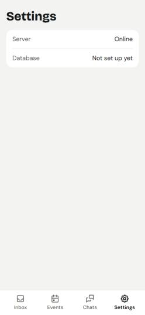

# S00: Walking skeleton

| Field | Value |
|---|---|
| Slice | S00 (infrastructure; no FR) |
| Plan version used | v01 |
| Lead | Abdul Hannan Rauf |
| Mode | AFK (exact scope, no privacy risk, no external system beyond Vercel) |
| Agent | Claude Code (Opus 5.5) |
| Branch | `slice/S00-skeleton` |
| Date | 23 Nov 2026 |

## 1. Select

First slice in `plan.md` v01. Every other slice depends on it.

## 2. Context loaded

`AGENTS.md` sections 2 to 4 and 9 (stack, structure, boundaries, Git workflow), `docs/architecture.md` sections 5 and 9, ADR-002 (one Vercel function, cron through `/internal/tick`), `docs/design/ui-direction.md` (tokens, fonts, bottom navigation).

## 3. Criteria and tests (agreed before coding, Gate 1)

| ID | Criterion | How it is checked |
|---|---|---|
| S00-1 | `GET /api/health` returns `{status: "ok", db: "not_configured"}` when `DATABASE_URL` is missing | `server/test/health.test.ts` |
| S00-2 | With `DATABASE_URL` set, `GET /api/health` runs `select 1` and returns `db: "ok"`; on failure it returns 503 without connection details | Same test, runs in CI against the Postgres service container |
| S00-3 | Unknown `/api/*` paths return a JSON 404 | Same test |
| S00-4 | `npm run lint` rejects an import of a file inside another module and accepts index, shared and own-module imports | `server/test/boundaries.test.ts` |
| S00-5 | The PWA shell loads with Kalender tokens and fonts, four-tab bottom navigation, empty states that name the next action, and Settings showing the server and database status | Manual check at 375 x 812, screenshots below |
| S00-6 | `npm run build` produces `web/dist`; `vercel.json` sends `/api/*` and `/internal/*` to the one function and everything else to the PWA | Build output; Vercel preview after push |

EP / BVA: `DATABASE_URL` has three classes (missing, set and reachable, set but unreachable). Missing and reachable are automated; unreachable is covered by the `catch` branch and checked manually by pointing `DATABASE_URL` at a closed port once Neon is set up.

## 4. HITL or AFK

AFK. The human reviews the result before Accept.

## 5. AI implementation (summary)

Prompt: "Build S00 from plan.md v01 following AGENTS.md: npm workspaces `web` and `server`, `api/index.ts` as the only Vercel function, `/api/health` with an optional Postgres check, a React shell using the approved tokens, Vitest and supertest, ESLint with the module boundary rule, GitHub Actions with a Postgres service, and `vercel.json`. No extra features."

Files: `package.json`, `server/src/app.ts`, `server/src/shared/db.ts`, `server/src/dev.ts`, `api/index.ts`, `vercel.json`, `eslint.config.mjs`, `web/` (shell, tokens, three components, four placeholder screens), `.github/workflows/ci.yml`, `.env.example`, `README.md`.

Problem found during the run: the first version of the boundary rule used a gitignore-style pattern (`../*/*`). A throwaway test showed it also blocked `../../shared/db`. The agent replaced it with a regular expression and added `boundaries.test.ts`, so a broken rule now fails the test suite.

## 6. Checks (Gate 2 and Gate 3)

Output: `evidence/test-runs/S00-2026-11-23.txt`.

- Tests: 5 passed, 1 skipped (the database case; it runs in CI where `DATABASE_URL` is set).
- Lint: clean. Typecheck: clean for `server`, `web` and `api`. Build: 263 kB JS (84 kB gzip).
- Manual: shell checked in the browser at 375 x 812.

| Inbox | Settings |
|---|---|
|  |  |

Not yet verified: the Vercel preview deployment (the Vercel project is not linked yet, open issue O-2).

## 7. Human decision

**Accept**, Abdul Hannan Rauf, 23 Nov 2026 ("Yes, merge and tag"). Reason: every S00 criterion passes and CI is green (38 s, including the database health test against Postgres 17). The Vercel deployment is checked right after the merge, because production deploys `main`.

## 8. Integrate

PR #1 merged into `main` with a merge commit, tagged `S00-accepted`; CI on `main` is Gate 4.

## 9. Context updated

README written; `.env.example` lists every variable later slices need; `plan.md` S00 status set to Accepted.
