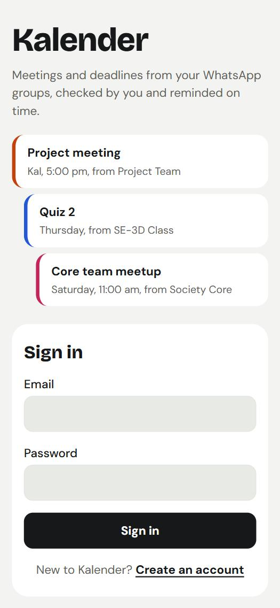
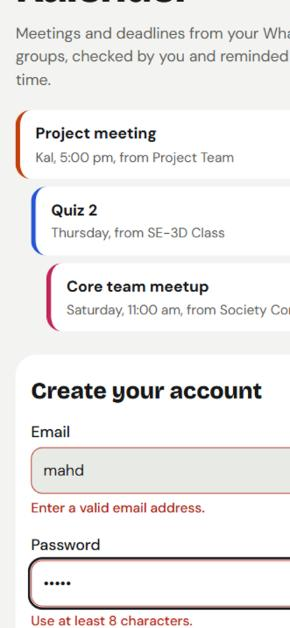
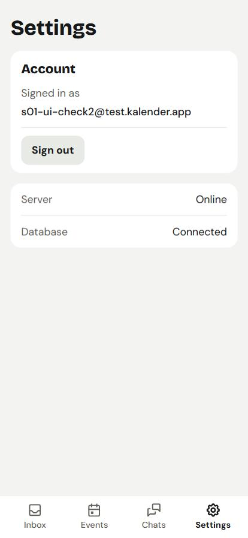

# S01: Accounts (create account, sign in and out, own data only)

| Field | Value |
|---|---|
| Slice | S01 |
| Requirements | FR-01, BR-11; AC-01.1, AC-01.2 (identity part) |
| Plan version used | v01 |
| Lead | Muhammad Areeb (proposed, O-7); session directed by Abdul Hannan Rauf |
| Mode | HITL (personal data and sessions) |
| Agent | Claude Code (Opus 5.5) |
| Branch | `slice/S01-accounts` |
| Date | 23 Nov 2026 |

## 1. Select

Next Must slice in `plan.md`. Every later slice needs a signed-in User and `req.userId`.

## 2. Context loaded

PRD FR-01, BR-11, AC-01.1, AC-01.2, AC-02.5; architecture section 5.2 (`identity` owns `users` and `sessions`), section 6 (public identity router before `requireUser`, `AuthedRequest` in `shared`), section 8 (sessions kept 30 days); AGENTS.md sections 3 to 5 (module layout, modules never import `identity`, `userId` only from the session, never log personal data); ADR-005 (Postgres, own session auth).

## 3. Criteria and tests (agreed before coding, Gate 1)

| ID | Criterion | Test |
|---|---|---|
| S01-1 (AC-01.1) | A new person creates an account with email and password and is signed in at once | `identity.routes.test.ts` "AC-01.1 register signs the User in" |
| S01-2 (AC-01.1) | A returning User signs in with the same email (any letter case) and password | "AC-01.1 returning User signs in" |
| S01-3 | A wrong password or unknown email is refused with one generic message, so the response does not reveal which accounts exist on sign-in | "refuses a wrong password", "refuses an unknown email" |
| S01-4 | Creating a second account with the same email is refused with 409 | "refuses a duplicate email" |
| S01-5 | Signing out ends the session: the same cookie no longer works | "sign-out ends the session" |
| S01-6 (AC-01.2, BR-11) | Every `/api` route except health and the public identity routes needs a valid session; `req.userId` comes only from the session, so User A's cookie can never act as User B | "AC-01.2 two Users only ever see themselves", "refuses a missing or forged session" |
| S01-7 | Passwords are stored only as bcrypt hashes; session tokens are stored only as SHA-256 hashes; the cookie is HttpOnly, SameSite=Lax, Secure on Vercel, 30 days | "stores only hashes" plus code review |
| S01-8 | The PWA shows a sign-in screen when signed out, a create-account screen, field errors under the field, and a sign-out button in Settings | Manual check at 375 x 812, screenshots |

AC-02.5 ("a new account has zero Approved Chats") moves to S02, because the Approved Chats list arrives there.

### EP and BVA (domain validation, `identity/domain.test.ts`)

| Input | Class or boundary | Expected |
|---|---|---|
| Email | valid `mahd@example.com` | accepted, stored lower case and trimmed |
| Email | `  Mahd@Example.COM ` | accepted as `mahd@example.com` |
| Email | empty, no `@`, no domain dot, contains a space | refused: "Enter a valid email address." |
| Email | 254 characters (max) | accepted |
| Email | 255 characters | refused |
| Password | 7 characters | refused: "Use at least 8 characters." |
| Password | 8 characters (min) | accepted |
| Password | 72 bytes (bcrypt max) | accepted |
| Password | 73 bytes, or 37 two-byte characters (74 bytes) | refused: "Use at most 72 characters." |
| Either | not a string (missing, number) | refused |

## 4. HITL or AFK

HITL. The human reviews the criteria above, the security choices in section 5, and the screens before Accept.

## 5. AI implementation

Prompt: "Build S01 from plan.md v01 and the criteria in this file, following AGENTS.md: an `identity` module with registerAccount, signIn, signOut, me and requireUser; `users` and `sessions` tables in a migration owned by identity; bcrypt passwords; hashed session tokens in an HttpOnly cookie; field errors in the PWA; no extra features."

What the agent built:
- `server/migrations/001_identity_create_users_and_sessions.sql` and a small migration runner (`server/src/shared/migrate.ts`), run by tests, by `npm run migrate -w server`, and by every Vercel build, so each build migrates its own database (preview uses the Neon `dev` branch, production the `production` branch).
- `server/src/modules/identity/`: `domain.ts` (validation), `repository.ts` (the only SQL on `users` and `sessions`), `service.ts`, `routes.ts`, `index.ts`. The composition root mounts the public routes, then `requireUser()` once on `/api`, then the signed-in routes.
- `shared/http.ts` (`AuthedRequest`, `userIdOf`), `shared/log.ts` (logs error name and code only, never messages), `shared/db.ts` (`db()` answers 503 when no database is configured).
- New lint rule: no module may import `identity` (with a test that guards the rule).
- PWA: `session.tsx` (loads `/api/me`, signed-in, signed-out or offline), `AuthPage` (sign in and create account), sign out in Settings, Chat palette tokens `--chat-1` to `--chat-8`.

Security choices for the human to review:
- Password: bcrypt cost 12, 8 to 72 bytes. Session token: 32 random bytes; only its SHA-256 is stored; 30-day expiry.
- Cookie: HttpOnly, SameSite=Lax (blocks cross-site POSTs, so no separate CSRF token), Secure on Vercel.
- Sign-in: one message for a wrong email or password, and an unknown email is checked against a dummy hash so both take the same time. Registration does say that an email is taken (409), which reveals that the account exists; accepted as normal for sign-up.
- Not done (known limits): no rate limit on sign-in; expired sessions are refused but not yet purged (the `purgeExpiredSessions` tick task comes with `jobs` in S07).
- Assumption: identity's lookups by email and by session token cannot take a `userId` first (AGENTS.md section 5), because no User is known yet at that point.

Process note: Vercel blocked the first S01 preview because the commits were authored by the GitHub account `i253053`, while the Vercel Hobby project belongs to `hannannrf`, and Hobby deploys only the owner's commits. The human approved committing as `hannannrf` in this repository only ("Yes, use hannannrf"). Teammates' commits will be blocked the same way; their work deploys when the owner merges it.

## 6. Checks

- Local without a database: 24 passed, 11 skipped. Lint, typecheck, build clean.
- Local against the Neon `dev` branch: **33 passed, 2 skipped** in 46 s (`evidence/test-runs/S01-2026-11-23-neon-dev.txt`). The first run timed out: Vitest's 5 s default is too short for a remote Neon branch waking from sleep plus bcrypt at cost 12, so `server/vitest.config.ts` now sets a 30 s test timeout.
- CI on PR #2 (Postgres 17 service): **33 passed, 2 skipped** (the two no-database cases). All 10 identity route tests and 13 EP/BVA domain tests ran. The build step ran the migration again: "applied 0 (none new)", so it is safe to repeat.
- Deployed preview (https://kalender-n8cxj4vva-hannan-f17c.vercel.app, Neon `dev` branch), driven with `vercel curl` because preview deployments are behind Vercel Authentication: the build log shows `migrate: applied 1 (001_identity_create_users_and_sessions.sql)`; register 201, `/api/me` 200 with the same email, sign-out 204, `/api/me` 401 afterwards, sign-in 200, wrong password 401 with the generic message. The cookie came back HttpOnly and Secure.
- Manual check of the screens at 375 x 812 (local dev server): the sign-in screen, and the create-account screen with both field errors under their fields.

- Signed-in check at 375 x 812 (local API on the Neon `dev` branch): created a test account, landed on the Inbox, opened Settings ("Signed in as" shows the email; Server Online, Database Connected), pressed Sign out, returned to `/sign-in`, and `/api/me` then answered 401.

| Sign in | Create account with field errors | Settings, signed in |
|---|---|---|
|  |  |  |

**Layout fix found during the signed-in check:** at phone width the email sat beside "Signed in as" and broke mid-word across lines. The account row now puts the email under its label (`.stacked` in `Page.module.css`).

**Observed, not fixed:** creating an account took about 8 s on the first request against a sleeping Neon branch (the button shows "Creating account…" meanwhile). Later requests are fast. Neon is in Singapore and the Vercel function in `iad1`; pinning the function region near the database is an open item for the human.

**Bug found during the manual check, fixed in this slice:** when the API was down, the Vite dev proxy answered `/api/me` with the HTML page and status 200, and the PWA treated that as "signed in" (empty email). The same would happen with any HTML answer, such as a Vercel login page. `web/src/api.ts` now refuses any answer that is not JSON, so the app shows "Kalender is not reachable" with Try again. Checked again in the browser after the fix.

## 7. Human decision

Pending.

## 8. Integrate

Pending.

## 9. Context updated

Pending.
