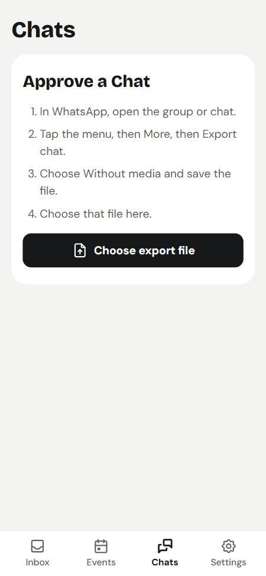
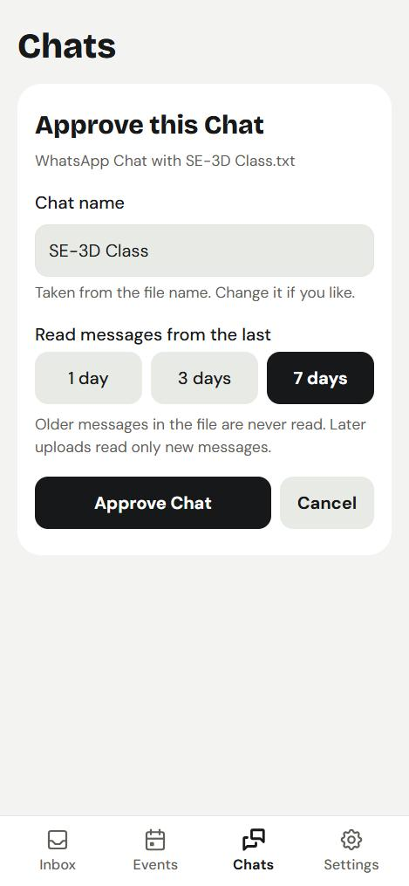
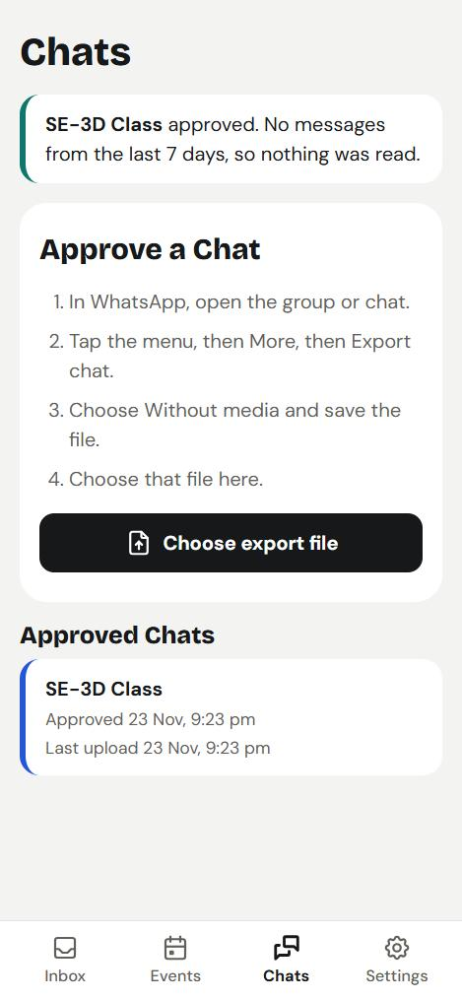
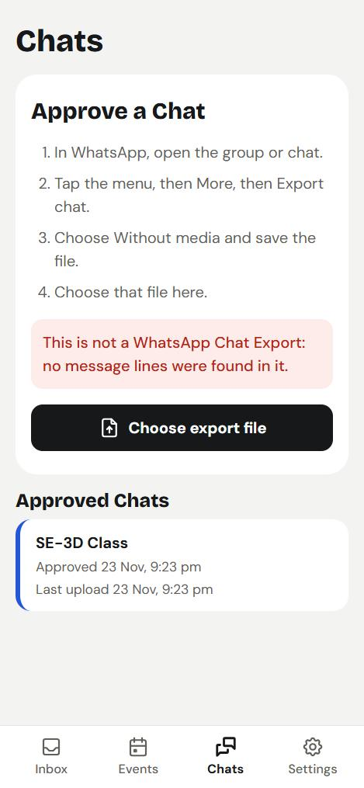

# S02: Approve a Chat from an Android export

| Field | Value |
|---|---|
| Slice | S02 |
| Requirements | FR-02, BR-01, BR-02, BR-03, BR-05, BR-15, NFR-01; AC-02.1, AC-02.3, AC-02.5 |
| Plan version used | v02 |
| Lead | Zain Amjad (proposed, O-7); session directed by Abdul Hannan Rauf |
| Mode | HITL (message privacy, a file format we do not control) |
| Agent | Claude Code (Opus 5.5) |
| Branch | `slice/S02-approve-chat` |
| Date | 23 Nov 2026 |

## 1. Select

Next Must slice in `plan.md`. Every later Chat and Event slice needs an Approved Chat and the read-once pointers.

## 2. Context loaded

PRD GL-02, GL-04, GL-05, GL-07, GL-17, GL-23 to GL-26, FR-02, BR-01 to BR-03, BR-05, BR-15, NFR-01, MF-02, AC-02.1, AC-02.3, AC-02.5; architecture section 5.2 (`chats` owns `approved_chats`, `ingestion` is pure), 6.1 (`previewExport`, `approveChat`, `listChats`, `parseExport`, `selectEligible`), 6.2 (`POST /chats/preview`, `POST /chats`, `GET /chats`, typed refusals, 4 MB), 6.3 (approve flow), 8 (read-once state, fingerprints, `name_from_file`, Chat colour), R2-4, R2-5, R2-6, R2-14, R2-18; AGENTS.md sections 3 to 6; `fixtures/README.md` (N1, F2).

Also looked at one real iPhone export the human supplied ("Binary tree", 343 messages, 5 senders), without printing any message text. It is the first real file the team has, and it answers part of R2-18: it uses month/day order with a two-digit year and seconds (`[10/25/26, 3:22:38 PM]`), a narrow no-break space before PM, and left-to-right marks before media lines. The sample exports use day/month with four-digit years only, so the parser must also accept two-digit years and month/day order. The `.zip` container is S05; the line rules are shared.

## 3. Criteria and tests (agreed before coding, Gate 1)

| ID | Criterion | Test |
|---|---|---|
| S02-1 (AC-02.1, N1) | Approving `WhatsApp Chat with SE-3D Class.txt` at 19 Oct 2026 10:25:40 PKT with the default 7-day Look-back gives Start Point 12 Oct 2026 10:25 and reads exactly 6 text messages; 1, 8 and 11 Oct, the media line, the deleted line and notices are not read; the three-line message is one message | `ingestion` unit test and `chats` service test "AC-02.1" |
| S02-2 (AC-02.3, F2) | `notes.txt` and `WhatsApp Chat with Fake.txt` are refused with `NOT_AN_EXPORT` and a reason; no Chat is created | route test "AC-02.3" |
| S02-3 (AC-02.5) | A new account has zero Approved Chats | route test "AC-02.5" |
| S02-4 (BR-15) | Preview returns the Chat name from the file name and stores nothing; the User can correct the name before approving | route test "preview stores nothing" |
| S02-5 (BR-15) | A Chat whose dates all fit both orders is refused with `NEEDS_DATE_ORDER` before anything is read (the question screen is S05) | `ingestion` unit test (B2 file) |
| S02-6 (Q-14) | Approving a second Chat with the same name from the file is refused with `DUPLICATE_CHAT` | route test |
| S02-7 (6.2) | A file over 4 MB is refused with `TOO_LARGE`, by the PWA before sending and by the server | route test plus PWA check |
| S02-8 (BR-11) | User B never sees User A's Chats | route test "two Users" |
| S02-9 (NFR-01, BR-05) | No message text, sender or file is stored: the Chat row holds only name, times, colour and SHA-256 fingerprints | route test "stores no message text" |
| S02-10 | The Chats screen guides the export (WhatsApp steps), previews the name, offers Look-back 1, 3 or 7 days (7 preselected), and shows how many messages were read | Manual check at 375 x 812, screenshots |

### EP and BVA (`ingestion`, pure)

| Input | Class or boundary | Expected |
|---|---|---|
| File | Android `.txt` with message lines | parsed |
| File | text with no message line (notes, renamed file), empty file | `NOT_AN_EXPORT` |
| File | `.zip` or other extension | refused (iPhone `.zip` arrives in S05) |
| File name | `WhatsApp Chat with SE-3D Class.txt`, `... (1).txt` | name "SE-3D Class" |
| File name | any other name | no name; the User types one |
| Message time | exactly at the Start Point minute | read |
| Message time | one minute before the Start Point | not read |
| Look-back | 1, 3, 7 | accepted; anything else refused |
| Date order | a first field above 12 | day/month |
| Date order | a second field above 12 | month/day (real export) |
| Date order | every date has both fields 12 or less | `NEEDS_DATE_ORDER` |
| Year | `2026` and `26` | both 2026 |
| Clock | `12:05 am`, `12:05 pm`, `9:00 am`, `21:00` | 00:05, 12:05, 09:00, 21:00 |
| Line | `<Media omitted>`, `sticker omitted`, `This message was deleted`, notice without a sender | not read |
| Line | `... <This message was edited>` | read without the marker |
| Line | continuation lines | joined to the message above |
| Encoding | UTF-8 BOM, CRLF line ends | parsed the same |

## 4. HITL or AFK

HITL. The human reviews the criteria, the privacy check in S02-9, the screens, and the known limits before Accept.

## 5. AI implementation

Prompt: "Start S02 from plan.md v02 and the criteria in this file, following AGENTS.md: a pure `ingestion` module (`parseExport`, `selectEligible`) for Android `.txt` exports, a `chats` module that owns `approved_chats` with preview, approve and list, multipart uploads in memory only, typed refusals, and a Chats screen with WhatsApp export steps. Store no message text. No extra features."

What the agent built:
- `server/src/modules/ingestion/`: `parse.ts` (line format, date order, 12- and 24-hour clocks, two- and four-digit years, multi-line messages, BR-03 filtering, edited marker, Chat name from the file name, SHA-256 fingerprints) and `select.ts` (Start Point, Read-up-to Point and boundary-minute counts, BR-02). No database, clock, file or log access.
- `server/migrations/002_chats_create_approved_chats.sql` and `server/src/modules/chats/` (`repository.ts`, `service.ts`, `routes.ts`, `index.ts`): `GET /api/chats`, `POST /api/chats/preview`, `POST /api/chats`. Uploads go through `multer` memory storage with a 4 MB limit and UTF-8 file names (emoji in group names).
- `shared/time.ts`: PKT wall clock to UTC, start of minute.
- PWA: `ChatsPage` with the four export steps, file check (4 MB) before sending, name confirmation, Look-back 1, 3 or 7 days (7 preselected), result and Approved Chats list with the Chat colour; `api.ts` now sends `FormData`.
- `fixtures/` copied unchanged into `server/test/fixtures/` (AGENTS.md section 3).
- New dependency: `multer` (already in the agreed stack, AGENTS.md section 2) and `@types/multer`.

Design choices for the human to review:
- Approved Chats have no foreign key to `users`: modules never reach into identity's tables, and S09's `deleteAllForUser` removes them.
- Refusals: `NOT_AN_EXPORT`, `NEEDS_DATE_ORDER`, `DATE_ORDER_MISMATCH` answer 422, `DUPLICATE_CHAT` 409, `TOO_LARGE` 413, each with a message the PWA shows.
- The Chat name check compares the normalised name from the file (R2-4), so `... (1).txt` is the same Chat.

Known limits (each closed by a later slice):
- **No detection yet.** Selected messages are counted as read and dropped. S03 passes them to `events.ingestMessages` in the same transaction. So an S02 approval of a real Chat advances its pointers without finding Events; only test accounts are used until S03.
- iPhone `.zip` exports are refused with a clear message until S05. The date-order question screen is S05; the API already refuses with `NEEDS_DATE_ORDER` and accepts `dateOrder`.
- Update, Revoke and the per-Chat "last upload" after updates arrive in S05.

## 6. Checks

- Local against the Neon `dev` branch: **68 passed, 2 skipped** (`evidence/test-runs/S02-2026-11-23-neon-dev.txt`): 22 `ingestion` unit tests (EP/BVA table above, N1, F2, B2 and the B1 boundary case) and 13 `chats` tests (AC-02.1, AC-02.3, AC-02.5, preview stores nothing, emoji name, duplicate, invalid fields, TOO_LARGE, two Users, NFR-01 no text stored, needs a session). The test run applied migration 002 to Neon `dev`.
- Lint (boundary rules), typecheck and build clean.
- Manual check at 375 x 812, local PWA and API on Neon `dev`: export steps, preview with the name from the file, Look-back with 7 days preselected, approval result, Approved Chats list with the first Chat colour, and the `notes.txt` refusal shown above the button.

| Export steps | Confirm name and Look-back | Approved | Not an export |
|---|---|---|---|
|  |  |  |  |

Found and fixed during the manual check: approving a Chat whose messages are all older than the Look-back said "0 messages read". It now says "No messages from the last 7 days, so nothing was read." The refusal for a non-export now says what the file is not, not only what is missing.

## 7. Human decision

Pending.

## 8. Integrate

Pending.

## 9. Context updated

Pending.
