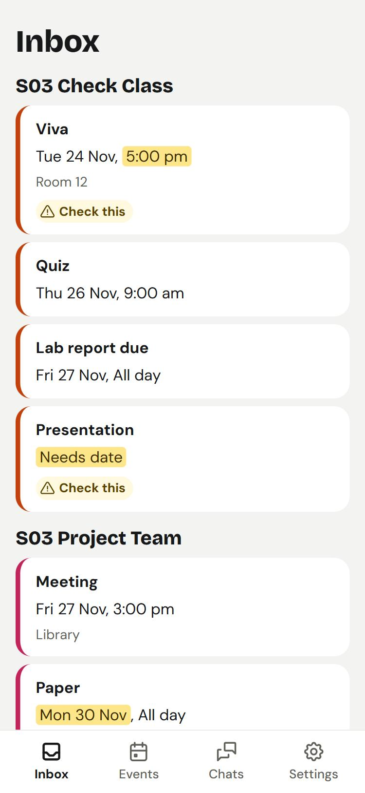

# S03: Detected Events appear after upload (with the NFR-05 gate)

| Field | Value |
|---|---|
| Slice | S03 |
| Requirements | FR-05, BR-12, BR-17, BR-20, BR-21, NFR-05; AC-05.1 to AC-05.9, AC-05.12, AC-05.13 |
| Plan version used | v03 |
| Lead | Abdul Hannan Rauf |
| Mode | HITL (ambiguous rules; message text stored for the first time) |
| Agent | Claude Code (Opus 5.5) |
| Branch | `slice/S03-detection` |
| Date | 23 Nov 2026 |

## 1. Select

Next Must slice. S02 reads messages but finds nothing; every review, Reminder and calendar slice needs Detected Events.

## 2. Context loaded

PRD GL-08, GL-09, GL-12, GL-18, GL-19, GL-27 to GL-29, FR-05, BR-05, BR-12, BR-17, BR-20, BR-21, NFR-05, MF-03, AC-05.x, Appendix A; ADR-004 (rule-based, pure `detect(text, sentAt)`, CI gate, title and place rules, Urdu script); architecture 5.2 and 6.1 (`events.ingestMessages` in the upload transaction, `listDetected`), 6.3 (store Detected Events and Source Messages, drop messages with no Event), 8 (message text only in `source_messages`; titles never copy the message), R2-2 (drafts already past at upload are not stored); `docs/design/ui-direction.md` (Inbox cards, "Check this" chip); `fixtures/detection/detection_test_set.csv` and `evaluate.py`.

## 3. Criteria and tests (agreed before coding, Gate 1)

All detection examples are sent on Monday 19 Oct 2026 10:00 PKT.

| ID | Criterion | Test |
|---|---|---|
| S03-1 (AC-05.1) | "Meeting tomorrow at 3pm in Room 4" gives 20 Oct 2026, 15:00, place "Room 4", no Uncertain marks | `detection.test.ts` |
| S03-2 (AC-05.2) | "kal shaam 5 baje project meeting hai" gives 20 Oct, 17:00, no Uncertain marks | `detection.test.ts` |
| S03-3 (AC-05.3) | "kal 5 baje project meeting hai" gives 20 Oct, 17:00, time Uncertain (U1) | `detection.test.ts` |
| S03-4 (AC-05.4) | "anyone has the slides?" gives no draft, and after an upload no Source Message is stored for it | `detection.test.ts`, `events` upload test |
| S03-5 (AC-05.5) | Urdu-script text gives no draft; media lines never reach detection (S02) | `detection.test.ts` |
| S03-6 (AC-05.6) | "agle hafte presentation hai" gives a "Needs date" draft | `detection.test.ts` |
| S03-7 (AC-05.7) | "The meeting yesterday went well" and "kal ki class bohat boring thi" give no draft | `detection.test.ts` |
| S03-8 (AC-05.8) | The 80-message Detection Test Set meets M1 to M4; the TypeScript scorer and `evaluate.py` agree in CI | `nfr05.gate.test.ts` plus a CI step running `evaluate.py` on the same output |
| S03-9 (AC-05.9) | "Lab report due Friday" gives an All-day Event on 23 Oct | `detection.test.ts` |
| S03-10 (AC-05.12) | "Monday ko paper hai" gives 26 Oct, date Uncertain (U5) | `detection.test.ts` |
| S03-11 (AC-05.13) | "meeting Friday 24/10 at 3pm" gives 24 Oct 15:00, date Uncertain (U6) | `detection.test.ts` |
| S03-12 (BR-17) | A message with two Events on separate lines gives two drafts | `detection.test.ts` |
| S03-13 (ADR-004) | Titles are built from activity words (at most 60 characters) and never equal the message; place at most 40 characters | `detection.test.ts` |
| S03-14 (AC-02.1 with detection) | Approving SE-3D Class at 19 Oct 10:25:40 stores exactly 2 Detected Events (the 20 Oct meeting and the 21 Oct OOP lab) and only their 2 Source Messages; the 16 Oct proposal deadline is already past at upload and is not stored (R2-2) | `events` upload test |
| S03-15 (BR-11) | `GET /api/detected-events` shows only the User's own Detected Events | route test "two Users" |
| S03-16 | The Inbox lists Detected Events grouped by Chat with the Chat colour, title, date and time, place, "Needs date", and a "Check this" chip (mark plus icon plus words) when a detail is Uncertain | Manual check at 375 x 812, screenshot |

### EP and BVA (`detection`, pure)

| Input | Class or boundary | Expected |
|---|---|---|
| Activity word | present / absent | draft / none |
| Tense | future or none / past marker (was, went, yesterday, thi, hua, ho gaya, parhaya) | draft / none |
| Shape | statement / question ending in "?" | draft / none |
| Script | Latin / Urdu | draft possible / none |
| Numeric date | day > 12 (22/10) / both parts 12 or less (03/11) | plain / date Uncertain (U3) |
| Date year | none: before the sent date / on or after | next year / this year |
| Day name | another weekday / the sent weekday / "next <day>" / conflicts with the explicit date | next one / +7 days U5 / following week U4 / explicit date U6 |
| Relative word | aaj, today / kal, tomorrow / parson | sent date / +1 / +2 |
| Period only | next week, agle hafte, this weekend, end of month | Needs date |
| Clock | 3pm, 9:30am, 15:00 / 5 baje with shaam / bare 1-7 / bare 8-11 / bare 12 | as written / PM / PM U1 / AM U1 / noon U1 |
| Clock | raat 12 baje | 00:00 next day, date and time Uncertain (U2) |
| Clock | sawa, sadhe, paune, dedh, dhai | +15, +30, -15 min, 1:30, 2:30 |
| Clock | only "subah", "after Zuhr" | All-day, time Uncertain (U8) |
| Wording | shayad, maybe, if, plan | Event Uncertain (U9) |
| Time | already past at the sent time (today 9am, sent 10:00) | none |

## 4. HITL or AFK

HITL. The human reviews the rule coverage against the gate report, the title and place rules (no message text in titles), the storage of Source Messages, and the Inbox screen before Accept.

## 5. AI implementation

Prompt: "Start S03 from plan.md v03 and the criteria in this file, following AGENTS.md and ADR-004: a pure, rule-based `detection` module (`detect(text, sentAt)`) for English and Roman Urdu with the BR-21 Uncertain rules, the NFR-05 gate test scored exactly as `fixtures/detection/evaluate.py` scores it, an `events` module that owns `detected_events` and `source_messages`, `chats.approveChat` passing the read messages to `events.ingestMessages` in one transaction, and an Inbox that lists Detected Events grouped by Chat. Never change the test set to make a run pass. No extra features."

What the agent built:
- `server/src/modules/detection/`: `vocabulary.ts` (word lists as data: activities, deadlines, past and tentative markers, periods, months, day names with Roman Urdu spellings, parts of the day, title stop words, places) and `detect.ts` (explicit, relative and day-name dates; clock times with am/pm, baje, sawa, sadhe, paune, dedh, dhai and parts of the day; U1 to U9 marks; short titles never copied from the message; places; one draft per Event line, BR-17). No database, clock, environment or log access.
- `detection/nfr05.gate.test.ts`: runs all 80 messages as if sent Monday 19 Oct 2026 10:00 PKT, scores M1 to M4 with the same rules as `evaluate.py`, and writes `server/test/out/detector_output.csv`. CI scores that file again with the unchanged `evaluate.py` and fails unless it prints "FR-05 detection: ACCEPTED".
- `detection/detection.test.ts`: the AC tests and cases outside the test set (to catch rules fitted only to the 80 messages).
- `server/migrations/003_events_create_detected_events.sql` and `server/src/modules/events/` (`repository.ts`, `service.ts`, `routes.ts`, `index.ts`): `ingestMessages` stores a Source Message only when it has at least one upcoming draft, then one Detected Event per draft with the Chat name and colour copied; `GET /api/detected-events`.
- `shared/db.ts`: `withTransaction` and a `Db` type, so repositories run on the pool or inside a transaction. `chats.approveChat` now runs the Chat insert and the event ingest in one transaction and returns the real `detectedEvents` count.
- PWA: `InboxPage` lists Detected Events grouped by Source Chat; each card has the Chat colour bar, title, date and time in PKT (or "All day"), place, "Needs date", and for any Uncertain detail the yellow mark on that value plus a "Check this" chip with an icon.

Design choices for the human to review:
- R2-2 at upload: a dated draft already over when the file is read is not stored (All-day lasts to the end of its date); a "Needs date" draft is not stored if its message is more than 7 days old (BR-05). Its message is then not stored either.
- `detected_events` and `source_messages` have no foreign keys to other modules' tables. Deleting a Source Message deletes its Detected Events (`on delete cascade`, inside the module).
- Dates and times are stored as plain PKT `date` and `time` values and sent as text, so no server time zone can shift them.

Known limits (each closed by a later slice):
- Review, confirm, dismiss and Possible Duplicate are S04; the Inbox shows the list only. The Inbox count badge on the bottom navigation comes with S04.
- The BR-05 and BR-14 expiry jobs (end of date, Needs date after 7 days) are S07. Until then expired Detected Events stay in the list.
- Updating an Approved Chat (reading only new messages) is S05.

## 6. Checks

- Local against the Neon `dev` branch: **114 passed, 2 skipped** (`evidence/test-runs/S03-2026-11-23-neon-dev.txt`). New: 33 `detection` unit tests, 9 NFR-05 gate tests, 4 `events` tests (S03-14, S03-15, a Chat approved after every Event has passed stores nothing, signed out 401); the `chats` test AC-02.1 now expects 2 Detected Events. The run applied migration 003 to Neon `dev`.
- NFR-05 gate (AC-05.8): M1 English 20/20 and Roman Urdu 20/20, M2 40/40, M3 20/20 detected and 20/20 flagged, M4 0/20 false and 0/8 past. The unchanged `evaluate.py` scores the same output: "FR-05 detection: ACCEPTED" (`evidence/test-runs/S03-nfr05-evaluate-py.txt`).
- Lint (boundary rules), typecheck and build clean.
- Manual check at 375 x 812, local PWA and API on Neon `dev`, test account only: two synthetic exports written for this check (no real messages) approved through the API. The Inbox groups them by Chat with each Chat's colour; "parson 5 baje viva" shows 5:00 pm marked with "Check this" (U1); "Monday ko paper hai" sent on a Monday shows the next Monday marked (U5); "agle hafte presentation hai" shows "Needs date"; "anyone has the slides?" created nothing and its text was not stored. No horizontal scroll.

Found and fixed during the manual check: "agle hafte presentation hai" was titled "Hafte presentation". Period words (week, hafte, mahine, ...) are now title stop words, and AC-05.6 checks the title "Presentation".
- CI on PR #4 (Postgres 17): green, including the new step that scores the gate output with the unchanged `evaluate.py` ("FR-05 detection: ACCEPTED").
- Deployed preview (https://kalender-9rp8pduxt-hannan-f17c.vercel.app, Neon `dev`), driven with `vercel curl` and a new test account: approving a 3-message synthetic export 201 with `messagesRead` 3 and `detectedEvents` 2; `GET /api/detected-events` 200 with "Viva" Tue 24 Nov 17:00, Room 12, time Uncertain (U1) and "Quiz" Thu 26 Nov 09:00; signed out 401. The build applied migration 003 to Neon `dev`.

## 7. Human decision

**Accept**, Abdul Hannan Rauf, 23 Nov 2026 ("Accept, merge and tag"). Reason: criteria S03-1 to S03-16 pass in CI, against Neon `dev`, on the deployed preview and in the manual phone-size check; the NFR-05 gate passes on every metric and the reference scorer agrees; the known limits (review and confirm in S04, Chat update in S05, expiry jobs in S07) are accepted.

## 8. Integrate

PR #4 merged into `main` with a merge commit, tagged `S03-accepted`; CI on `main` is Gate 4. Production applies migration 003 to the Neon `production` branch during the build.

## 9. Context updated

`plan.md` v04 (copy in `docs/plan-history/plan-v04.md`): S03 Accepted. Row 6 added to `evidence/workflow-evidence-log.md`.
