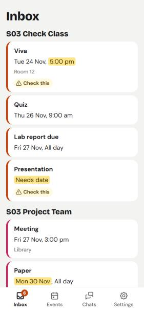
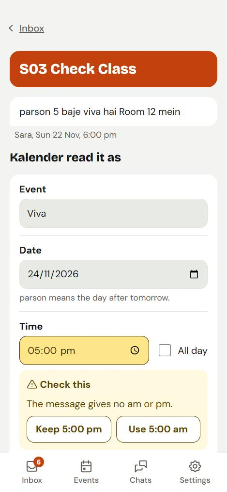
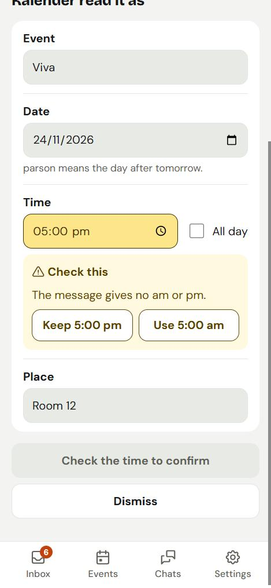
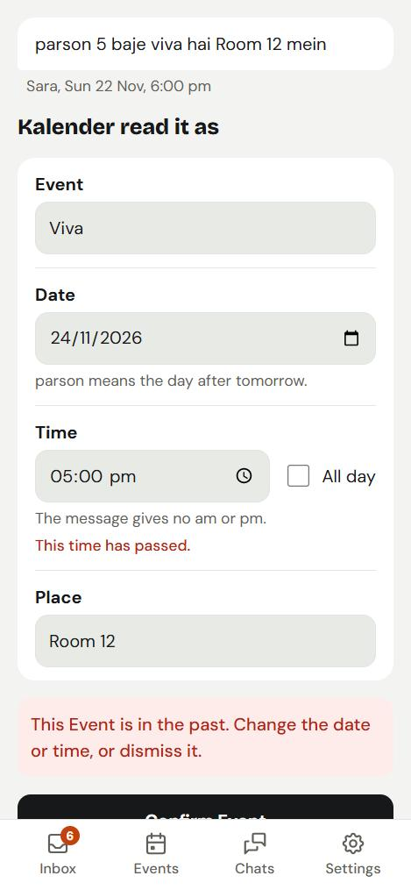
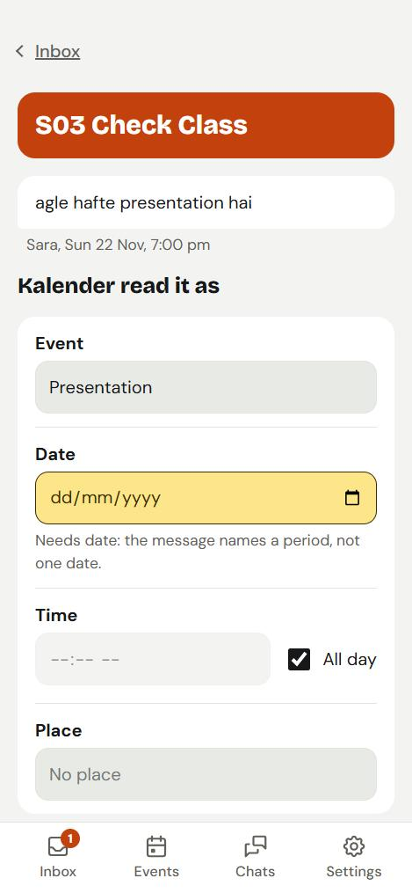
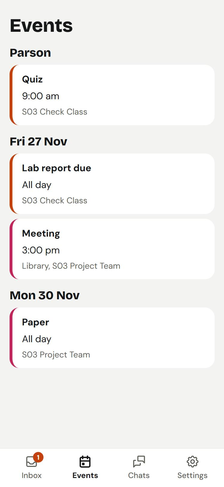

# S04: Review a Detected Event and see upcoming Events

| Field | Value |
|---|---|
| Slice | S04 |
| Requirements | FR-06, FR-11, BR-05, BR-16, BR-17, BR-21; AC-06.1, AC-06.2, AC-06.3, AC-06.5, AC-06.7, AC-06.8, AC-11.1, AC-11.2 |
| Plan version used | v04 |
| Lead | Muhammad Areeb (proposed, O-7); session directed by Abdul Hannan Rauf |
| Mode | HITL (the Uncertain gate is the product's main promise; message text is deleted here) |
| Agent | Claude Code (Opus 5.5) |
| Branch | `slice/S04-review` |
| Date | 24 Nov 2026 |

## 1. Select

Next Must slice in `plan.md`. S03 lists Detected Events but the User cannot act on them; Reminders (S07), Manual Events and edits (S06) and Possible Duplicate (S08) all need Confirmed Events.

## 2. Context loaded

PRD GL-09, GL-10, GL-12, GL-19, GL-28, FR-06, FR-11, BR-05, BR-16, BR-17, BR-21, AC-06.1 to AC-06.8, AC-11.1, AC-11.2; architecture 5.2 (`events` owns `confirmed_events`), 6.1 (`reviewDetail`, `confirm`, `dismiss`, `listUpcoming`), 6.2 (`POST /detected-events/:id/review`, `/confirm`, `/dismiss`, `GET /events`), 6.3 (confirm flow: gate checks, one transaction, delete the Source Message only when no other Detected Event uses it), 8 (Confirmed Events keep the Chat name and colour, times in PKT), R2-16 (UI-level ACs tested at API level plus a manual checklist); `docs/design/ui-direction.md` (review screen, Events day headers, Inbox count badge).

## 3. Criteria and tests (agreed before coding, Gate 1)

| ID | Criterion | Test |
|---|---|---|
| S04-1 (AC-06.1) | Confirming a Detected Event with no Uncertain marks in one action creates a Confirmed Event, removes the Detected Event from the list, and deletes its Source Message text | `events` route test |
| S04-2 (AC-06.2) | Editing the time and confirming gives a Confirmed Event with the edited time | `events` route test |
| S04-3 (AC-06.3) | Dismissing removes the Detected Event, creates no Confirmed Event, and deletes its Source Message text | `events` route test |
| S04-4 (AC-06.5) | After the date is edited to 18 Oct 2026, confirming is refused with the date named as the reason (BR-16) | `events` route test |
| S04-5 (AC-06.7) | Confirming "kal 5 baje project meeting hai" without reviewing the time is refused, and the refusal names the time; the review screen highlights it | `events` route test; manual check |
| S04-6 (AC-06.8) | Accepting 17:00, or changing it to 05:00, clears the Uncertain mark, and the Event then confirms in one action with the reviewed time | `events` route test; manual check |
| S04-7 (BR-05, BR-17) | When one message has two Detected Events, confirming one keeps the Source Message; resolving the other deletes it | `events` service test |
| S04-8 (GL-19) | A "Needs date" Detected Event cannot be confirmed until a date is entered | `events` route test |
| S04-9 (BR-16) | An empty title, a title over 60 characters, a place over 40 characters, an invalid date or time are refused with the field named | `events` route test |
| S04-10 (AC-11.1) | Three Upcoming Confirmed Events are listed in date-and-time order with their Source Chat | `events` route test |
| S04-11 (AC-11.2) | A Confirmed Event whose start time has passed is not listed | `events` service test |
| S04-12 (BR-11) | Another User's Detected Event cannot be read, reviewed, confirmed or dismissed (404), and their Events are not listed | route test "two Users" |
| S04-13 | Review screen: Chat band, quoted Source Message, field card with reasons, Uncertain mark plus icon plus "Check this" with two explicit choices, confirm disabled with the reason until every Uncertain detail is resolved; Events list under Aaj, Kal, Parson and weekday headers; Inbox count badge | Manual check at 375 x 812, screenshots |

### EP and BVA

| Input | Class or boundary | Expected |
|---|---|---|
| Uncertain marks at confirm | none / reviewed (accepted or changed) / not reviewed | confirm / confirm / refused, fields named |
| Date at confirm | yesterday / today / tomorrow | refused / allowed (All-day, or a time not yet passed) / allowed |
| Time at confirm, date today | 1 minute ago / now / later | refused / allowed / allowed |
| Date | null (Needs date) / valid / 2026-02-30 / not a date | refused at confirm / accepted / 400 / 400 |
| Time | 00:00 / 23:59 / 24:00 / null (All-day) | accepted / accepted / 400 / accepted |
| Title (trimmed) | 0 / 1 / 60 / 61 characters | 400 / accepted / accepted / 400 |
| Place | null or empty / 40 / 41 characters | no place / accepted / 400 |
| Upcoming list, start vs now | start before now / start equal to now / later; All-day today | hidden / shown / shown; shown |
| Source Message users | last Detected Event resolved / another still open | deleted / kept |
| Owner | own / another User's id / unknown id | acts / 404 / 404 |

## 4. HITL or AFK

HITL. The human reviews the Uncertain gate (no path confirms an unreviewed detail), the message deletion on confirm and dismiss, and the review screen wording before Accept.

## 5. AI implementation

Prompt: "Start S04 from plan.md v04 and the criteria in this file, following AGENTS.md: in `events`, review (edit details and resolve Uncertain marks), confirm with the FR-06 and BR-16 gate in one transaction, dismiss, delete the Source Message once no Detected Event uses it, and list Upcoming Confirmed Events; in the PWA, the review screen from ui-direction.md, the Events list with day headers, and the Inbox count badge. No Reminders or calendar work yet. No extra features."

What the agent built:
- `server/migrations/004_events_create_confirmed_events.sql`: `confirmed_events` (Event details plus the Source Chat name and colour, no message text; `chat_id` null is kept for Manual Events in S06).
- `events` service and routes: `GET /api/detected-events/:id` (with the Source Message), `POST /api/detected-events/:id/review`, `POST /api/detected-events/:id/confirm`, `POST /api/detected-events/:id/dismiss`, `GET /api/events`. Confirm and dismiss lock the row, and each runs in one transaction.
- `shared/time.ts`: `pktParts` (PKT date and clock time of an instant) and `eventStart`.
- PWA: `ReviewPage` (Chat band, quoted Source Message with sender and sent time, "Kalender read it as" field card with a one-line reason per detail, Uncertain mark plus icon plus "Check this" with two explicit choices, Confirm disabled with the reason until every mark is resolved, Dismiss), `EventsPage` (Aaj, Kal, Parson, then weekday and date headers; Source Chat or "Manual"), Inbox cards open the review screen, Inbox count badge on the bottom navigation, loading states, `format.ts` shared by the screens.

Design choices for the human to review:
- **Review rule:** a detail the User sends counts as reviewed, so its mark is cleared; "Keep" sends `accept` for that mark. The Event mark (U9) clears only with "Keep this Event". Changing the time does not clear a date mark (U2 marks both).
- **Confirm refusals** are 422 with the fields named: `NEEDS_REVIEW` (each open mark), `NEEDS_DATE`, `PAST` (`date` when the date is before today, `time` when today's time has passed). A timed Event may start in the current minute; an All-day Event may be today.
- **Upcoming list:** a timed Event is shown until its start minute has passed; an All-day Event through its whole date.
- Unknown, malformed and other Users' ids all answer 404, so ids cannot be probed (BR-11).

Known limits (each closed by a later slice):
- No `EventConfirmed` outbox message yet, so no Reminder or calendar copy: S07 adds jobs, the outbox and Reminders; S11 the calendar.
- Possible Duplicate is S08. Manual Events and editing a Confirmed Event are S06.
- An Event that became past while waiting stays in the Inbox until the S07 expiry jobs; confirming it is refused (BR-16), and the User can change it or dismiss it.

## 6. Checks

- Local against the Neon `dev` branch: **129 passed, 2 skipped** (`evidence/test-runs/S04-2026-11-24-neon-dev.txt`). New: 15 `events` review tests (S04-1 to S04-12, the EP/BVA boundaries for confirm time, title, place, date, time and the upcoming list, two Users, needs a session). They upload an export written relative to the real clock, because the routes use the current time. The run applied migration 004 to Neon `dev`.
- Lint (boundary rules), typecheck and build clean.
- Manual check at 375 x 812, local PWA and API on Neon `dev`, test account only, with the synthetic S03 check Chats:
  - Inbox shows the count badge (6).
  - "parson 5 baje viva" opens with the time marked and "Check this", "The message gives no am or pm.", choices "Keep 5:00 pm" and "Use 5:00 am"; the primary button reads "Check the time to confirm" and is disabled.
  - After "Keep 5:00 pm" the button reads "Confirm Event". Confirming was refused because 5:00 pm today had already passed: "This time has passed." under Time and the BR-16 message. Dismiss then removed it, and the badge dropped to 5.
  - "Monday ko paper hai" shows the U5 reason; "Keep Mon 30 Nov" enabled Confirm, and the Event appeared under Mon 30 Nov in Events.
  - Events lists Parson, Fri 27 Nov and Mon 30 Nov with times, places and Source Chat names.
  - "agle hafte presentation hai" shows an empty, marked Date with "Needs date" and the button "Add a date to confirm".
  - Every input has a label; no horizontal scroll.

| Inbox badge | Time to check | Confirm disabled | Past refused | Needs date | Events |
|---|---|---|---|---|---|
|  |  |  |  |  |  |

Found and fixed during the manual check: the screens were blank for several seconds while the API answered (the local API talks to Neon in Singapore), and the Confirm button gave no sign it was working. Inbox, Events and the review screen now show a loading line, and the button shows "Saving…".
- CI on PR #5 (Postgres 17): green, including the `evaluate.py` detection step.
- Deployed preview (https://kalender-391ezcblz-hannan-f17c.vercel.app, Neon `dev`), driven with `vercel curl` and a new test account, with a 2-message synthetic export sent 30 minutes earlier: approve 201 with 2 Detected Events; confirm "Meeting" 201 (place Room 4); confirm "Project meeting" 422 `NEEDS_REVIEW` naming the time; review `{"accept":["time"]}` 200 with the mark cleared; confirm 201 at 17:00; `GET /api/events` 200 with both in time order; `GET /api/detected-events` empty; signed out 401. The build applied migration 004 to Neon `dev`.

## 7. Human decision

**Accept**, Abdul Hannan Rauf, 24 Nov 2026 ("Accept, merge and tag"). Reason: criteria S04-1 to S04-13 pass in CI, against Neon `dev`, on the deployed preview and in the manual phone-size check; the Uncertain gate holds on the server and in the screen; the known limits (outbox and Reminders in S07, Manual Events and edits in S06, Possible Duplicate in S08) are accepted.

## 8. Integrate

PR #5 merged into `main` with a merge commit, tagged `S04-accepted`; CI on `main` is Gate 4. Production applies migration 004 to the Neon `production` branch during the build.

## 9. Context updated

`plan.md` v05 (copy in `docs/plan-history/plan-v05.md`): S04 Accepted. Row 7 added to `evidence/workflow-evidence-log.md`.
