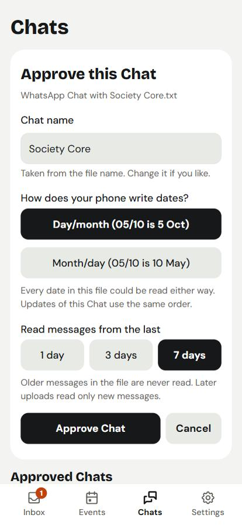
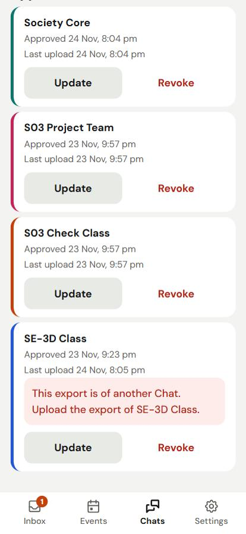
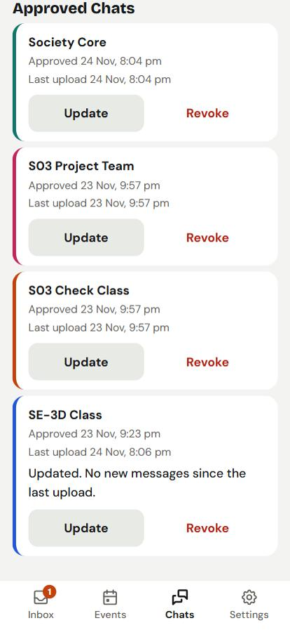
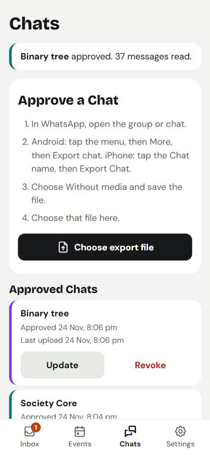
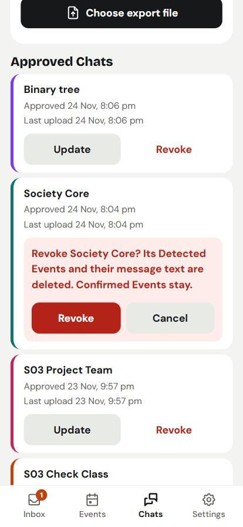
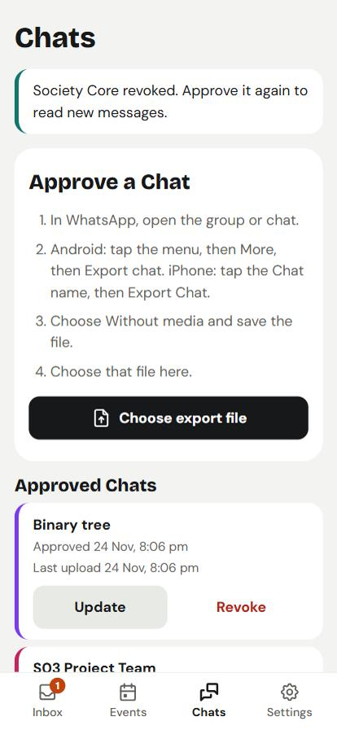

# S05: Update an Approved Chat, iPhone `.zip`, date-order question, Approved Chats list, Revoke

| Field | Value |
|---|---|
| Slice | S05 |
| Requirements | FR-03, FR-04, BR-02, BR-03, BR-06, BR-15, NFR-01; AC-02.2, AC-02.4, AC-03.1..03.3, AC-04.1, AC-04.2; R2-4, R2-6, R2-15, R2-18 |
| Plan version used | v07 |
| Lead | Abdul Hannan Rauf (planned lead Zain Amjad) |
| Mode | HITL (the plan said AFK; changed because this slice commits a real export and adds a library) |
| Agent | Claude Code (Opus 5.5) |
| Branch | `slice/S05-update-iphone` |
| Date | 24 Nov 2026 |

## 1. Select

S05 is the last Must slice on the upload side. It was waiting for O-3, a real export with names replaced. On 24 Nov the human supplied the "Binary tree" iPhone export with sender names replaced. The agent replaced the rest (see 2.1), so the iPhone half of O-3 is done. No real Android export exists yet.

## 2. Context loaded

- PRD: FR-02, FR-03, FR-04; BR-02, BR-03, BR-06, BR-15; NFR-01; AC-02.2, AC-02.4, AC-03.1..03.3, AC-04.1, AC-04.2.
- architecture.md:
  - 5.1: `ingestion` is pure and inflates only `_chat.txt`;
  - 6.1: `chats.updateChat` and `chats.revokeChat`;
  - 6.2: `POST /chats/:id/uploads` and `DELETE /chats/:id`;
  - 6.3: one transaction for an update, and Revoke calls `events.deleteUnconfirmedForChat`;
  - 7: `fflate` is in the approved stack;
  - 14 and 15: Q-13, Q-14, R2-4, R2-6, R2-15, R2-18.
- `fixtures/README.md` cases N2, B1, B2, F1, F3.
- Existing code: `ingestion/parse.ts` reads Android lines only and refuses every `.zip`. Migration 002 already has `read_up_to`, `boundary`, `last_upload_at` and `revoked_at`, so S05 needs no migration. The PWA does not yet ask for the date order.

### 2.1 Real iPhone export (O-3)

- Source: the human's own "Binary tree" group export, with sender names already replaced by PersonA, PersonB and PersonC.
- The agent checked it without printing message text. Message text still held 16 first names, 7 ChatGPT and Claude share links (some with account ids), 12 roll numbers in file names, and 1 gaming handle.
- A scrub script replaced them with placeholder names, `https://example.com/shared/N`, `00x0000` and a placeholder handle. It then asserted that none of the patterns was left. The script stays outside the repository because its patterns are the real names.
- The result is `fixtures/exports/real/WhatsApp Chat - Binary tree.zip`. It holds only `_chat.txt`, deflated as an iPhone makes it: 343 lines, CRLF line endings, with the narrow no-break space before AM and PM, the left-to-right marks and the mention marks all kept.
- What it shows that the samples do not:
  - month/day order with a two-digit year; a day above 12 settles the order without asking;
  - WhatsApp notices use the group name as the sender, and their text starts with a left-to-right mark;
  - media lines put a left-to-right mark before "image omitted". Documents appear as the file name followed by "document omitted", and some images have a caption in front.
- The current parser refuses this file ("no message lines were found"), because it only knows the Android line format.

## 3. Criteria and tests (agreed before coding, Gate 1)

| ID | Criterion | Test |
|---|---|---|
| S05-1 (AC-02.2, N2, Q-13) | The sample iPhone `.zip` of "ISE Project Team", approved at 19 Oct 2026 10:25:40 with 3 days, reads the 2 text messages from Zain. Only `_chat.txt` is inflated: a `.zip` whose photo entry is damaged is still read. | `ingestion` and `chats` tests |
| S05-2 (R2-18) | The real "Binary tree" `.zip`, approved at 23 Nov 2026 20:00 PKT, finds month/day by itself and reads 37 text messages with 7 days and 11 with 1 day. Notices, media lines, document lines and captioned media lines are not read. Mention marks and left-to-right marks are removed from the text. | `ingestion` test |
| S05-3 (BR-15) | A `.zip` without `_chat.txt`, a damaged `.zip`, a `.zip` whose `_chat.txt` would inflate past 20 MB, and a file that is neither `.txt` nor `.zip` are refused with `NOT_AN_EXPORT` and a reason. No Chat is created. | `ingestion` and route tests |
| S05-4 (AC-02.4, B2) | When every date fits both orders, the PWA asks which order the phone uses, day/month first, before anything is read. After day/month, "Society Core" reads only the 12 Oct message. | route test, manual check |
| S05-5 (AC-03.1, B1) | Updating "SE-3D Class" with `v2/` at 22 Oct 09:00 reads exactly the 3 messages not read before, including the new 10:25 one on 19 Oct. The Read-up-to Point and last upload time move. | route test |
| S05-6 (BR-02) | Uploading the same file again reads 0 messages and says there was nothing new. The last upload time still moves. | route test |
| S05-7 (AC-03.2, F1, R2-4) | Updating "SE-3D Class" with the "Ammi" export is refused with `WRONG_CHAT`. Nothing is read, and the Read-up-to Point and last upload time do not change. A " (1)" copy suffix on the right Chat's file is accepted. | route test |
| S05-8 (R2-6) | An update reuses the Chat's stored date order. A file whose dates prove the other order is refused with `DATE_ORDER_MISMATCH`. | route test |
| S05-9 (AC-03.3) | With two Approved Chats, `GET /api/chats` and the Chats screen show each with its Approval Time and last upload time. | route test, manual check |
| S05-10 (AC-04.1, BR-06) | Revoking a Chat deletes its unconfirmed Detected Events and their Source Messages, cancels their expiry jobs and clears its Read-up-to Point, all in one transaction. Its Confirmed Events stay, with the Chat name and colour. The Chat leaves the list. | route test |
| S05-11 (AC-04.2, F3, R2-15) | After a Revoke, an update upload is refused with `CHAT_NOT_APPROVED` and nothing is read. Approving the Chat again creates a new Chat with a new Approval Time and Start Point. | route test |
| S05-12 (BR-11) | Updating or revoking another User's Chat, or an unknown id, answers 404 and changes nothing. | route test "two Users" |
| S05-13 | The Chats screen has Update (pick a newer export) and Revoke (two steps, saying what is deleted and that Confirmed Events stay) on each Chat. The file picker accepts `.zip`. | Manual check at 375 x 812, screenshots |

### EP and BVA

| Input | Class or boundary | Expected |
|---|---|---|
| File type | `.txt` / `.zip` / `.pdf` or no extension | read / read / `NOT_AN_EXPORT` |
| `.zip` contents | `_chat.txt` plus media / no `_chat.txt` / damaged / media entry damaged | read / refused / refused / read (media never inflated) |
| Inflated `_chat.txt` size | 20 MB / 20 MB + 1 byte | read / refused |
| Line format | Android `d/m/yyyy, h:mm am - ` / iPhone `[m/d/yy, h:mm:ss AM] ` / 24-hour | read / read / read |
| Year | four digits / two digits | 2026 / 2026 |
| Date order | a date proves DMY or MDY / every date fits both / update file proves the other order | used without asking / asked, DMY first / `DATE_ORDER_MISMATCH` |
| iPhone line kind | text / notice (group name as sender) / media / document / caption with media / deleted | read / ignored / ignored / ignored / ignored / ignored |
| Update boundary (AC-03.1) | sent before the Read-up-to minute / in that minute, already read / in that minute, new / after | not read / not read / read / read |
| Update file Chat | same name / same with " (1)" / another Chat | read / read / `WRONG_CHAT` |
| Chat state | active / revoked / another User's / unknown id | acts / `CHAT_NOT_APPROVED` / 404 / 404 |

## 4. HITL or AFK

HITL. Decisions for the human before coding:

1. **Add `fflate`** to `server`. It is in the approved stack (architecture section 7) but not installed yet. `ingestion` uses its `unzipSync` with a filter, so only `_chat.txt` is ever inflated. The filter refuses a `_chat.txt` larger than 20 MB before inflating it (zip-bomb guard).
2. **A media line with a caption is ignored as a whole** (BR-03). An Event written only as a photo caption is missed. This keeps the rule simple, and it is recorded as a known limit.
3. **Commit the scrubbed real export** at `fixtures/exports/real/WhatsApp Chat - Binary tree.zip`. The Android half of O-3 stays open: Android update tests use the sample exports, and `plan.md` keeps O-3 open for a real Android file before Gate 5.
4. **New refusal codes:** `WRONG_CHAT` (update from another Chat) and `CHAT_NOT_APPROVED` (update after a Revoke), both answered with 422 and a reason, as in `fixtures/README.md`.
5. **Revoke wording:** "Revoke <Chat>? Its Detected Events and their message text are deleted. Confirmed Events stay." with Revoke and Cancel. Revoke cannot be undone; approving again starts a new Look-back Period.

**Gate 1:** approved by Abdul Hannan Rauf, 24 Nov 2026 ("Approve, build it"). Decisions 1 to 5 as written: add `fflate`; ignore captioned media lines whole; commit the scrubbed export; the two new refusal codes; the Revoke wording.

## 5. AI implementation

Prompt: "Build S05 from plan.md v07 and the agreed criteria in this file, following AGENTS.md. In `ingestion`, read iPhone `.zip` exports with `fflate`, inflating only `_chat.txt` with a 20 MB guard, and read the iPhone line format, ignoring notices, media and documents. In `chats`, add `updateChat` (stored date order, Chat-name check, pointers moved in the same transaction as the Detected Events) and `revokeChat` (one transaction with `events.deleteUnconfirmedForChat`). In the PWA, ask for the date order when the file needs it, and add Update and a two-step Revoke to each Approved Chat. Use the scrubbed real export and the sample cases. No migration and no extra features."

What the agent built:
- **`ingestion`:**
  - `.zip` uploads go through `fflate`'s `unzipSync` with a filter that accepts only `_chat.txt` and refuses one larger than 20 MB before inflating it. A damaged `.zip` or one with no chat is refused with a reason;
  - a second line pattern for iPhone (`[m/d/yy, h:mm:ss AM] `), sharing the date, time and order rules with Android. Seconds are dropped, so the minute rules of BR-02 stay the same;
  - a message whose text starts with a left-to-right mark (notices sent as the group or as "You", media) or ends with "<mark>image/document/... omitted" is ignored whole. The left-to-right and @mention marks are removed from the text that is read.
- **`events`:** `deleteUnconfirmedForChat(tx, userId, chatId)` deletes the Chat's Detected Events and Source Messages and cancels each expiry job, inside the caller's transaction.
- **`chats`:**
  - `updateChat` locks the Chat row, refuses a revoked Chat (`CHAT_NOT_APPROVED`), parses with the stored date order (`DATE_ORDER_MISMATCH` if the file proves the other), refuses another Chat's file (`WRONG_CHAT`), then stores the Detected Events and moves the Read-up-to Point, boundary and last upload time in one transaction;
  - `revokeChat` deletes through `events`, then sets `revoked_at` and clears the pointers, in one transaction. The row stays without text (R2-15);
  - routes `POST /api/chats/:id/uploads` and `DELETE /api/chats/:id`; unknown, malformed and other Users' ids answer 404.
- **PWA (Chats screen):**
  - when a file needs the date order, the approve form asks "How does your phone write dates?" with day/month first;
  - each Approved Chat has Update (pick a newer export; the result shows in that Chat's card) and Revoke (two steps, with the agreed wording). After a Revoke the notice at the top takes focus, because the card is gone;
  - the picker accepts `.zip`, and step 2 says how to export on Android and on iPhone.
- **Fixtures:** the scrubbed real export in `fixtures/exports/real/` and its copy in `server/test/fixtures/`, with case R1 added to both READMEs.

Design choices for the human to review:
- **Sent time:** iPhone seconds are dropped, so two messages in the same minute are still told apart by their fingerprint, as for Android.
- **Order of checks on update:** the file is parsed before the Chat-name check, so a file from another Chat that also proves the other date order gets `DATE_ORDER_MISMATCH` rather than `WRONG_CHAT`. Either way nothing is read.
- **Last upload time** moves on every accepted update, even when nothing new is read (S05-6), so the User can see that the upload worked.

Known limits:
- An Event written only in a photo caption is missed (decision 2).
- No real Android export yet; O-3 stays open for one before Gate 5.
- The 20 MB guard reads the size the `.zip` declares for `_chat.txt`. `fflate` inflates into a buffer of that size, so a `.zip` that understates it gets a cut-off chat, never a larger one. Checked by hand: a 30 MB `_chat.txt` declared as 100 bytes came out as 100 bytes.

## 6. Checks

- **CI on PR #8** (Postgres 17 service): lint, typecheck, **173 passed, 2 skipped**, build.
- **New tests:** 5 in `ingestion/ingestion.test.ts` (S05-1, S05-2 twice, S05-3 twice) and 12 in `chats/update.test.ts` (S05-1 to S05-12 and "needs a session"). The old test "refuses anything that is not a .txt for now" became the S05-3 file-type test.
- **Local against Neon `dev`:** `evidence/test-runs/S05-2026-11-24-neon-dev.txt` holds lint, typecheck, tests and build. Two full runs each had **171 passed, 2 failed, 2 skipped**. Both failures are in S07's `reminders.test.ts`: S07-4 hit the 30-second test limit, and in S07-6 the Reminder was not yet scheduled when the route answered, because dispatch before the answer has a 2-second budget.
  - Neon `dev` was slow during these runs: `reminders.test.ts` alone took 268 s, and all 16 of its tests passed.
  - To check whether S05 caused it, the suite was run once more on Neon `dev` **without** `chats/update.test.ts`. It failed worse: 4 timeouts (S04-6, S07-2, S07-4 and S07-6), 157 passed.
  - So these failures come from database speed, not from S05 code. On CI, with a local Postgres, all 173 pass. The timing-sensitive tests are recorded as a risk for S13.
- **Deployed preview** (https://kalender-pwancccq6-hannan-f17c.vercel.app, Neon `dev`), driven with `vercel curl` and a new test account:
  - preview of the real `.zip` gives "Binary tree"; approving it with 7 days reads 37 messages (201);
  - the same `.zip` again as an update reads 0 and says there was nothing new (200);
  - "Society Core" without a date order is refused with `NEEDS_DATE_ORDER`; a text file renamed to `.zip` is refused as damaged;
  - the "Ammi" export as an update of "SE-3D Class" is refused with `WRONG_CHAT`; the `v2` export named "… (1).txt" is accepted and moves the last upload time;
  - the "Ammi" export as an update of "Binary tree" is refused with `DATE_ORDER_MISMATCH` (design choice in section 5);
  - Revoke answers 204; then the Chat list and Detected Events are empty, an update answers `CHAT_NOT_APPROVED`, an unknown id answers 404, and signed out answers 401.
- **Manual check at 375 x 812**, local PWA and API on Neon `dev`, test account. The file picker was driven from the browser console with the fixture files, because the browser pane cannot open the phone's file dialog:
  - "Society Core" asked "How does your phone write dates?" with day/month first, then approved;
  - "SE-3D Class": the "Ammi" file showed "This export is of another Chat. Upload the export of SE-3D Class." in its card; the `v2` file showed "Updated. No new messages since the last upload." (this account approved it on 23 Nov, so the October messages are before its Start Point);
  - the real "Binary tree" `.zip` needed no date-order question and read 37 messages;
  - Revoke asked with the agreed wording, then showed "Society Core revoked. Approve it again to read new messages." at the top. Both test Chats added in this check were revoked afterwards.

| Date order | Wrong Chat | Update | iPhone `.zip` | Revoke | Revoked |
|---|---|---|---|---|---|
|  |  |  |  |  |  |

Found and fixed during the manual check: the result of an update first appeared only at the top of the screen, out of view when the Chat was further down. It now shows in that Chat's card. After a Revoke the card disappears, so the notice at the top takes focus instead.

## 7. Human decision

**Accept**, Abdul Hannan Rauf, 24 Nov 2026 ("Accept, merge and tag"). Reason: criteria S05-1 to S05-13 pass in CI, on the deployed preview and in the manual phone-size check. Accepted with these known limits: captioned photos are ignored; no real Android export yet (O-3 stays open until Gate 5); two S07 Reminder tests time out against a slow Neon `dev`, recorded as a risk for S13.

## 8. Integrate

PR #8 merged into `main` with a merge commit, tagged `S05-accepted`; CI on `main` is Gate 4. No migration in this slice. `fflate` is added to `server`.

After merge: CI on `main` passed at `c97a0ee`, and the Vercel deployment of that commit succeeded and is aliased to https://kalender-tan-eta.vercel.app. `/api/health` answers `{"status":"ok","db":"ok"}`. `GET /api/chats`, `POST /api/chats/<id>/uploads` and `DELETE /api/chats/<id>` answer 401 when signed out.

## 9. Context updated

`plan.md` v08 (copy in `docs/plan-history/plan-v08.md`): S05 Accepted and marked HITL, O-3 iPhone half done and Android half moved to before Gate 5. Row 10 added to `evidence/workflow-evidence-log.md`.
