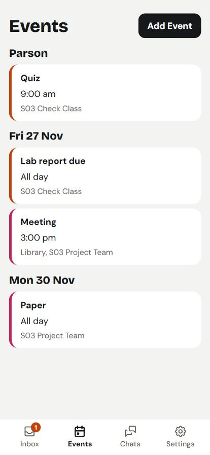
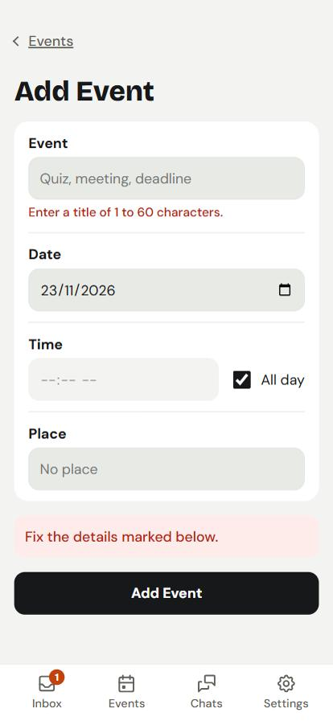
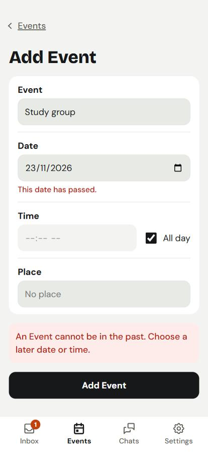
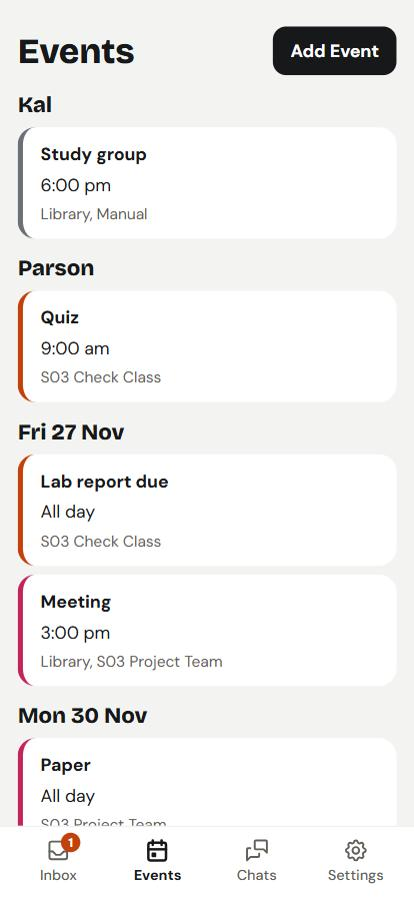
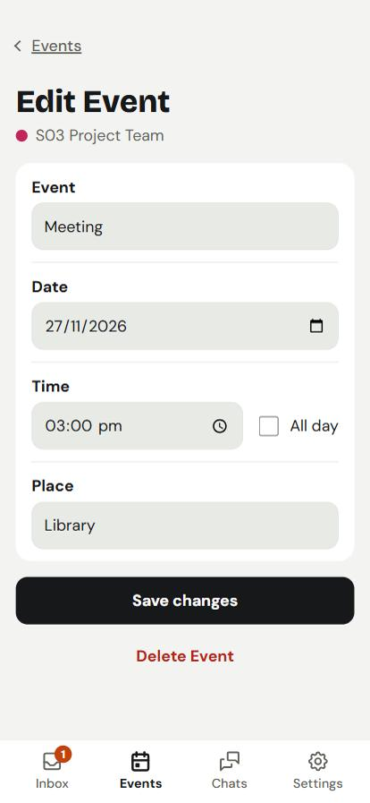
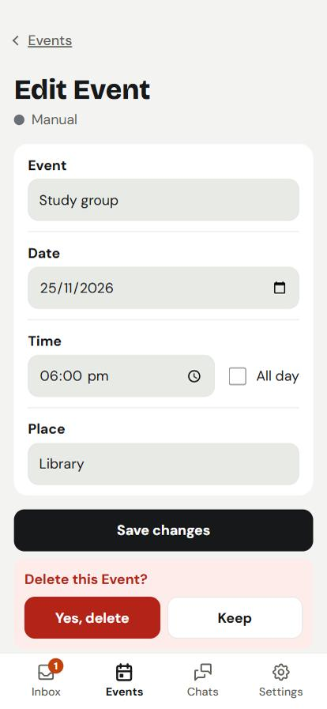

# S06: Manual Events; edit and delete a Confirmed Event

| Field | Value |
|---|---|
| Slice | S06 |
| Requirements | FR-07, FR-12, BR-16, BR-11; AC-07.1, AC-07.2, AC-12.1 (Event part), AC-12.2 (Event part) |
| Plan version used | v05 |
| Lead | Muhammad Areeb (proposed, O-7); session directed by Abdul Hannan Rauf |
| Mode | AFK (same rules as S04, no new risk) |
| Agent | Claude Code (Opus 5.5) |
| Branch | `slice/S06-manual-events` |
| Date | 24 Nov 2026 |

## 1. Select

S05 cannot be accepted until a real iPhone export with names replaced is in `fixtures/exports/real/` (O-3), so S06 runs first. S07 (Reminders) needs Confirmed Events that can be created, edited and deleted, because each of those changes a Reminder.

## 2. Context loaded

PRD GL-10, GL-11, FR-07, FR-12, BR-16, AC-07.1, AC-07.2, AC-12.1, AC-12.2; architecture 5.2 (`events` owns Confirmed and Manual Events), 6.1 (`createManual`, `editConfirmed`, `deleteConfirmed`), 6.2 (`POST /events`, `PATCH /events/:id`, `DELETE /events/:id`), 6.3 and 8 (`EventUpdated` and `EventDeleted` move or cancel Reminders and calendar copies; Manual Events are grey); `docs/design/ui-direction.md` (Manual colour, errors under the field). The Reminder and calendar parts of AC-12.1 and AC-12.2 close in S07 and S11 (`plan.md` note `*`).

## 3. Criteria and tests (agreed before coding, Gate 1)

| ID | Criterion | Test |
|---|---|---|
| S06-1 (AC-07.1) | A title and a future date create a Confirmed Event shown as "Manual" in the Events list | `events` route test |
| S06-2 (AC-07.2) | An empty title or a past date is refused, and the refusal names the field and says why | `events` route test |
| S06-3 (BR-16) | A Manual Event today is allowed All-day or at a time not yet passed, and refused at a time already passed | `events` service test |
| S06-4 (AC-12.1, Event part) | Editing a Confirmed Event's time changes it in the Events list and the order follows | `events` route test |
| S06-5 (AC-12.2, Event part) | Deleting a Confirmed Event removes it; reading, editing or deleting it again answers 404 | `events` route test |
| S06-6 (BR-16) | An edit that makes the Event past is refused; title, place, date and time follow the same limits as review (S04-9) | `events` route test |
| S06-7 | Editing keeps the Source Chat name and colour; a Manual Event stays "Manual" | `events` route test |
| S06-8 (BR-11) | Another User's Confirmed Event cannot be read, edited or deleted (404) | route test "two Users" |
| S06-9 | Events screen: "Add Event" opens the form; each Event opens an edit form with Save and a two-step Delete; errors sit under the field | Manual check at 375 x 812, screenshots |

### EP and BVA

| Input | Class or boundary | Expected |
|---|---|---|
| Title (trimmed) | missing or empty / 1 / 60 / 61 characters | 400 / accepted / accepted / 400 |
| Date | missing / yesterday / today / tomorrow / 2026-02-30 | 400 / 422 PAST / accepted / accepted / 400 |
| Time, date today | 1 minute ago / this minute / later / null (All-day) | 422 PAST / accepted / accepted / accepted |
| Place | missing or empty / 40 / 41 characters | no place / accepted / 400 |
| Edit fields | none sent / some sent | unchanged / only those change |
| Owner | own / another User's id / unknown or malformed id | acts / 404 / 404 |

## 4. HITL or AFK

AFK: the gate and validation rules are the ones accepted in S04. The human reviews the diff, tests and screenshots at Accept.

## 5. AI implementation

Prompt: "Start S06 from plan.md v05 and the criteria in this file, following AGENTS.md: in `events`, create a Manual Event, read, edit and delete a Confirmed Event, with the same field limits as review and the BR-16 past rule; in the PWA, Add Event on the Events screen and one form for adding and editing, with Save and a two-step Delete. No Reminders, calendar or outbox work yet. No extra features."

What the agent built:
- `events` service: `readDetails` (the title, date, time and place limits, now shared by review, create and edit), `createManual`, `getConfirmed`, `editConfirmed` (locks the row, merges only the details sent, checks BR-16, one transaction), `deleteConfirmed`. No migration: `confirmed_events` from S04 already allows a null Source Chat.
- `events` repository: `getConfirmed`, `updateConfirmed`, `deleteConfirmed`, each filtered by `userId`.
- Routes: `POST /api/events` (201), `GET /api/events/:id`, `PATCH /api/events/:id`, `DELETE /api/events/:id` (204). Invalid details answer 400 with the fields; a past result answers 422 `PAST` with the field; unknown, malformed and other Users' ids answer 404.
- PWA: `EventFormPage` for `/events/new` and `/events/:id` (Event, Date, Time with All day, Place; errors under each field; Source Chat or "Manual" under the heading; "Delete Event" opens "Delete this Event?" with "Yes, delete" and "Keep"). Events screen has an "Add Event" button and each card opens its edit form.

Design choices for the human to review:
- An edit sends only the details the User changed; the Source Chat name and colour never change, and a Manual Event stays Manual.
- A Manual Event today may be All-day or at the current minute or later, the same rule as confirm (BR-16).
- Delete is immediate after the second step. There is no undo, because S07 will cancel the Reminder and S11 will remove the calendar copy when the Event is deleted.

Known limits (each closed by a later slice):
- No `EventConfirmed`, `EventUpdated` or `EventDeleted` outbox message yet; each place has a `// shortcut:` comment. S07 adds the outbox and Reminders, S11 the calendar copy. The Reminder and calendar parts of AC-12.1 and AC-12.2 close there.

## 6. Checks

- Local against the Neon `dev` branch: **139 passed, 2 skipped** (`evidence/test-runs/S06-2026-11-24-neon-dev.txt`). New: 10 tests in `events/manual.test.ts` (S06-1 to S06-8 and the EP/BVA table). The BR-16 "today" boundaries (one minute ago, this minute, one minute later, All-day, yesterday) call the service with a fixed time, so they do not depend on when CI runs.
- Lint (boundary rules), typecheck and build clean.
- Manual check at 375 x 812, local PWA and API on Neon `dev`, test account only:
  - Events shows "Add Event" beside the heading.
  - Add Event with no title: "Enter a title of 1 to 60 characters." under Event.
  - Title "Study group" on 23 Nov: "This date has passed." under Date and the BR-16 message.
  - 25 Nov at 6:00 pm, place Library: the Event appears under "Kal" with the grey Manual bar and "Library, Manual".
  - Meeting (S03 Project Team) opens "Edit Event" with its Chat dot and name; time changed to 8:00 am shows in the list.
  - "Delete Event" on Study group asks "Delete this Event?" with "Yes, delete" and "Keep"; after "Yes, delete" it is gone from the list.
  - Every input has a label; no horizontal scroll.

| Events | Title error | Past refused | Manual in list | Edit form | Edited time | Delete step | After delete |
|---|---|---|---|---|---|---|---|
|  |  |  |  |  |  |  |  |

Found and fixed during the manual check:
- The form message said "Fix the details marked below" but sits under the fields; it now says "above" (also on the review screen).
- The Events tab was not highlighted on the add and edit forms; only the Inbox tab now needs an exact path match.
- The message about a refused save stayed after the User changed a field; it now clears on change.
- CI on PR #6 (Postgres 17): green, including the `evaluate.py` detection step.
- Deployed preview (https://kalender-ei86sxow2-hannan-f17c.vercel.app, Neon `dev`), driven with `vercel curl` and a new test account: create "Group study" tomorrow 18:00 at Library 201 (Source Chat null); yesterday 422 `PAST` naming the date; empty title 400 naming the title; edit time to 20:00 200 with the other details unchanged; `GET /api/events` lists it; delete 204; read after delete 404; signed out 401.
