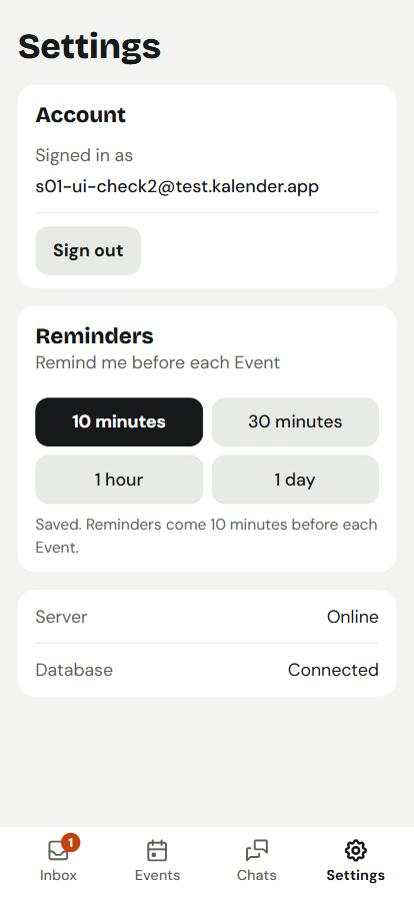
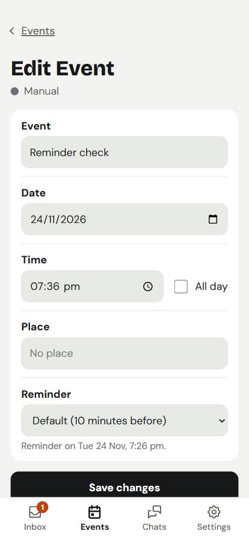
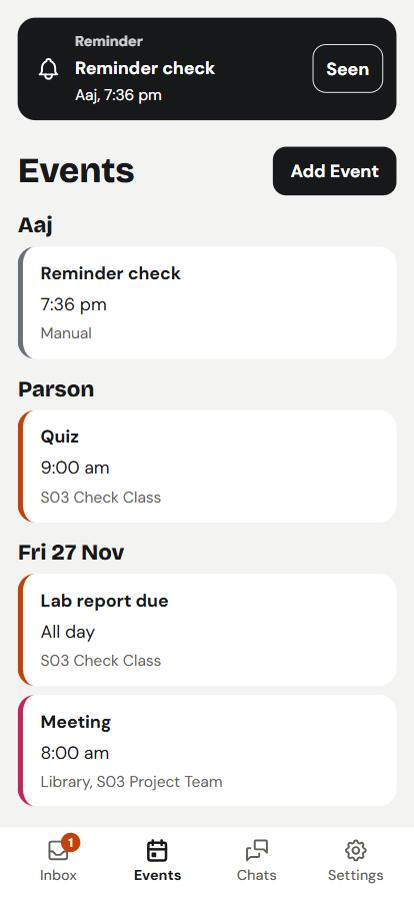
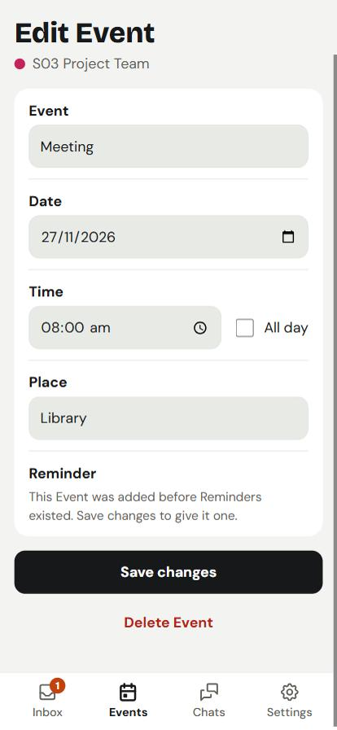
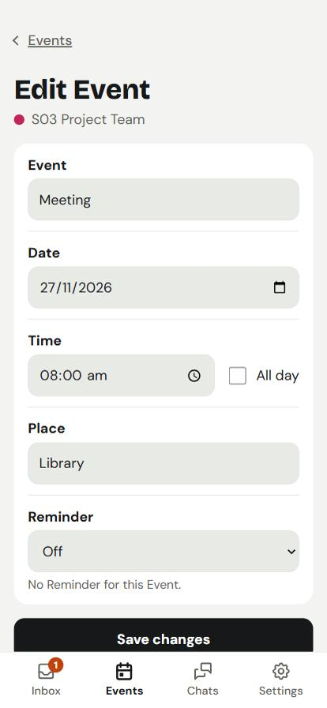

# S07: Jobs, tick, in-app Reminders, Lead Time, timed deletions

| Field | Value |
|---|---|
| Slice | S07 |
| Requirements | FR-09 (in-app part), FR-10, BR-05, BR-07, BR-08, BR-14, BR-19, NFR-03; AC-09.1..09.5, AC-10.1..10.4, AC-05.11, AC-06.6, plus the Reminder part of AC-12.1 and AC-12.2 |
| Plan version used | v06 |
| Lead | Abdul Hannan Rauf |
| Mode | HITL (new scheduled work, new tables, a new secret, an external timer) |
| Agent | Claude Code (Opus 5.5) |
| Branch | `slice/S07-reminders` |
| Date | 24 Nov 2026 |

## 1. Select

S07 is the next Must slice. S09 (delete account), S10 (push) and S11 (Google Calendar) all depend on it, because each one needs jobs, the outbox or the tick. S06 is accepted, so Confirmed Events can now be created, edited and deleted, and each of those changes a Reminder.

## 2. Context loaded

- PRD: GL-15, GL-16, GL-20 and GL-21; FR-09 and FR-10; MF-05; BR-05, BR-07, BR-08, BR-14 and BR-19; NFR-03; AC-09.x, AC-10.x, AC-05.11, AC-06.6, AC-12.1 and AC-12.2.
- ADR-002: the tick every minute, the transactional outbox, the order outbox, then jobs, then tick tasks, the 10-minute late window, and housekeeping. ADR-005: `System` repository functions.
- architecture.md:
  - 5.2: `jobs` owns jobs, outbox and outbox_deliveries; `reminders` owns reminders, reminder_settings and in_app_notifications.
  - 6.1: the interfaces and outbox messages.
  - 6.2: `PUT /events/:id/reminder`, `GET/PUT /settings/reminders`, `GET /notifications`, `POST /notifications/:id/seen` and `POST /internal/tick`.
  - 6.3: the tick order and dispatching before the response.
  - 8: Reminder copies and retention.
  - 14 and 15: Q-1, Q-8, Q-10, Q-11, Q-23, Q-28 and R2-1; the tick uses a Bearer header and answers 404 on a mismatch; one `reminders` row per Confirmed Event.
- AGENTS.md section 4, rules 2 and 7.

## 3. Criteria and tests (agreed before coding, Gate 1)

| ID | Criterion | Test |
|---|---|---|
| S07-1 (AC-09.1) | A Confirmed Event at 15:00 with a 30-minute Lead Time gets a Reminder Time of 14:30. A tick at 14:29 presents nothing, and a tick at 14:30 creates the in-app notification with its scheduled and actual times. | `reminders` and `jobs` test with a fixed clock |
| S07-2 (AC-09.2, AC-12.2 Reminder part) | Deleting a Confirmed Event cancels its Reminder. Even when `EventDeleted` is still in the outbox at tick time, nothing is presented, because the outbox runs first (R2-1). | tick test |
| S07-3 (AC-09.3) | A due Reminder is presented inside the app (`GET /api/notifications`) without any push setup, and "Seen" marks it. | route test |
| S07-4 (AC-09.4, BR-08) | An Event at 15:00 confirmed at 14:45 gets no Reminder. An edit or Lead Time change that puts the Reminder Time in the past schedules none. | service test |
| S07-5 (AC-09.5, BR-07) | An All-day Event with the default Lead Time is reminded at 08:30 PKT on its date. A 1-day Lead Time gives 09:00 the day before. | service test |
| S07-6 (AC-10.1) | After the default changes to 1 hour, a newly confirmed Event is reminded 1 hour before. | route test |
| S07-7 (AC-10.2) | Turning off one Event's Reminder means it is never presented, and turning it back on schedules it again. | route and tick test |
| S07-8 (AC-10.3, AC-10.4, BR-19, Q-28) | A default change moves every Upcoming Event that uses the default. An Event with its own Lead Time keeps it. | route test |
| S07-9 (AC-12.1 Reminder part) | Editing an Event's time moves its Reminder. | tick test |
| S07-10 (NFR-03, Q-23) | A Reminder found up to 10 minutes late is presented and marked late. One more than 10 minutes late is recorded as missed and shown in-app as missed. Each row keeps `reminder_at` and `delivered_at`. | tick test |
| S07-11 (idempotency) | Two ticks at the same minute, or one tick run twice, present each Reminder once, and each outbox message reaches each subscriber once. | tick test |
| S07-12 (AC-06.6, BR-14) | An unreviewed dated Detected Event, and its Source Message if no other Detected Event uses it, is removed at the end of its date (00:00 PKT the next day). Confirming or dismissing cancels that job. | `events` job test |
| S07-13 (AC-05.11, BR-05) | A "Needs date" Detected Event, and its Source Message, is deleted 7 days after the message was sent. | `events` job test |
| S07-14 | `POST /internal/tick` without the right `Authorization: Bearer <TICK_SECRET>` answers 404 and runs nothing. With it, the tick runs and answers with counts only. | route test |
| S07-15 (BR-11) | Another User's Event Reminder, Lead Time and notifications cannot be read or changed (404). | route test "two Users" |
| S07-16 | Settings shows the default Lead Time (10 min, 30 min, 1 hour, 1 day). The Event form shows the Reminder (default, a set Lead Time, or Off). Due Reminders appear in the app with "Seen". | Manual check at 375 x 812, screenshots |

### EP and BVA

| Input | Class or boundary | Expected |
|---|---|---|
| Tick time against Reminder Time | 1 minute before / exactly / +1 minute / +10 minutes / +11 minutes | nothing / presented / presented late / presented late / missed |
| Reminder Time against confirm time | before now / equal to now / after now | none (BR-08) / scheduled, sent on the next tick / scheduled |
| Lead Time | 10, 30, 60, 1440 / 0, 15, 45, missing, text | accepted / 400 |
| Event time | timed / All-day (09:00 basis) | start minus Lead / 09:00 minus Lead |
| Event change | edit time or date / delete / Reminder off then on | moved / cancelled / cancelled then rescheduled |
| Default change | Event on default / Event with its own Lead / past Event | moved / kept / unchanged |
| Detected Event expiry | dated, before the end of its date / at 00:00 PKT next day; Needs date, 7 days minus 1 minute / exactly 7 days | kept / removed; kept / removed |
| Tick secret | missing / wrong / right | 404 / 404 / 200 |
| Owner | own / another User's Event or notification / unknown id | acts / 404 / 404 |

## 4. HITL or AFK

HITL. Decisions for the human before coding:

1. **New tables:**
   - migration 005 for `jobs`: `jobs`, `outbox` and `outbox_deliveries`;
   - migration 006 for `reminders`: `reminder_settings`, `reminders` and `in_app_notifications`.

   `reminders` keeps a copy of the title, date and time to show the notification (architecture section 8). It stores no message text.
2. **A new secret, `TICK_SECRET`.** It must be set in Vercel for Preview and Production. A cron-job.org job must also call `POST /internal/tick` every minute with that header (O-5). The person who owns the cron-job.org account sets that job up. NFR-03 evidence on production needs it.
3. **In-app Reminders:**
   - due Reminders show at the top of every screen as a card with the title, the time and "Seen";
   - the PWA asks `GET /api/notifications` when the screen changes and every 30 seconds while it is open;
   - "presented" means the notification row exists (Q-23).

   Push comes in S10.
4. **The per-Event Reminder is set on the Event edit form.** Confirming from the review screen uses the default Lead Time. The Reminder row on the review screen in ui-direction.md is left for S13 polish.
5. **`events` now publishes `EventConfirmed`, `EventUpdated` and `EventDeleted`** through the outbox, in the same transaction, replacing the S04 and S06 shortcuts. Routes dispatch before they respond (2-second budget, 5 messages). It also enqueues and cancels the expiry jobs for Detected Events.

**Gate 1:** Abdul Hannan Rauf approved the criteria and decisions 1 to 5 on 24 Nov 2026 ("Approve, build it"). He also approved the agent generating `TICK_SECRET` and adding it to `.env.local` and to Vercel Preview and Production without printing it ("Yes, add it").

## 5. AI implementation

Prompt: "Build S07 from plan.md v06 and the agreed criteria in this file, following AGENTS.md and ADR-002. Add a `jobs` module (job table, transactional outbox, per-subscriber deliveries, registry, tick in the R2-1 order, `POST /internal/tick` with a Bearer secret answering 404 on mismatch). Add a `reminders` module (Lead Time settings, one Reminder per Confirmed Event, BR-07, BR-08 and BR-19, in-app delivery with the NFR-03 times, late and missed per Q-23). In `events`, publish `EventConfirmed`, `EventUpdated` and `EventDeleted` in the same transaction, dispatch before responding, and queue and cancel the BR-05 and BR-14 expiry jobs. In the PWA, add the default Lead Time in Settings, the Reminder on the edit form, and in-app Reminder cards. No push and no Google work. No extra features."

What the agent built:
- **Migrations:**
  - `005_jobs_create_jobs_and_outbox.sql`: `jobs` (one pending row per type and dedupe key), `outbox` and `outbox_deliveries`;
  - `006_reminders_create_reminders.sql`: `reminder_settings`, `reminders` (with `reminder_at` and `delivered_at` as the NFR-03 record) and `in_app_notifications`.

  Neither has a foreign key to another module's table.
- **`shared/contracts/outbox.ts`:** the three Event messages. The snapshot also carries `at`, the confirm or edit time, so BR-08 decides against it and not against when the message is dispatched.
- **`jobs`:**
  - `enqueue`, `cancel`, `publish`, `dispatchOutbox` and `runDueJobs` (three tries, a minute apart);
  - `tick`, which runs the outbox first, then due jobs, then tick tasks;
  - housekeeping that removes finished rows after 7 days;
  - the tick route, which compares the secret in constant time.

  It imports no module, and a new lint rule enforces that.
- **`reminders`:**
  - outbox subscribers for confirm, edit and delete;
  - `deliverDue`: up to 1 minute after the Reminder Time counts as on time, up to 10 minutes as late, and later as missed. Each is recorded with its times and creates an in-app notification;
  - `setDefaultLeadTime`, which moves only undelivered Reminders that use the default;
  - `setEventReminder`, `getReminderStates`, notifications and Seen, and the 7-day notification purge.

  Routes: `GET/PUT /api/settings/reminders`, `PUT /api/events/:id/reminder`, `GET /api/notifications` and `POST /api/notifications/:id/seen`. A lint rule allows it to import only `jobs`.
- **`events`:**
  - the S04 and S06 shortcuts are replaced by outbox messages;
  - confirm, create, edit and delete routes dispatch before they respond (2 s, 5 messages);
  - `GET /api/events/:id` includes the Reminder state (the read-model exception);
  - one job type, `events.expireDetected`, removes a dated Detected Event at the end of its date and a Needs date one 7 days after the message. A review that changes the date moves the job, and confirm and dismiss cancel it.
- **PWA:**
  - Reminder cards at the top of every screen (bell, title, day and time, "Seen"; late and missed look quieter), loaded on every screen change and every 30 seconds while visible;
  - Settings has "Remind me before each Event" with 10 minutes, 30 minutes, 1 hour and 1 day;
  - the edit form has a Reminder select (Default, the four Lead Times, Off) with a line saying when the Reminder comes, or why there is none.

Design choices for the human to review:
- **Timing rules:**
  - Exactly 1 minute after the Reminder Time is still on time, which matches the NFR-03 window. Section 3 had "+1 minute → late"; the code and test S07-4 follow the PRD.
  - An Event confirmed in its Reminder Time's own minute is scheduled and shown on the next tick.
- **What moves a Reminder:**
  - A title-only edit keeps a Reminder that was already shown. A new date or time schedules it again.
  - A default change does not touch Reminders already shown.
- **Expiry jobs:** one job type for both expiry rules, in place of the two names in architecture 6.1 (`expireDetected`, `expireNeedsDate`). A review that adds a date then simply moves the same job.
- **Events confirmed before S07** have no Reminder row, because a `reminders` migration may not read `confirmed_events` (ADR-005). The edit form says "Save changes to give it one", and saving publishes `EventUpdated`, which creates the Reminder. Detected Events stored before S07 have no expiry job; new uploads do.

Known limits:
- Push is S10. The NFR-03 export script and the one-week measurement are S13.
- The production tick needs the cron-job.org job (O-5), which the account owner sets up. Until then, production presents Reminders only when something calls the tick.
- A failing outbox message is retried on every tick without a limit (a `// shortcut:` in `jobs`). S11 adds per-subscriber retries for Google calls.
- `identity.purgeExpiredSessions` is not registered yet. Expired sessions are already refused at sign-in time; S09 wires the purge with account deletion.

## 6. Checks

- Local against the Neon `dev` branch: **156 passed, 2 skipped** (`evidence/test-runs/S07-2026-11-24-neon-dev.txt`).
  - New: 16 tests in `server/test/reminders.test.ts` (S07-1 to S07-15 and the EP/BVA rows) and one boundary-rule test for `jobs` and `reminders`.
  - The tests tick at fixed instants in June 2020, so a test tick only reaches rows those tests made. The tick-route test pins `Date` the same way, because test files run in parallel.
  - The run applied migrations 005 and 006 to Neon `dev`.
- Lint (boundary rules, now including `jobs` and `reminders`), typecheck and build clean.
- Manual check at 375 x 812, local PWA and API on Neon `dev`, test account only:
  - Settings shows "Remind me before each Event"; choosing 10 minutes says "Saved. Reminders come 10 minutes before each Event."
  - Added "Reminder check" today at 7:36 pm. Its edit form showed "Default (10 minutes before)" and "Reminder on Tue 24 Nov, 7:26 pm", so the route dispatched before answering.
  - A local tick at 7:26:05 pm with the secret answered `"reminders.deliverDue":1`. The same call without the secret answered 404.
  - The Reminder card appeared at the top of Events ("Reminder", "Reminder check", "Aaj, 7:36 pm", "Seen"), and Seen removed it.
  - "Meeting", confirmed in S03 before Reminders existed, said so. Save gave it a Reminder ("Reminder on Fri 27 Nov, 7:50 am"), and Off then showed "No Reminder for this Event."
  - The default was set back to 30 minutes afterwards.

- CI on PR #7 passed (lint, typecheck, tests on Postgres 17, build).
- Deployed preview (https://kalender-abczsf4au-hannan-f17c.vercel.app, Neon `dev`), driven with `vercel curl` and a new test account:
  - health 200 with `db: ok`; register 201;
  - `GET /api/settings/reminders` gives the default 30; `PUT` 10 answers 200, and `PUT` 15 answers 400 naming the four choices;
  - "Seminar" tomorrow at 18:00 created (201). `GET /api/events/:id` shows the Reminder `scheduled` for 17:50 PKT, so the route dispatched before answering;
  - Reminder set to 1 day: 200 with status `none`, because that time (today 18:00) had already passed (BR-08). Off: 200 with status `off`;
  - `GET /api/notifications` 200 with an empty list;
  - `POST /internal/tick` with no secret and with a wrong secret both answer 404. With the Preview `TICK_SECRET` it answers 200 and ran the job queue, which shows the secret is set in Preview;
  - delete 204; signed out, `/api/notifications` answers 401.

| Settings | Edit form | Reminder card | Before S07 | Off |
|---|---|---|---|---|
|  |  |  |  |  |

Found and fixed during the manual check: an Event confirmed before S07 showed only "it has none". The form now tells the User to save, which creates the Reminder.

## 7. Human decision

**Accept**, Abdul Hannan Rauf, 24 Nov 2026 ("Accept, merge and tag"). Reason: criteria S07-1 to S07-16 pass in CI, against Neon `dev`, on the deployed preview and in the manual phone-size check; the known limits (push in S10, calendar copies in S11, Events from before S07) are accepted. The plan had O-5, the cron-job.org tick, as a condition for accepting S07. It is not set up yet. The slice was accepted without it, and `plan.md` v07 moves O-5 to before Gate 5.

## 8. Integrate

PR #7 merged into `main` with a merge commit, tagged `S07-accepted`; CI on `main` is Gate 4. The production build applies migrations 005 and 006 to the Neon `production` branch.

After merge: CI on `main` passed at `194ebb1`. Production deployment `kalender-busz82ypy` is aliased to https://kalender-tan-eta.vercel.app; its build log shows `migrate: applied 2 (005_jobs_create_jobs_and_outbox.sql, 006_reminders_create_reminders.sql)`. `/api/health` answers `{"status":"ok","db":"ok"}`, `/api/settings/reminders` and `/api/notifications` answer 401 when signed out, and `POST /internal/tick` without the secret answers 404.

## 9. Context updated

`plan.md` v07 (copy in `docs/plan-history/plan-v07.md`): S07 Accepted, O-5 moved to before Gate 5. Row 9 added to `evidence/workflow-evidence-log.md`.
