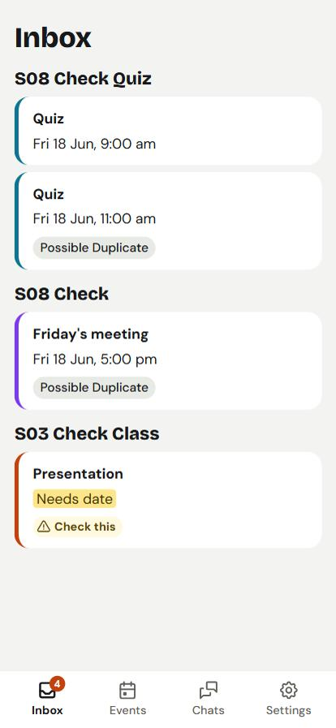
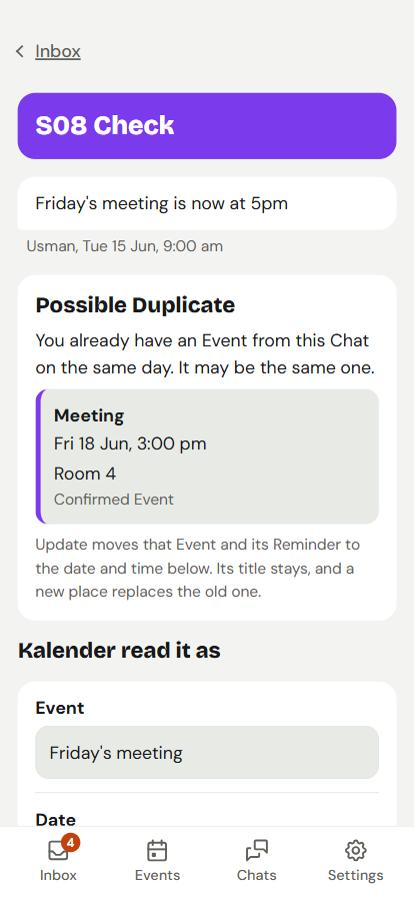
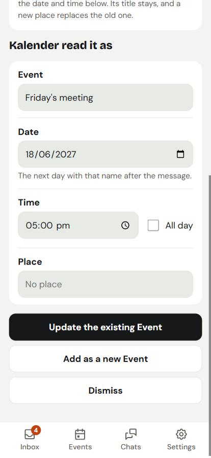
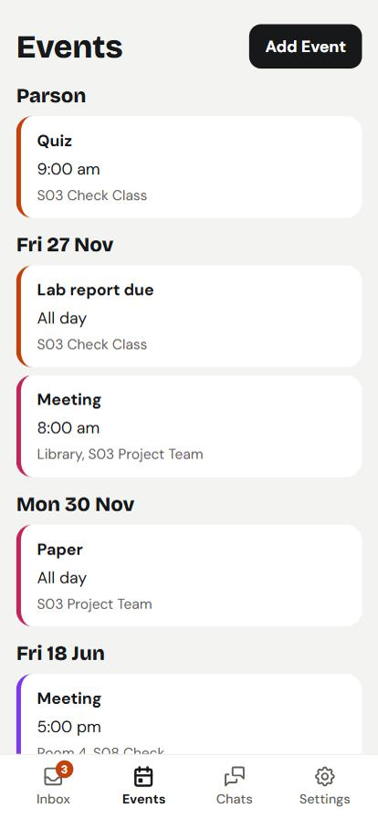
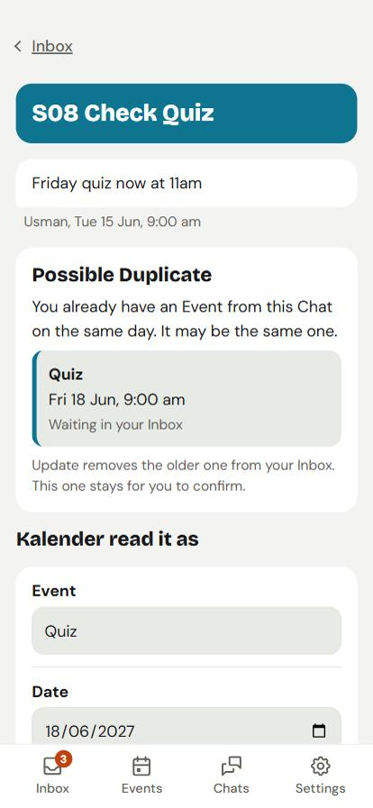
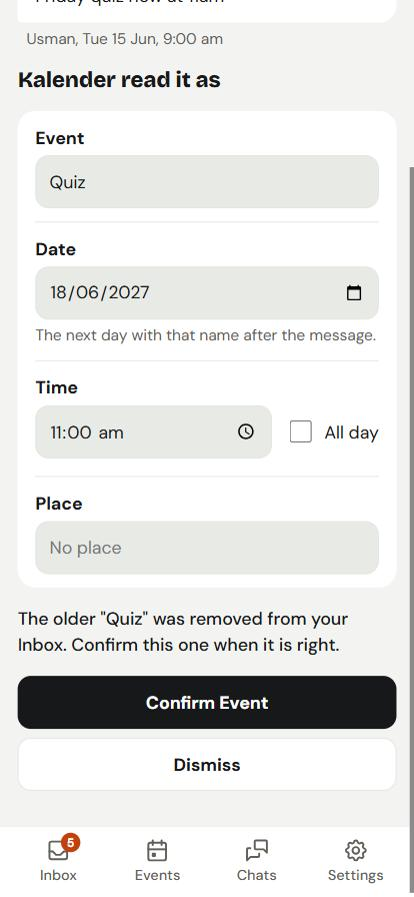

# S08: Possible Duplicate: add new, update existing, or dismiss

| Field | Value |
|---|---|
| Slice | S08 |
| Requirements | FR-05 (Possible Duplicate mark), FR-06 (duplicate choice), BR-04, BR-13, BR-11; AC-05.10, AC-06.4 (Event and Reminder part) |
| Plan version used | v08 |
| Lead | Zain Amjad (plan owner); session directed by Abdul Hannan Rauf |
| Mode | AFK build after Gate 1. Gate 1 asks one rule question about BR-13 (section 4) |
| Agent | Claude Code (Opus 5.5) |
| Branch | `slice/S08-possible-duplicate` |
| Date | 24 Nov 2026 |

## 1. Select

S08 is the last Must slice on the review flow. S04 (review, confirm, dismiss), S05 (updates read new messages from the same Chat) and S07 (Reminders follow `EventUpdated`) are accepted. An update of a Chat is exactly when a changed plan ("Friday's meeting is now at 5pm") arrives, so the hint is needed before the demo.

## 2. Context loaded

- PRD: GL-13 (Possible Duplicate), FR-05, FR-06, BR-04, BR-13, the known limit "matching uses only Source Chat and date" (section 7), AC-05.10, AC-06.4.
- architecture.md:
  - 5.2: `events` owns `detected_events`, `source_messages` and `confirmed_events`, so the match is one query inside `events`;
  - 6.1: `resolveDuplicate`; 6.2: `POST /detected-events/:id/duplicate`;
  - 8: Source Chat is the Chat id (a Revoked and re-approved Chat is a new Source Chat);
  - 15: "Possible Duplicate computed on read" (no new column or table);
  - R2-14: an edited boundary-minute message may be read twice, and this hint covers it.
- AGENTS.md section 4 rule 2: updating a Confirmed Event publishes `EventUpdated` in the same transaction; `events` never calls `reminders`.
- The calendar part of AC-06.4 closes in S11, when `calendar-sync` subscribes to `EventUpdated` (`plan.md` note `*`).

## 3. Criteria and tests (agreed before coding, Gate 1)

| ID | Criterion | Test |
|---|---|---|
| S08-1 (AC-05.10, BR-04) | A Confirmed Event on Fri 23 Oct 2026 from Chat A ("Meeting Friday 3pm in Room 4"). When "Friday's meeting is now at 5pm" is read from Chat A, the new Detected Event is marked Possible Duplicate, and the Inbox list and review detail show the existing Event (title, date, time, place, Confirmed). | `events` route test |
| S08-2 (BR-13) | The same message read from Chat B, a Manual Event on the same date, and a Confirmed Event from Chat A one day before or after are not matches. | `events` route test |
| S08-3 (BR-04) | Two Detected Events from Chat A on the same date: only the one whose message was sent later is marked, and it shows the earlier one (Detected). A "Needs date" Detected Event is never marked. | `events` route test |
| S08-4 (AC-06.4, BR-13) | "Update the existing Event" on S08-1: the Confirmed Event keeps its id and title, and takes 23 Oct 17:00 and keeps "Room 4", because the new message gives no place (decision 2a). No new Confirmed Event is created. The Detected Event, its Source Message and its expiry job are removed. `EventUpdated` is published, and the Reminder moves to 16:30. | `events` route test and tick |
| S08-5 (BR-13) | "Update the existing Event" when the existing one is a Detected Event: the older Detected Event is replaced, which means it is removed with its Source Message (if unused) and expiry job. The new one stays in the Inbox for review. | `events` route test |
| S08-6 (FR-06, BR-21, BR-16) | Updating is refused like Confirm when an Uncertain detail is not reviewed (`NEEDS_REVIEW`) or the new time has passed (`PAST`). Nothing changes. | `events` route test |
| S08-7 | Updating is refused with `NOT_DUPLICATE` (422) when the Event named is no longer a match, for example after the date was changed in review, or it was deleted. Nothing changes. | `events` route test |
| S08-8 (FR-06) | "Add as a new Event" confirms the Detected Event as usual, so the User has two Events. "Dismiss" removes it as usual. | `events` route test |
| S08-9 (BR-11) | Another User's Confirmed Event on the same Chat id and date is never a match. Another User's Detected Event id answers 404 on `/duplicate`, and an Event id from another User is `NOT_DUPLICATE`. | `events` route test "two Users" |
| S08-10 | A choice other than add, update or dismiss, or update without `existingId`, answers 400. | `events` route test |
| S08-11 | The Inbox card shows "Possible Duplicate". The review screen shows the existing Event and three choices: "Update the existing Event", "Add as a new Event" and "Dismiss". | Manual check at 375 x 812, screenshots |

### EP and BVA

| Input | Class or boundary | Expected |
|---|---|---|
| Existing Event's Source Chat | same Chat id / other Chat / Manual (no Chat) / same name after Revoke and re-approve | match / no match / no match / no match (new Chat id, architecture 8) |
| Existing Event's date | day before / same day / day after; new Event Needs date | no match / match / no match; never a match |
| Existing Event's kind | Confirmed / earlier Detected / later Detected | match / match / no match (the later one carries the mark) |
| Existing Event's owner | same User / other User | match / no match |
| Choice | add / update / dismiss / other / missing | confirm / update / dismiss / 400 / 400 |
| Update gate | no Uncertain marks and future time / Uncertain mark left / time passed / not a match any more | updated / `NEEDS_REVIEW` / `PAST` / `NOT_DUPLICATE` |

## 4. HITL or AFK

AFK build: no new table, dependency, module or interface used by another module. `events` gains `resolveDuplicate` and one route, both already named in architecture 6.1 and 6.2.

Decisions for the human before coding:

1. **Matching is computed on read** (architecture 15) by one query in `events`. When several Events match, one is shown: a Confirmed Event first (the most recently confirmed), otherwise the latest earlier Detected Event. "Existing" for two Detected Events means the one whose message was sent earlier; the later one is marked.
2. **BR-13 rule question: what "takes the new date, time and place" does when the new message gives no place.** In AC-05.10 the new message ("Friday's meeting is now at 5pm") has no place, and the existing Event has "Room 4". Options:
   - (a) keep the existing place when the new Detected Event has none, and take the new place when it has one. Date and time are always taken; a missing time is already an Uncertain mark (U8) that the User reviews first. **Recommended:** a follow-up message that only moves the time should not erase the room.
   - (b) take all three as they are, so the place becomes empty.
3. **Updating needs the same gate as Confirm** (FR-06, BR-21, BR-16): every Uncertain detail reviewed, and the result not past. Otherwise a duplicate could change a Confirmed Event with details the User never checked.
4. **The title of the existing Event is kept.** BR-13 lists only date, time and place.
5. **The PWA sends `existingId`**, the Event the User saw, so an update never lands on a different Event than the one shown.
6. **Review screen:** a "Possible Duplicate" panel above the details shows the existing Event. Its three buttons replace Confirm and Dismiss. Edits in the details are saved first, as with Confirm. The Inbox card gets a "Possible Duplicate" chip.

**Gate 1:** Abdul Hannan Rauf approved the criteria and decisions 1 and 3 to 6 on 24 Nov 2026 ("Approve, build it"), and chose 2(a) for BR-13 ("Keep old place"). The reading is recorded as D-28 in `docs/decisions.md`.

## 5. AI implementation

Prompt: "Build S08 from plan.md v08 and the agreed criteria and decisions in this file, following AGENTS.md. In `events`, compute the Possible Duplicate on read (same User, Source Chat id and date; Confirmed first, else an earlier Detected Event), return it with each Detected Event, and add `POST /detected-events/:id/duplicate` with add, update and dismiss. Update follows BR-13 and D-28 and publishes `EventUpdated` in the same transaction. In the PWA, add the Inbox chip and the review panel with three choices. No new table, dependency or module."

What the agent built:
- **`events` repository:** one `left join lateral` (`DUPLICATE_JOIN`) used by `listDetected` and `getDetected`. It unions the User's Confirmed Events and earlier Detected Events with the same `chat_id` and `date`, ranks Confirmed first, and keeps one row. Manual Events have no `chat_id`, and a "Needs date" Event has no date, so neither ever matches. No migration.
- **`events` service:**
  - each Detected Event view carries `possibleDuplicate` (kind, id, title, date, time, place) or `null`;
  - `confirmGate` is the FR-06, BR-21 and BR-16 check, now shared by `confirm` and the update; `removeDetected` is the BR-05 clean-up shared by confirm, dismiss and the update;
  - `updateExisting(userId, id, existingId, now)`: one transaction. It locks the Detected Event and checks that `existingId` is still its match (`NOT_DUPLICATE` otherwise). For a Confirmed Event, it applies the gate, takes the new date and time and the new place if there is one, keeps the title, removes the Detected Event and publishes `EventUpdated`. For an older Detected Event, it removes that one and returns the new one;
  - `review` reads the Event again after saving, so a changed date also changes the Possible Duplicate in the answer.
- **`events` routes:** `POST /api/detected-events/:id/duplicate` with `{ choice: 'add' }` (the Confirm handler), `{ choice: 'dismiss' }` (the Dismiss handler) or `{ choice: 'update', existingId }`. Refusals are 422 with `NEEDS_REVIEW`, `NEEDS_DATE`, `PAST` or `NOT_DUPLICATE`; a bad choice is 400; another User's id is 404.
- **PWA:**
  - Inbox card: a neutral "Possible Duplicate" chip in words (a hint, not a warning);
  - review screen: a "Possible Duplicate" panel under the message with the existing Event as a small card in the Chat colour, "Confirmed Event" or "Waiting in your Inbox", and one line on what Update does. The buttons are "Update the existing Event", "Add as a new Event" and "Dismiss". Edits are saved first, as with Confirm. While a detail is still Uncertain, the Update button for a Confirmed Event says "Check the time to update" and is disabled, like Confirm;
  - after replacing an older Detected Event the screen stays, the panel goes, and a status line says the older one was removed.

Design choices for the human to review:
- **Interface name.** Architecture 6.1 names the use case `resolveDuplicate`. The service function is `updateExisting`, because add and dismiss reuse `confirm` and `dismiss` and only the update is new. It is not exported from the module's `index.ts`, because no other module uses it.
- **The Confirm gate applies only when the existing Event is Confirmed.** Replacing an older Detected Event changes nothing the User has confirmed, and the new one still has to pass the gate when it is confirmed (S08-6 covers the Confirmed case).
- **Two Detected Events from one message on one date** (for example "quiz and viva Friday") mark each other in id order: the one with the larger id is marked. This is the BR-13 false positive the PRD accepts.

Known limits:
- The calendar copy part of AC-06.4 closes in S11, when `calendar-sync` subscribes to `EventUpdated`.
- The Inbox count on the bottom bar refreshes on the next screen change, so it is one too high right after a replace.
- A Revoked and re-approved Chat is a new Source Chat (architecture 8), so its old Confirmed Events are not matched.

## 6. Checks

- Local against the Neon `dev` branch (`evidence/test-runs/S08-2026-11-24-neon-dev.txt`): **174 passed, 12 failed, 2 skipped**. Lint, typecheck and build are clean.
  - 11 of the 12 failures are the 30-second test timeout, in S04, S06, S07 and S08 tests that each pass alone. The twelfth is S07-6, where the Reminder was not yet written when the route answered. Both are the Neon `dev` slowness already recorded in S05 section 6 as a risk for S13. No assertion about S08 behaviour failed.
  - The 13 new tests in `events/duplicate.test.ts` pass when run alone against Neon `dev` (11 first, then the 4 split S08-7 and S08-8 tests after two timed out with two setups each).
- Manual check at 375 x 812, local PWA and API on Neon `dev`, the local test account (approved by Abdul Hannan Rauf for this check). A script seeded one Confirmed Event and follow-ups in two fake Chats, "S08 Check" and "S08 Check Quiz", in June 2027. Afterwards a second script dismissed and deleted all of them through the `events` service (3 Detected Events dismissed, 2 Confirmed Events deleted).
  - The Inbox shows "Possible Duplicate" on "Friday's meeting" and on the later Quiz, not on the earlier Quiz or on the S03 "Needs date" card.
  - "Friday's meeting is now at 5pm" shows the existing Meeting, Fri 18 Jun, 3:00 pm, Room 4, Confirmed Event, and the three choices.
  - "Update the existing Event" opens Events, where Meeting is now 5:00 pm and still in Room 4 (D-28).
  - The later Quiz shows the earlier one as "Waiting in your Inbox". After Update the panel goes and Confirm comes back.

| Inbox | Confirmed match | Choices | After update | Detected match | After replace |
|---|---|---|---|---|---|
|  |  |  |  |  |  |

Found and fixed during the manual check:
- After replacing an older Detected Event, the clicked button disappeared and nothing said what happened. The screen now shows "The older "Quiz" was removed from your Inbox. Confirm this one when it is right." in a status line.
- CI on PR #9 (Postgres 17): green, including all 13 S08 tests and every S04, S06 and S07 test that timed out on Neon `dev`.
- Deployed preview (https://kalender-e2ahr3tzo-hannan-f17c.vercel.app, Neon `dev`), driven with `vercel curl` and a new throwaway account `s08-preview-<random>@test.kalender.app`:
  - approved "S08 Preview" with one message from 7:00 pm today, "Meeting Friday 3pm in Room 4", and confirmed it as Meeting, Fri 27 Nov 15:00, Room 4;
  - updated the Chat with a newer export that adds "Friday's meeting is now at 5pm" (7:30 pm). The new Detected Event lists `possibleDuplicate` as the Confirmed Meeting (AC-05.10);
  - `{"choice":"merge"}` answered 400; update with an unknown `existingId` answered 422 `NOT_DUPLICATE`;
  - update with the Meeting's id answered 200: the same id, title Meeting, 17:00, Room 4. The Events list holds only that Event, the Inbox is empty, and its Reminder is scheduled for 16:30 PKT (`2026-11-27T11:30:00Z`) (AC-06.4, D-28);
  - signed out, `/duplicate` answered 401.
