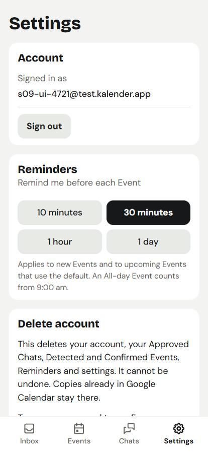
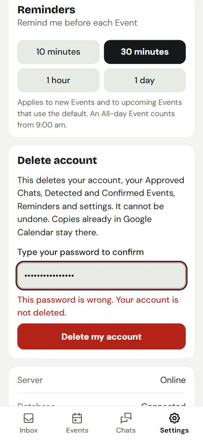
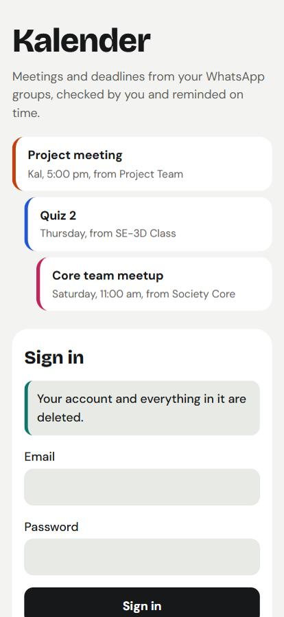
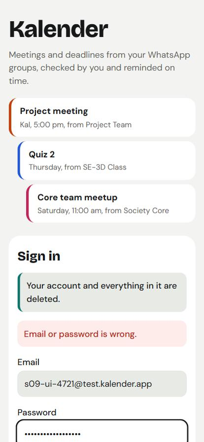

# S09: Delete the account and everything it owns

| Field | Value |
|---|---|
| Slice | S09 |
| Requirements | FR-13 (account part), MF-07, BR-11, NFR-01; AC-13.1, AC-13.3 (the Google token part closes in S11) |
| Plan version used | v09 |
| Lead | Muhammad Areeb (plan owner); session directed by Abdul Hannan Rauf |
| Mode | AFK build after Gate 1. Gate 1 asks one product question (section 4, decision 1) |
| Agent | Claude Code (Opus 5.5) |
| Branch | `slice/S09-delete-account` |
| Date | 25 Nov 2026 |

## 1. Select

S09 is the next Must slice. It depends on S07 (jobs and the tick), which is accepted. Every module that stores User data now exists except `calendar-sync` (S11), so account deletion can cover all stored data today, and S11 adds its own step.

## 2. Context loaded

- PRD: FR-13, MF-07 (deletion and its edge cases), AC-13.1, AC-13.3 (backups are deferred to design), NFR-01, BR-11.
- architecture.md:
  - 5.1: `identity` orchestrates account deletion;
  - 6.1: `deleteAccount(userId)`, each module's `deleteAllForUser`, the job handler `resumeAccountDeletion` and the tick task `purgeExpiredSessions`;
  - 6.2: `DELETE /account`;
  - 6.3: set `users.deletion_requested_at` first, then each module's step in its own transaction; publish no outbox messages; Google copies stay;
  - 8: what each module stores; sessions last 30 days;
  - 14 and 15: Q-24, R2-9.
- ADR-005: data ownership, `deleteAllForUser` in each module, backups out of scope.
- AGENTS.md section 4 rule 1: `identity` may call only `deleteAllForUser` of the other modules, plus `jobs`.
- Migration 001 already has `users.deletion_requested_at`, and sign-in and `requireUser` already refuse a User who has it.

## 3. Criteria and tests (agreed before coding, Gate 1)

| ID | Criterion | Test |
|---|---|---|
| S09-1 (AC-13.1) | After `DELETE /api/account` with the right password (204, cookie cleared), the old session gets 401 on `/api/me`, on approving a Chat and on updating one. Signing in with the same email and password gets 401. | cross-module route test |
| S09-2 (AC-13.3, NFR-01) | A User with an active and a Revoked Approved Chat, Detected Events with Source Messages, a Confirmed and a Manual Event, Reminders, a Lead Time setting, an in-app notification, a pending outbox message and pending jobs: after deletion, no row with that User's id is left in any table (`users`, `sessions`, `approved_chats`, `source_messages`, `detected_events`, `confirmed_events`, `reminders`, `reminder_settings`, `in_app_notifications`, `jobs`, `outbox`). | cross-module test |
| S09-3 (BR-11) | Another User's data of every kind is untouched. | same test, second User |
| S09-4 | A wrong or missing password answers 403 with a field message. Nothing is deleted and the User stays signed in. | route test |
| S09-5 (R2-9, Q-24) | Deletion survives a failure after the first step: the User is already refused, and the `identity.resumeAccountDeletion` job queued in that first transaction (5 minutes later) removes everything that is left. Running the steps twice is safe. | identity test |
| S09-6 (MF-07) | The same email can register again afterwards, and gets a new, empty account. | route test |
| S09-7 (architecture 8) | The tick task `identity.purgeExpiredSessions` deletes expired sessions and keeps current ones. | identity test |
| S09-8 | Settings has "Delete account": what is deleted, a password field, and a red "Delete my account" button. A wrong password shows its message under the field. After deletion the sign-in screen says the account was deleted. | Manual check at 375 x 812, screenshots |

### EP and BVA

| Input | Class or boundary | Expected |
|---|---|---|
| Password | right / wrong / empty / missing | 204 / 403 / 403 / 403 |
| Session | own, current / after deletion / none | acts / 401 / 401 |
| Data owner | the deleted User / another User | removed / kept |
| Approved Chat | active / Revoked (R2-15 keeps the row) | removed / removed |
| Step failure | none / after the first step | all removed at once / all removed by the job |
| Session expiry | 1 second ago / in 1 second | purged / kept |

## 4. HITL or AFK

AFK build: no new table, dependency or module. Each module gets the `deleteAllForUser` that architecture 6.1 already names.

Decisions for the human before coding:

1. **Product question: ask for the password again before deleting?** Options:
   - (a) the User types their password, and the server checks it. **Recommended:** deletion cannot be undone, and a phone is often left unlocked or shared;
   - (b) a two-step button only ("Delete account?" then "Yes, delete"), like Revoke.
2. **The `users` row is deleted last.** Its email is personal data (AC-13.3), so no record of the account is kept. The same email can register again as a new account.
3. **`jobs.deleteAllForUser` deletes the User's jobs and outbox rows in every state**, not only the pending ones (`cancelForUser` in architecture 6.3). Dispatched outbox rows still hold Event titles for up to 7 days, and AC-13.3 says none may stay.
4. **The order is:**
   - one transaction sets `deletion_requested_at` and queues `identity.resumeAccountDeletion` for 5 minutes later. The job has no `user_id`, so the jobs step leaves it alone;
   - then `jobs`, `chats`, `events` and `reminders`, each in its own transaction;
   - then the User's sessions and `users` row.

   The job always runs once, as a sweep. It finishes a deletion that failed half-way, and it also removes anything an upload that was already running wrote after its step.
5. **No outbox messages are published**, so Google Calendar copies stay (MF-06). `calendar-sync` does not exist yet. S11 adds `calendar-sync.deleteAllForUser` (best-effort token revoke, then delete) as one more step, and closes the token part of AC-13.3.
6. **`identity.purgeExpiredSessions`** is registered as a tick task now. S07 left it for this slice.
7. **Settings screen:** a "Delete account" section under the Account rows. It says what is deleted (Chats, Events, Reminders, settings and the account) and that copies already in Google Calendar stay.

**Gate 1:** Abdul Hannan Rauf approved the criteria and decisions 2 to 7 on 25 Nov 2026 ("Approve, build it"), and chose 1(a): the User types their password again ("Ask for password").

## 5. AI implementation

Prompt: "Build S09 from plan.md v09 and the agreed criteria and decisions in this file, following AGENTS.md. Add `deleteAllForUser` to `jobs`, `chats`, `events` and `reminders`. In `identity`, add `DELETE /account` that checks the password, marks the account in one transaction with the resume job, runs each module's step in its own transaction, then deletes the sessions and the `users` row. Register the resume handler and the `purgeExpiredSessions` tick task. In the PWA, add the Delete account section to Settings and a notice on the sign-in screen. No new table, dependency or module."

What the agent built:
- **Each data module:** `deleteAllForUser(db, userId)` in its repository, exported from its `index.ts` with a comment that only `identity` calls it:
  - `jobs`: every job and outbox row with the User's id, in any state (decision 3);
  - `chats`: Approved Chats, active and Revoked;
  - `events`: Detected Events, Source Messages and Confirmed Events;
  - `reminders`: Reminders, the Lead Time setting and in-app notifications.
- **`identity` service:**
  - `requestDeletion`: one transaction that sets `deletion_requested_at` (kept if already set) and queues `identity.resumeAccountDeletion` for 5 minutes later, with the User's id as the dedupe key and no `user_id`;
  - `finishDeletion`: the four module steps, then `deleteUser` (sessions go with the `users` row), each in its own transaction;
  - `deleteAccount`: checks the password with bcrypt, then `requestDeletion`, then `finishDeletion`. If a later step fails, the error is logged and the route still answers 204, because the User is already refused and the job finishes the rest;
  - `register`: the resume handler runs the same steps inside the job's transaction, and the tick task `identity.purgeExpiredSessions` deletes sessions whose `expires_at` has passed.
- **`identity` routes:** `DELETE /api/account` with `{ password }`. A wrong, empty or missing password answers 403 `wrong_password` with a field message. Success clears the session cookie and answers 204.
- **Lint rule:** `identity` may now import `chats`, `events`, `reminders`, `calendar-sync` and `jobs`, and nothing else (AGENTS.md section 4 rule 1). A boundary test guards it.
- **PWA:**
  - Settings: a "Delete account" section under Reminders. It says what is deleted and that copies already in Google Calendar stay, asks for the password, and has a red "Delete my account" button that says "Deleting…" while it works;
  - a wrong password shows "This password is wrong. Your account is not deleted." under the field;
  - after deletion the app goes to the sign-in screen, which says "Your account and everything in it are deleted."

Design choices for the human to review:
- **The route answers 204 even if a step after the first fails.** The User can no longer sign in, and the job removes the rest within about 5 minutes (R2-9). Answering 500 would tell the User their account still exists, which is not true for them.
- **The resume job always runs**, even after a clean deletion. It then finds nothing and does nothing. This also covers an upload that was running during deletion and wrote rows after the `chats` and `events` steps.
- **`purgeExpiredSessions` uses `expires_at <= now`**, so a session is purged at the exact second it expires, the same second `requireUser` stops accepting it.

Known limits:
- `calendar-sync` does not exist yet. S11 adds its `deleteAllForUser` (revoke the Google token, then delete it) as one more step, and closes the token part of AC-13.3.
- Backups are out of scope (ADR-005). Neon keeps its own point-in-time history for the branch's retention window.
- There is no "Forgot password" yet, so a User who forgot their password cannot delete their account from the app.

## 6. Checks

- Local against the Neon `dev` branch (`evidence/test-runs/S09-2026-11-25-neon-dev.txt`): **191 passed, 2 failed, 2 skipped**. Lint, typecheck and build are clean.
  - Both failures are the 30-second test timeout in S09-2 and S09-5, the two tests that seed a User with data of every kind (S09-2 seeds two). Both passed when the S09 file ran alone against Neon `dev` earlier the same day. This is the Neon `dev` slowness already recorded in S05 section 6 as a risk for S13. No assertion failed.
  - Every S04, S06, S07 and S08 test that timed out in the S08 run passed this time.
- Manual check at 375 x 812, local PWA and API on Neon `dev`. As approved by Abdul Hannan Rauf ("Throwaway, sign back in"), the local test account was signed out, a new throwaway account `s09-ui-<random>@test.kalender.app` was created and deleted, and the test account was signed in again afterwards.
  - Settings shows the Delete account section under Reminders.
  - A wrong password shows "This password is wrong. Your account is not deleted." under the field, and the User stays on Settings.
  - The right password goes to the sign-in screen, which says "Your account and everything in it are deleted."
  - Signing in again with the deleted account's email and password shows "Email or password is wrong."

| Settings | Wrong password | After deletion | Sign-in refused |
|---|---|---|---|
|  |  |  |  |
