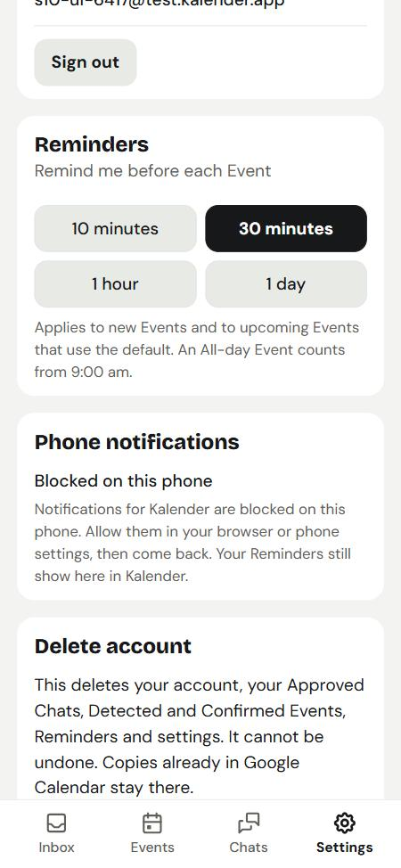
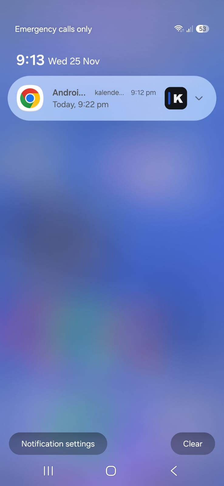
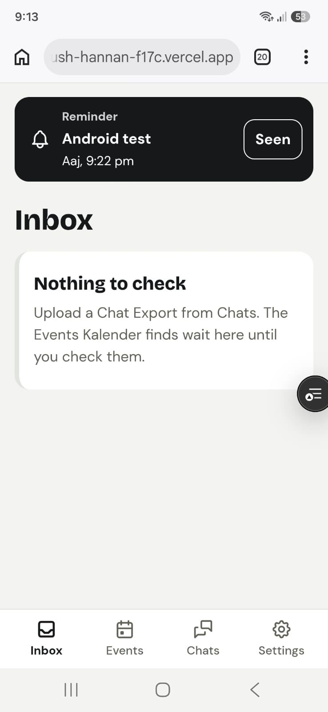

# S10: Push notifications and an installable PWA

| Field | Value |
|---|---|
| Slice | S10 |
| Requirements | FR-09 (phone notification part), C-05, MF-05 item 3; AC-09.1 and AC-09.3 as push (G-10 manual row), AC-13.3 (push subscriptions) |
| Plan version used | v10 |
| Lead | Muhammad Areeb (plan owner); session directed by Abdul Hannan Rauf |
| Mode | HITL: an external system (the browser push services), a new kind of personal data, secrets in Vercel, and a check on a real phone |
| Agent | Claude Code (Opus 5.5) |
| Branch | `slice/S10-push` |
| Date | 25 Nov 2026 |

## 1. Select

S10 is the next slice in the plan. It depends on S07 (jobs, the tick and in-app Reminders), which is accepted. Today a due Reminder is only shown inside Kalender. C-05 makes phone notifications the main way to deliver a Reminder, so this slice adds web push and makes the PWA installable, which iPhones need before they allow push.

## 2. Context loaded

- PRD: FR-09, C-05, MF-05 (item 3 and the lock-screen edge case), AC-09.1, AC-09.3, AC-09.5, AC-13.3.
- architecture.md:
  - 4: the service worker receives web push and shows Reminders;
  - 5.1 and 6.1: `reminders` owns `push_subscriptions` and the use cases `registerPushSubscription` and `removePushSubscription`;
  - 6.2: `GET /push/public-key`, `POST /push-subscriptions`, `DELETE /push-subscriptions/:id`;
  - 7: `web-push` with VAPID keys is in the approved stack; "only `reminders` sends push. The in-app fallback always exists (C-05)";
  - 14: Q-23 (more than 10 minutes late is not pushed, only shown as "missed").
- ADR-002: tick delivery, late and missed Reminders.
- `reminders` service: `deliverDue` already writes the in-app row and the NFR-03 times. S10 adds the push after it.
- G-10: push criteria may be checked by a manual checklist row with a screenshot.

## 3. Criteria and tests (to agree before coding, Gate 1)

| ID | Criterion | Test |
|---|---|---|
| S10-1 | `GET /api/push/public-key` answers the VAPID public key when the keys are set, and 404 `push_not_configured` when they are not. Signed out, it answers 401. | route test |
| S10-2 | `POST /api/push-subscriptions` with a valid browser subscription (an `https` endpoint of at most 1000 characters, plus `keys.p256dh` and `keys.auth`) answers 201 with an id. The same endpoint sent again keeps one row and moves it to the current User. Anything else answers 400 with a field message. | route test |
| S10-3 | `DELETE /api/push-subscriptions/:id` removes the User's own subscription (204). Another User's id answers 404 and changes nothing. | route test |
| S10-4 (FR-09, AC-09.1) | When a Reminder is due, `deliverDue` writes the in-app notification as before and sends one push to each of that User's subscriptions. A Reminder up to 10 minutes late is pushed too; a "missed" one is not pushed (Q-23). | reminders test with a fake push sender |
| S10-5 (AC-09.3, C-05) | A push that fails (network error, timeout, no subscription, or no VAPID keys) never stops or undoes the in-app notification or the NFR-03 times. | reminders test |
| S10-6 | When the push service answers 404 or 410, that subscription is deleted. Any other failure keeps it. The log holds the status code only, never the endpoint or the Event title. | reminders test |
| S10-7 (BR-11) | Another User's subscriptions never receive the push. | reminders test |
| S10-8 (AC-13.3) | Deleting the account deletes the User's push subscriptions. | `account.test.ts` gains `push_subscriptions` |
| S10-9 | The PWA is installable: `/manifest.webmanifest` has the name, `start_url` `/`, `display` `standalone`, theme colours and 192 and 512 pixel icons, and the service worker is active at scope `/`. | manual check in the browser, screenshot |
| S10-10 | Settings has a "Phone notifications" section that shows one of four states: not available on this browser, blocked, off ("Turn on phone notifications") or on ("Turn off"). Each state says that Reminders always show inside Kalender too. On an iPhone that has not added Kalender to the Home Screen, it says to do that first. | manual check at 375 x 812, screenshots |
| S10-11 (G-10) | On a real phone with notifications on, a Reminder due on the deployed preview arrives as a phone notification within the AC-09.1 minute, and tapping it opens Kalender. | manual check on a phone, screenshot |

### EP and BVA

| Input | Class or boundary | Expected |
|---|---|---|
| Endpoint scheme | `https` / `http` / not a URL | 201 / 400 / 400 |
| Endpoint length | 1000 / 1001 characters | 201 / 400 |
| Keys | both present / one missing / not strings | 201 / 400 / 400 |
| Same endpoint | same User again / another User | one row, same User / one row, moved to the new User |
| Lateness at delivery | 1 minute (on time) / 10 minutes (late) / 10 minutes and 1 second (missed) | pushed / pushed / not pushed |
| Push answer | 201 / 404 or 410 / 500 or timeout | kept / deleted / kept |
| Subscriptions per User | 0 / 1 / 2 phones | no push / 1 push / 2 pushes |
| VAPID keys | set / not set | push sent / in-app only, no error |

## 4. HITL or AFK

HITL. Decisions for the human before coding:

1. **Dependency `web-push`** (server only). It is already in the approved stack in architecture 7, but it is a new installed library, so AGENTS.md section 7 asks first.
2. **New personal data: the push subscription.** The browser's push endpoint URL and its two keys, in a new `push_subscriptions` table owned by `reminders` (migration 007, already named in architecture 5.1). A row is kept until the User turns notifications off on that phone, signs out on it, the push service says it is gone (404 or 410), or the account is deleted. Architecture section 8 gets this row.
3. **Product question: what the notification says.** Options:
   - (a) the Event title and time, for example "Project meeting" and "Today, 5:00 pm". **Recommended:** MF-05 already says the phone's own lock-screen settings decide whether details show, and a Reminder with no title is much less useful;
   - (b) only "You have a Reminder in Kalender", with the details inside the app.
4. **Signing out on a phone turns that phone's notifications off** (the PWA removes its subscription before signing out), so a shared phone does not get the last User's Reminders.
5. **VAPID keys.** I generate one key pair locally and put it in `.env.local`. With your OK, I also add `VAPID_PUBLIC_KEY`, `VAPID_PRIVATE_KEY` and `VAPID_SUBJECT` to the Vercel project for Preview and Production with `vercel env add`, without printing the private key. The subject is the production URL, not an email address. Without the keys, push stays off and Reminders still show in the app.
6. **Push is sent after the in-app rows are saved**, outside their transaction. The sends run together with a 5-second timeout each, so a slow push service cannot hold the database or undo the in-app Reminder.
7. **Service worker:** hand-written `web/public/sw.js` that handles only `push` and `notificationclick`. It caches nothing, so no Event data is stored in the browser and a new deploy is never hidden behind an old cache. There is no offline mode (not in the PRD).
8. **The Android share target stays out** of this slice. Architecture 4 puts it in the service worker, but no slice in the plan asks for it; it can be added later as its own decision.
9. **Real-phone check (S10-11):** you open the preview on your Android phone in Chrome, sign in with a throwaway account and turn notifications on; I add a Confirmed Event and trigger the tick at the Reminder minute. An iPhone check is optional and needs Kalender on the Home Screen (iOS 16.4 or later).

**Gate 1:** Abdul Hannan Rauf approved the criteria and decisions 1, 2, 4 and 6 to 9 on 25 Nov 2026 ("Approve, build it"), chose 3(a) ("Title and time") and approved decision 5, adding the VAPID keys to Vercel Preview and Production ("Yes, add to Vercel").

## 5. AI implementation

Prompt: "Build S10 from plan.md v10 and the agreed criteria and decisions in this file, following AGENTS.md and ADR-002. In `reminders`, add `push_subscriptions` (migration 007), `GET /push/public-key`, `POST /push-subscriptions` and `DELETE /push-subscriptions/:id`, and push each on-time or late Reminder to the User's phones after the in-app rows are saved, with the title and time. Delete a subscription on 404 or 410. Add it to `deleteAllForUser`. In the PWA, add a manifest, icons, a hand-written service worker with only `push` and `notificationclick`, and a Phone notifications section in Settings; sign-out turns this phone's notifications off. Use `web-push`; nothing else new."

What the agent built:
- **Migration 007** (`reminders`): `push_subscriptions` with a unique `endpoint`, so one phone is one row; sending it again as another User moves the row.
- **`reminders` service:**
  - `deliverDue` collects the on-time and late Reminders while it writes the in-app rows, commits, and only then calls `pushAll`. A missed Reminder is not pushed (Q-23). Any error in `pushAll` is logged by name only and never reaches the in-app part;
  - `pushAll` sends one push per subscription of each User, all at once, through `web-push` with the VAPID keys from the environment, a 5-second timeout, `TTL` 600 seconds (after 10 minutes the Reminder counts as missed anyway) and high urgency. A 404 or 410 deletes that subscription; any other failure is logged as `{ where: 'reminders.push', status }` only;
  - the payload is `{ title, body, tag, url }`: the Event title, a PKT time text in the in-app words, such as "Aaj, 5:00 pm", "Kal, All day" or "Fri 27 Nov, 5:00 pm" (`whenText`), the Event id as the tag (a repeat replaces the old notification) and `/`;
  - with no VAPID keys, push is off and nothing else changes;
  - `registerPushSubscription` checks the browser's `PushSubscription.toJSON()` shape: an `https` endpoint of at most 1000 characters and two keys of at most 200 characters each;
  - `setPushSender` replaces the push service in tests. It is not exported from the module's `index.ts`.
- **`reminders` routes:** `GET /api/push/public-key` (404 `push_not_configured` without keys), `POST /api/push-subscriptions` (201 with the id, 400 with field messages), `DELETE /api/push-subscriptions/:id` (204, or 404 for an unknown or another User's id).
- **`deleteAllForUser`** in `reminders` also deletes the User's push subscriptions (AC-13.3).
- **PWA:**
  - `web/public/manifest.webmanifest`, `/icons/` (192 and 512 pixel icons, a maskable icon, an Apple touch icon and a monochrome badge, all drawn from the existing favicon design), and the manifest and touch icon links in `index.html`;
  - `web/public/sw.js`: shows the notification on `push` and on tap focuses an open Kalender window or opens one. It caches nothing;
  - `web/src/push.ts`: registers the service worker at start-up, works out the state (not available, add to Home Screen first, not set up on the server, blocked, off, on), turns notifications on (permission, subscribe with the server's public key, save) and off (delete on the server, unsubscribe);
  - Settings: a "Phone notifications" section under Reminders, with a label for the state, one line on what to do, and "Turn on phone notifications" or "Turn off". Every state says that Reminders still show inside Kalender;
  - sign-out first removes this phone's subscription, and account deletion unsubscribes the browser afterwards (S10 decision 4).
- **Lint:** `web/public/sw.js` is linted with service worker globals.
- **Docs:** architecture section 8 has a retention row for push subscriptions (decision 2). `.env.example` has `VAPID_SUBJECT`.
- **Secrets:** one VAPID key pair, generated locally into `.env.local` and added to Vercel Preview and Production with `vercel env add` from a file, never printed. The private key is stored as a Vercel Secret. The subject is the production URL.

Design choices for the human to review:
- **The push goes after the commit, not through the outbox.** If the function stops between the commit and the push, that push is lost, but the in-app Reminder is already saved (C-05). Retrying pushes would need a new job type and could deliver a Reminder twice.
- **Delivery time is still the in-app time.** `delivered_at` records when the Reminder was presented in the app (Q-23). The push usually arrives within seconds after it, but the browser push service does not report when.
- **A phone that is subscribed but whose id is not stored** (for example after the browser storage was cleared) is saved again when Settings opens, so the User still sees the right state.

Known limits:
- The tick runs every minute only once cron-job.org calls it (O-5). Until then, Reminders, in the app and by push, go out only when the tick is called.
- iPhones get push only when Kalender is added to the Home Screen (iOS 16.4 or later). Settings says this.
- The browser pane used for the local check blocks notifications, so only the "blocked" state was shown there. The "on" state and a real push were checked on the phone (S10-11).

## 6. Checks

- Local against the Neon `dev` branch (`evidence/test-runs/S10-2026-11-25-neon-dev.txt`): **197 passed, 3 failed, 2 skipped**. Lint, typecheck and build are clean.
  - All 8 new S10 tests pass, and so does S09-2 with the full set of tables including `push_subscriptions`.
  - The 3 failures are the Neon `dev` slowness recorded in S05 section 6: two 30-second timeouts (S09-5 and S07-4) and S07-6, where the Reminder was not yet written when the route answered. Each passed in CI on the earlier slices. No S10 assertion failed.
  - S10-4 and S09-2 seed two Users each and now have a 120-second timeout, because they timed out at 30 seconds on Neon `dev` when run alone.
- Manual check in the local browser pane (Neon `dev`):
  - S10-9: the page links `/manifest.webmanifest`; it has the name, `start_url` `/`, `display` `standalone` and the theme colour, and its three icons load at 192 x 192, 512 x 512 and 512 x 512 (maskable). The service worker `/sw.js` is served as JavaScript, is `activated` at scope `/` and controls the page;
  - S10-10 at 375 x 812, with a throwaway account `s10-ui-<random>@test.kalender.app` (approved by Abdul Hannan Rauf: "Throwaway account"). The pane blocks notifications, so Settings shows "Blocked on this phone" and how to allow them. Afterwards the account was deleted from Settings, and the deletion went to the sign-in screen with the deleted notice, so the new `forgetThisPhone` step did not hold it up.

| Settings, blocked |
|---|
|  |

Found and fixed on the deployed preview:
- Every `/api` route on the first preview answered 500. The function log showed `ERR_REQUIRE_ESM`: `web-push` 4.0.0 is published as an ES module only, and the Vercel function loads the server as CommonJS. Locally and in CI the tests passed, because Node 24 and Vitest can load it. The dependency is now pinned to `web-push` 3.6.7, the CommonJS version with the same API, which matches `@types/web-push` 3.6. The S10 tests, lint and typecheck pass again.
- CI on PR #11 (Postgres 17): green, **200 passed, 2 skipped**, including all S10 tests.
- Deployed preview (https://kalender-pkiq6s9r2-hannan-f17c.vercel.app, Neon `dev`), driven with `vercel curl` and a new throwaway account `s10-preview-<random>@test.kalender.app`:
  - `/manifest.webmanifest` answers 200 as `application/manifest+json`, `/sw.js` as `application/javascript`, and `/icons/icon-512.png` as `image/png`;
  - `GET /api/push/public-key` answers 200 with the key, so the VAPID keys are set in Preview;
  - an `http` endpoint answers 400 with the field message; a valid subscription answers 201 with an id; deleting it answers 204, and again 404;
  - a second subscription, then `DELETE /api/account`: 204, and a query on Neon `dev` finds no subscription row left from this check (AC-13.3);
  - signed out, `/api/push/public-key` answers 401.
- Preview tick with the Preview `TICK_SECRET`: the first calls worked through a backlog left by earlier test runs on Neon `dev` (128 Reminders and 185 Detected Event expiry jobs). Each job took about 2 seconds from the Vercel function to Neon `dev`, so those ticks took 95 to 105 seconds. Once the backlog was gone, a tick took 6 seconds. This matters for NFR-03: the tick runs jobs before Reminders, so a large job backlog makes Reminders late. It is a risk for S13, together with the open Vercel region decision.
- **S10-11, real phone (Android, Chrome), on the S10 preview.** Abdul Hannan Rauf created a throwaway account on the phone, turned phone notifications on, chose a 10-minute Lead Time and added "Android test" for today at 9:22 pm. The agent called the preview tick every minute.
  - The tick at 21:12:59 PKT delivered 1 Reminder. Its Reminder Time was 21:12, so it was on time (AC-09.1).
  - The phone showed the notification at 9:12 pm with the Kalender icon, the title and "Today, 9:22 pm" (decision 3(a)). Tapping it opened Kalender on the Inbox, where the in-app Reminder card was also shown (C-05).
  - The throwaway account was deleted on the phone afterwards. No push subscription from a real phone is left on Neon `dev`.
  - An earlier attempt, 20:51 to 21:05 PKT, ticked every minute, but the phone was not set up yet, so nothing was sent.
  - The agent's tick log printed UTC times labelled PKT, because Git Bash on Windows ignored `TZ=Asia/Karachi`. The PKT times here were converted from it and match the phone's clock.

| Lock screen | Tapped |
|---|---|
|  |  |

Found and fixed after the phone check:
- The push said "Today, 9:22 pm", but the in-app card for the same Reminder said "Aaj, 9:22 pm". The push now uses the in-app words: "Aaj", "Kal" and "Parson", then the weekday and date, and "All day" (ui-direction.md). The S10 tests check this.

## 7. Human decision

**Accept**, Abdul Hannan Rauf, 25 Nov 2026 ("Accept, merge and tag"). Reason: criteria S10-1 to S10-11 pass in CI, on the deployed preview, in the local browser check and on a real Android phone. Accepted with these known limits: iPhones need Kalender on the Home Screen before push works, and that was not checked on an iPhone; a push lost between the commit and the send is not retried (the in-app Reminder stays); a large job backlog makes the tick slow from Vercel to Neon `dev`, which is a NFR-03 risk for S13; the Android share target is left out.

## 8. Integrate

PR #11 merged into `main` with a merge commit, tagged `S10-accepted`; CI on `main` is Gate 4. Migration 007 runs on the production database at the production build. New dependency: `web-push` 3.6.7 (server). New Vercel variables: `VAPID_PUBLIC_KEY`, `VAPID_PRIVATE_KEY` and `VAPID_SUBJECT` in Preview and Production.

## 9. Context updated

`plan.md` v11 (copy in `docs/plan-history/plan-v11.md`): S10 Accepted, the tick-backlog risk added for S13. Architecture section 8 has the push subscription retention row. Row 13 added to `evidence/workflow-evidence-log.md`.
