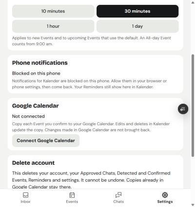
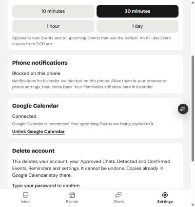
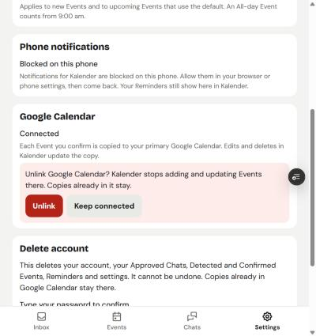
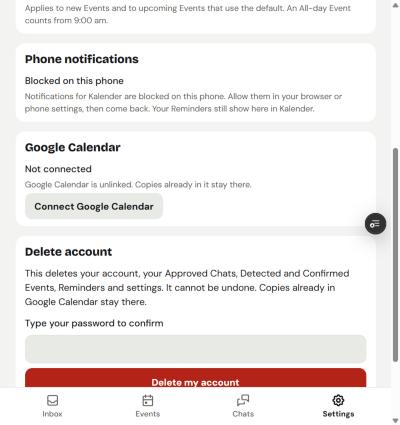
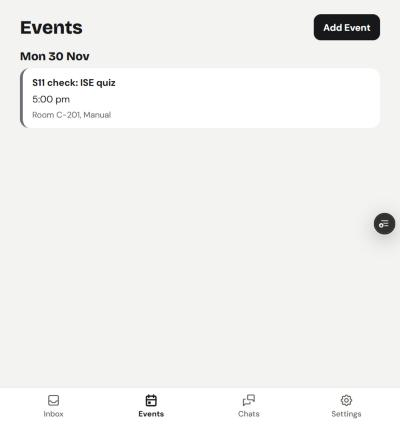
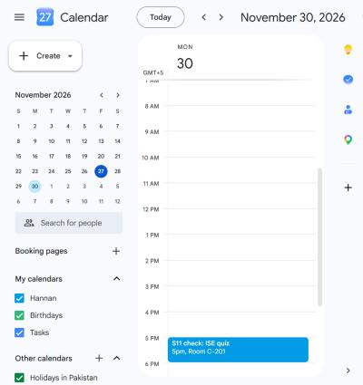
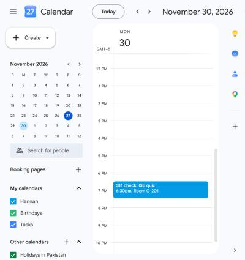
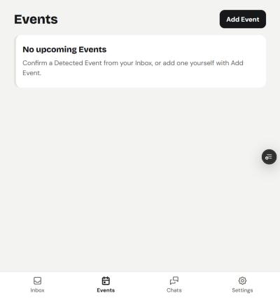
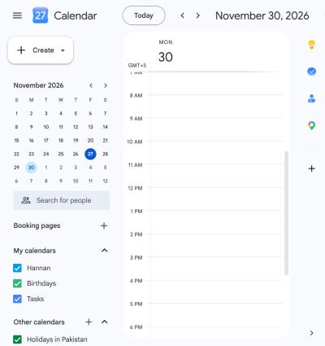
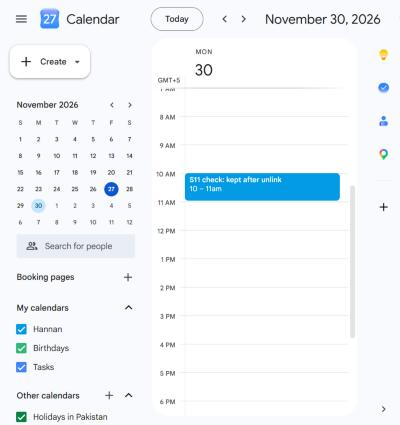

# S11: Connect Google Calendar, one-way copies, retries and unlink

| Field | Value |
|---|---|
| Slice | S11 |
| Requirements | FR-08, FR-13 (unlink), BR-09, BR-10, BR-18, MF-06; AC-08.1, AC-08.2, AC-08.3, AC-12.1, AC-12.2, AC-13.2, AC-13.3 (Google token part), AC-06.4 (calendar part) |
| Plan version used | v11 |
| Lead | Zain Amjad (plan owner); session directed by Abdul Hannan Rauf |
| Mode | HITL: an external system (Google OAuth and the Calendar API), a new kind of stored secret (Google tokens), new Vercel secrets, and a check with a real Google account |
| Agent | Claude Code (Opus 5.5) |
| Branch | `slice/S11-google-calendar` |
| Date | 25 Nov 2026 |

## 1. Select

S11 is the last Should slice in the plan. It depends on S07 (jobs, outbox and tick), which is accepted. Three accepted slices left a calendar part for it: S06 (AC-12.1 and AC-12.2), S08 (AC-06.4) and S09 (the Google token part of AC-13.3).

## 2. Context loaded

- PRD: FR-08, FR-13, BR-09, BR-10, BR-18, MF-06 and its edge cases, AC-08.1 to AC-08.3, AC-12.1, AC-12.2, AC-13.2, AC-13.3, AC-06.4, GL-22 ("Calendar update failed").
- architecture.md:
  - 5.1: `calendar-sync` owns `calendar_links` (encrypted tokens) and `calendar_copies`, and never reads changes back (BR-09) or blocks confirmation;
  - 6.1: `startLink`, `completeLink`, `unlink`, `getLinkStatus`, `retryNow`, `getStatuses`, `deleteAllForUser`; subscribers `EventConfirmed`, `EventUpdated`, `EventDeleted` and `EventResync`; job handler `calendarRetry`; `events` answers `CalendarLinked` with one `EventResync` per Upcoming Confirmed Event;
  - 6.2: `GET /calendar`, `POST /calendar/link`, `GET /calendar/callback`, `DELETE /calendar`, `POST /calendar/retry/:eventId`;
  - 6.3: confirming dispatches the outbox before answering; `calendar-sync` adds the copy or queues `calendarRetry`; account deletion revokes the Google token best-effort, then deletes it;
  - 7: Calendar REST through `fetch`, scope `calendar.events`, primary calendar, timed copies last 1 hour, All-day copies are all-day;
  - 14 and 15: Q-3 (backfill through outbox messages), Q-6, Q-24, Q-27 (HMAC-signed OAuth `state`, no new table), R2-8 (unlink keeps `calendar_copies`; a resync checks each copy and re-adds it if gone), R2-12 (retries at +1, +5 and +15 minutes from the first failure).
- ADR-002: retries, "confirming must never wait for Google", and Google "Testing" mode refresh tokens expiring after 7 days.
- ADR-005: tokens encrypted with AES-256-GCM, key from the environment; Google OAuth only for the Calendar API, never for sign-in.
- AGENTS.md section 4 rule 6: only `calendar-sync` talks to Google, through built-in `fetch` (no `googleapis`).

## 3. Criteria and tests (to agree before coding, Gate 1)

Google is replaced by a fake in the automated tests. The real Google account is used only in the manual check (S11-12, G-10).

| ID | Criterion | Test |
|---|---|---|
| S11-1 | `POST /api/calendar/link` answers a Google consent URL for the primary calendar's `calendar.events` scope, with offline access and a signed `state` that names the User and expires after 10 minutes. Without Google settings it answers 404 `calendar_not_configured`. | route test |
| S11-2 | `GET /api/calendar/callback` with a good code and `state` stores the tokens encrypted (no token appears in clear in the database), publishes `CalendarLinked` and sends the browser to Settings. A `state` that is forged, expired or signed for another User, or a refused consent, stores nothing and sends the browser to Settings with a message. | route test |
| S11-3 (AC-08.1) | With a Linked Calendar, confirming a Detected Event or adding a Manual Event adds one copy with the same title, date and time (timed: 1 hour long; All-day: all-day), in `Asia/Karachi`. | cross-module test with fake Google |
| S11-4 (AC-08.2, AC-08.3, BR-18) | Linking adds a copy for each Upcoming Confirmed Event that has none, and not for past ones. Linking again adds no second copy. | cross-module test |
| S11-5 (AC-12.1, AC-06.4) | Editing a copied Event's date, time, title or place changes its copy. Updating an existing Event from a Possible Duplicate changes the copy too. | cross-module test |
| S11-6 (AC-12.2) | Deleting a copied Event removes its copy from Google. | cross-module test |
| S11-7 (BR-09) | If the copy was deleted directly in Google, a later edit in Kalender adds it back. Nothing is ever read back from Google. | cross-module test |
| S11-8 (BR-10, R2-12) | A failed add, change or remove keeps the Event and its Reminder. It is retried at 1, 5 and 15 minutes after the first failure. After the third failed retry the Event shows "Calendar update failed", and `POST /api/calendar/retry/:eventId` tries again. Deleting the Event, unlinking or deleting the account cancels pending retries. | cross-module test with fake clock |
| S11-9 (MF-06) | Expired or revoked Google access counts as a failure (BR-10), and `GET /api/calendar` reports that the calendar needs reconnecting. | cross-module test |
| S11-10 (AC-13.2, R2-8) | After `DELETE /api/calendar`, no further Event is added to Google, and the tokens are deleted. Copies already in Google stay. Relinking later re-adds a copy that is gone and adds no duplicate. | cross-module test |
| S11-11 (AC-13.3, BR-11) | Deleting the account revokes the Google token best-effort and leaves no `calendar_links` or `calendar_copies` row. Another User's link and copies are never touched or shown. | `account.test.ts` plus a two-User test |
| S11-12 (G-10) | With a real Google account: connect, confirm an Event and see it in Google Calendar, edit its time, delete it, and unlink. Settings shows the calendar state, and the Events list shows "Calendar update failed" with Retry when a copy fails. | manual check, screenshots |

### EP and BVA

| Input | Class or boundary | Expected |
|---|---|---|
| OAuth `state` | valid / forged / another User's / 10 minutes old / 10 minutes and 1 second old | link / refused / refused / link / refused |
| Callback | code / `error=access_denied` / Google refuses the code | linked / "not connected" message / "could not connect" message |
| Event time | timed (1 hour copy) / All-day (date to next date) / 23:30 (ends 00:30 the next day) | as stated |
| Event date at linking | today and later / yesterday | copied / not copied |
| Google answer | 200 / 404 or 410 on change (deleted in Google) / 409 on add (copy already there) / 500 or timeout / 401 with refresh refused | done / added back / updated instead / retried / retried and "needs reconnecting" |
| Retry count | first failure / 3rd retry fails / manual retry succeeds | retry at +1 minute / "Calendar update failed" / mark cleared |
| Link state | linked / unlinked / never linked | copies made / no copies / no copies |

## 4. HITL or AFK

HITL. Decisions for the human before coding:

1. **No new library.** Google OAuth and the Calendar API go through built-in `fetch`, as AGENTS.md section 2 says. One migration (008) creates `calendar_links` and `calendar_copies`, which architecture 5.1 already names.
2. **New stored secret: the Google refresh and access tokens**, encrypted with AES-256-GCM. With your OK, I generate `TOKEN_ENCRYPTION_KEY` (32 random bytes) into `.env.local` and add it to Vercel Preview and Production with `vercel env add`, without printing it, as for `TICK_SECRET` and the VAPID keys. The same key also signs the OAuth `state` (with a separate label), so there is no new table (Q-27).
3. **What goes to Google.** Options:
   - (a) the title, date, time and place, plus the description "Added by Kalender". **Recommended:** it is what AC-08.1 needs, and the Chat name stays out of Google;
   - (b) the same, plus "From <Chat name>" in the description.
4. **One copy per Event, with an id Kalender chooses.** The Google event id is made from the Event's id. If Kalender adds a copy that is already there (for example after a timeout that actually worked, or on relinking), Google answers 409 and Kalender updates that copy instead. If a copy was deleted in Google, a later edit puts it back (BR-09, R2-8). This removes the need for an extra Google read before each add.
5. **The copy is added inside the outbox delivery**, with a 5-second limit on each Google call. A failure never fails the delivery: `calendar-sync` records it and queues `calendarRetry` at +1 minute (then +5 and +15 from the first failure, R2-12). After the third failed retry the Event is marked "Calendar update failed". The confirm or edit request keeps its 2-second dispatch budget, but that budget is checked between messages, so a slow Google answer can make one request wait up to 5 seconds per Google call. (Corrected during the build: the Gate 1 text said the request never waits longer than 2 seconds, which is not true when Google is slow.)
6. **Settings, "Google Calendar" section:** "Connect Google Calendar", or the connected state with "Unlink" (two steps, like Revoke) and a line that copies already in Google stay. When access has expired: "Google access ended. Connect again to keep your calendar up to date." The Events list and the edit screen show "Calendar update failed" with "Try again".
7. **The redirect address is built from the request's own host**, so local, preview and production each use their own `/api/calendar/callback`. Each one must be listed in the Google OAuth client.
8. **Google "Testing" mode** (ADR-002): refresh tokens end after 7 days, which shows as decision 6's "connect again" state. Publishing the Google app is out of scope.

**What only you can do (needed for the manual check S11-12, not for building):**
- In Google Cloud Console, with your own Google account:
  1. create a project and enable the Google Calendar API;
  2. set up the OAuth consent screen as External, in Testing, with your Google account as a test user and the `.../auth/calendar.events` scope;
  3. create an OAuth client of type Web application, with these redirect URIs:
     - `http://localhost:5173/api/calendar/callback`
     - `https://kalender-git-slice-s11-google-calendar-hannan-f17c.vercel.app/api/calendar/callback`
     - `https://kalender-tan-eta.vercel.app/api/calendar/callback`
- Put the client id and secret in `.env.local` as `GOOGLE_CLIENT_ID` and `GOOGLE_CLIENT_SECRET`, and add both to Vercel Preview and Production (`vercel env add`). I will not enter them myself.

### Gate 1 decision (25 Nov 2026)

Abdul Hannan Rauf approved, through the agent's question form:
- criteria S11-1 to S11-12 as written: "Approve, build it";
- `TOKEN_ENCRYPTION_KEY`: "Yes, add to Vercel". The agent generated it into `.env.local` and added it to Vercel Preview and Production as a sensitive variable; its value was never printed;
- what goes to Google: option (a), "Title, time, place", with "Added by Kalender" and no Chat name;
- the Google Cloud OAuth client: "Build first, I do it meanwhile". Only the manual check S11-12 waits for it.

## 5. AI implementation

Prompt: "Build S11 from plan.md v11 and the agreed criteria and decisions in this file, following AGENTS.md, ADR-002 and ADR-005. Create the `calendar-sync` module with migration 008 (`calendar_links`, `calendar_copies`), the five `/calendar` endpoints, the outbox subscribers for `EventConfirmed`, `EventUpdated`, `EventDeleted` and `EventResync`, and the `calendarRetry` handler with retries at +1, +5 and +15 minutes. `events` answers `CalendarLinked` with one `EventResync` per Upcoming Confirmed Event, and its read endpoints show the "Calendar update failed" mark. Encrypt tokens with AES-256-GCM, sign the OAuth state with HMAC, and talk to Google only through built-in `fetch`. Add the Google Calendar section in Settings and the mark with Try again. Test with a fake Google; nothing new to install."

What the agent built:
- **Migration 008** (`calendar-sync`):
  - `calendar_links`: one row per User, with the encrypted refresh and access tokens, when the access token ends, and `linked` or `needs_reconnect`;
  - `calendar_copies`: one row per Event that has, or should have, a copy. It keeps what the copy should show (`details`: title, date, time and place; null means "remove it"), whether the copy is in Google, and the sync state (`synced`, `pending` or `failed`) with the first failure time and the retry count.
- **Outbox contract:** `CalendarLinked { userId }` and `EventResync` (an Event snapshot) added to `shared/contracts/outbox.ts`. `reminders` now ignores message types it does not handle.
- **`calendar-sync` module** (it imports only `jobs`):
  - `google.ts` is the only code that talks to Google: the token exchange, refresh and revoke, and insert, update and delete of events in the primary calendar, all through `fetch` with a 5-second timeout. Every call answers a status code (0 for a network error) and never throws for a Google failure;
  - tokens are sealed with AES-256-GCM. The key comes from `TOKEN_ENCRYPTION_KEY` through HKDF with one label for tokens and another for the OAuth `state` HMAC (decision 2). The `state` is `userId.expiry.signature`; it is refused when forged, expired (after 10 minutes) or signed for another User;
  - **one copy per Event:** the Google event id is the Event id without dashes (decision 4). Adding a copy that is already there (409) updates it; changing a copy that is gone from Google (404 or 410) adds it again (BR-09); removing a copy that is gone counts as done. Nothing is read back from Google;
  - a copy has the title, place and "Added by Kalender" (decision 3(a)); a timed copy lasts 1 hour in `Asia/Karachi`, an All-day copy covers its date;
  - **failures (BR-10):** a failed add, change or remove is recorded and `calendarRetry` is queued at +1 minute from the first failure, then +5 and +15. After the third failed retry the copy is `failed`, which the Events list and edit form show as "Calendar update failed". `POST /calendar/retry/:eventId` tries again. Each retry has its own job key, because a retry that fails must queue the next one while its own job is still the pending row;
  - **expired or revoked access (MF-06):** a refresh answered with 400 or 401 marks the link `needs_reconnect`; the change counts as a failure and is retried;
  - **unlink (AC-13.2, R2-8):** deletes the tokens, cancels pending retries, forgets copies that never reached Google, keeps the others, and revokes the grant at Google best-effort;
  - `deleteAllForUser` revokes the grant best-effort, then deletes the link and every copy row. Identity runs it in its deletion steps (AC-13.3);
  - routes: `GET /calendar` (status), `POST /calendar/link` (the consent address, or 404 `calendar_not_configured`), `GET /calendar/callback` (stores the link, dispatches the outbox twice so the copies are added before Settings opens, and redirects to `/settings?calendar=linked|denied|failed`), `DELETE /calendar` and `POST /calendar/retry/:eventId`. The redirect address is built from the request's own host (decision 7).
- **`events`:** answers `CalendarLinked` with one `EventResync` per Upcoming Confirmed Event (BR-18, Q-3). `GET /events` and `GET /events/:id` add `calendarFailed` from `calendar-sync.getStatuses` (the read-model exception in AGENTS.md section 4).
- **PWA:**
  - Settings has a "Google Calendar" section: its state (not available yet, not connected, connected, needs connecting again), one line on what that means, "Connect Google Calendar" or "Connect again", and a two-step "Unlink Google Calendar" that says copies already in Google stay. The outcome of Google's consent screen shows once;
  - the Events list shows "Calendar update failed" in words on the card; the edit form shows the same with "Try again".
- **Lint:** a boundary rule lets `calendar-sync` import only `jobs`, with a test.
- **Tests:** `server/test/calendar.test.ts` replaces Google with a fake that keeps one primary calendar in memory and, like Google, keeps deleted events as cancelled. It runs on its own after the other test files (root and server `test` scripts): the fake replaces Google only in its own process, and another test file's tick would otherwise hand these Users' outbox messages to the real Google client.
- **Docs:** architecture section 8 has retention rows for the Google tokens and the copy records.
- **Secrets:** `TOKEN_ENCRYPTION_KEY` (32 random bytes), generated into `.env.local` and added to Vercel Preview and Production as a sensitive variable. Its value was never printed.

Design choices for the human to review:
- **Google is called inside the outbox delivery**, in the delivery's transaction, as decision 5 says. A slow Google answer holds that transaction and the request that dispatched it, up to 5 seconds per call.
- **No GET before each change.** R2-8 says the resync checks each copy with a GET; the fixed event id does the same job with one call fewer: an update of a missing copy answers 404 and Kalender adds it.
- **On unlink, a copy that was waiting for its first add is forgotten**, because there is nothing in Google to keep; a relink adds it again from the resync.
- **"Calendar update failed" shows only after the third failed retry.** While retries are pending, the Event shows nothing.

Known limits:
- Until the Google Cloud OAuth client exists, Settings shows "Not available yet" and no copy is made. The automated tests do not need it.
- Google keeps the app in Testing mode, so a link ends after 7 days and Settings asks to connect again (ADR-002).
- Retries run only when the tick runs (O-5).

## 6. Checks

- Local against the Neon `dev` branch:
  - `calendar.test.ts` alone (`evidence/test-runs/S11-2026-11-25-neon-dev-calendar.txt`): **15 passed**. Lint, typecheck and build are clean.
  - Full run (`evidence/test-runs/S11-2026-11-25-neon-dev.txt`): **196 passed, 5 failed**. Two failures came from S11 changing what other tests see, and both tests were fixed:
    - S07-11 expected only the `reminders` subscriber; it now expects `calendar-sync` too.
    - In S09-2, another User's late outbox delivery reached the calendar link that the test seeds. The test now dispatches the User's outbox before seeding the link.
  - The other 3 failures (S07-4, S07-6 and S09-5) are the Neon `dev` slowness recorded in S05 section 6.
  - A local rerun after the fixes was stopped by the network: Neon `dev` stopped answering on port 5432 from this machine. CI is the full check for the two fixed tests.
- CI on PR #12 (Postgres 17): green. The main run had **201 passed, 2 skipped**, and the separate calendar run had **15 passed**. Vercel built the preview.
- **S11-12, real Google account, on the S11 preview** (https://kalender-git-slice-s11-google-calendar-hannan-f17c.vercel.app, Neon `dev`), 27 Nov 2026:
  - Setup:
    - Abdul Hannan Rauf created the Google Cloud project "Kalender" with the agent's help: Calendar API enabled, External consent screen in Testing, his Gmail as the only test user, and a Web OAuth client "Kalender web" with the three redirect URIs in section 4. He clicked Create on the client and copied the client id and secret into `.env.local` himself.
    - Both values had been pasted inside `< >`. The agent removed the brackets and checked each value's format, never printing either. The agent then added both to Vercel Preview and Production as sensitive variables and redeployed the S11 preview.
  - The agent created a throwaway account `s11-preview-<random>@test.kalender.app` on the preview. Settings showed "Not connected".
  - **Connect:** "Connect Google Calendar" opened Google's consent screen for the `calendar.events` scope. Abdul Hannan Rauf chose his account and allowed access himself. Kalender came back to Settings with "Connected" (S11-1, S11-2).
  - **Add (AC-08.1):** the agent added a Manual Event, "S11 check: ISE quiz", on 30 Nov 2026 at 5:00 pm in Room C-201. Google Calendar showed one copy, 5 pm to 6 pm, in Room C-201. The Events list showed no failed mark.
  - **Edit (AC-12.1):** changing the time to 6:30 pm in Kalender moved the copy to 6:30 pm to 7:30 pm.
  - **Delete (AC-12.2):** deleting the Event in Kalender removed the copy from Google Calendar.
  - **Unlink (AC-13.2):** the agent added a second Event, "S11 check: kept after unlink", at 10:00 am, and its copy appeared in Google. Unlink asked to confirm, with the line that copies already in Google stay. After Unlink, Settings showed "Not connected", and the copy was still in Google Calendar.
  - Each copy and change was already in Google Calendar when the agent looked, 5 to 10 seconds after the action in Kalender.
  - Not checked with the real account:
    - "Calendar update failed" with Try again, because Google did not fail during the check. S11-8 covers it with the fake Google.
    - The revoke at Google after Unlink, on the Google account's third-party connections page.

| Not connected | Connected | Unlink, confirm | Unlinked |
|---|---|---|---|
|  |  |  |  |

| | Kalender | Google Calendar |
|---|---|---|
| Added |  |  |
| Edited to 6:30 pm |  |  |
| Deleted |  |  |
| After Unlink | |  |
